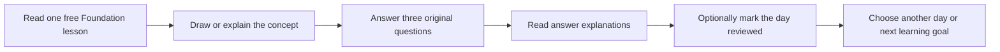

import FoundationExploreReturn from '../../components/FoundationExploreReturn.astro';

import FoundationChallenge from '../../components/FoundationChallenge.astro';
import FoundationChallengeLayout from '../../components/FoundationChallengeLayout.astro';

<FoundationExploreReturn />

<FoundationChallengeLayout>
**Seven days. Seven practical exercises. Twenty-one original questions.**

Start building technical skills with the GoHackersCloud Foundation curriculum. This challenge is suitable for a college student, a career switcher or a professional refreshing IT and security fundamentals. No sign-up, paid Academy membership, cloud account or lab subscription is required.

**What you need:** A browser, a notebook and—in a few optional exercises—a computer you own or have permission to use. All assignments can be completed with fictional examples when a particular system is unavailable.

## How the challenge works

The “Day” labels provide a suggested sequence, **not seven consecutive calendar dates**. You may start any day, revisit lessons and retake all quizzes without waiting or paying.

| Day | Main topic | Your independent evidence |
|---|---|---|
| **01** | IT hardware and systems | Labeled hardware/VM diagram |
| **02** | Networking and web requests | DNS/TLS/HTTPS request path |
| **03** | Linux fundamentals | Read-only process and identity observations |
| **04** | Windows and identity | Authentication-versus-authorization decision tree |
| **05** | Cloud architecture | Service diagram and shared-responsibility matrix |
| **06** | Cybersecurity mindset | CIA and risk/control worksheet |
| **07** | Git and professional reporting | Reviewable change workflow and five-sentence technical summary |

<FoundationChallenge />

## Assessments and progress — your choice

The **three-question checks** are original educational questions derived from Foundation lessons. Answers and explanations are shown after you submit all three selections. No minimum score is necessary to continue.

By default, quiz results are kept **only in the current page session** and disappear when you reload. If you explicitly select **“Remember progress in this browser”**, the site saves only seven day scores and review checkmarks in browser local storage. The feature does not require a user account, send quiz data to a server or sync with Academy. Turn saving off to delete the stored record; use **Clear my progress** to reset the current page as well.

Completion is **self-reported**—marking a day reviewed is not evidence that an instructor verified its exercise. This challenge issues **no formal certificate, vendor credential, badge, exam result or professional qualification**.

## Build on your seven-day learning notes

After completing a few self-reviews, visit the [free Career & Portfolio Hub](/portfolio/) to turn a hardware drawing, network request flow or risk/control worksheet into a guided technical project. The hub provides six synthetic case studies and seven downloadable Markdown reporting templates. No special completion score, login or hosted Lab is required.

## After the challenge: keep learning for free

If you enjoy the IT or operating-systems activities, continue with the [Core IT & DevOps pathway](/core-it-devops/). If cloud and security resonate with you, explore the [Cloud Security Engineer career roadmap](/learning-hub/cloud-security-roadmap/) or browse the [16-module Foundation curriculum](/curriculum/).

For separately available, authorized advanced practice, explore [GHC Academy & Labs](/ghc-labs/). Hosted labs and Academy subscriptions have their own terms; neither is needed to complete these seven free exercises.

**[Back to Foundation Home](/)** · [Student Learning Path](/paths/students/) · [Professional Upskilling Path](/paths/professionals/)

</FoundationChallengeLayout>
