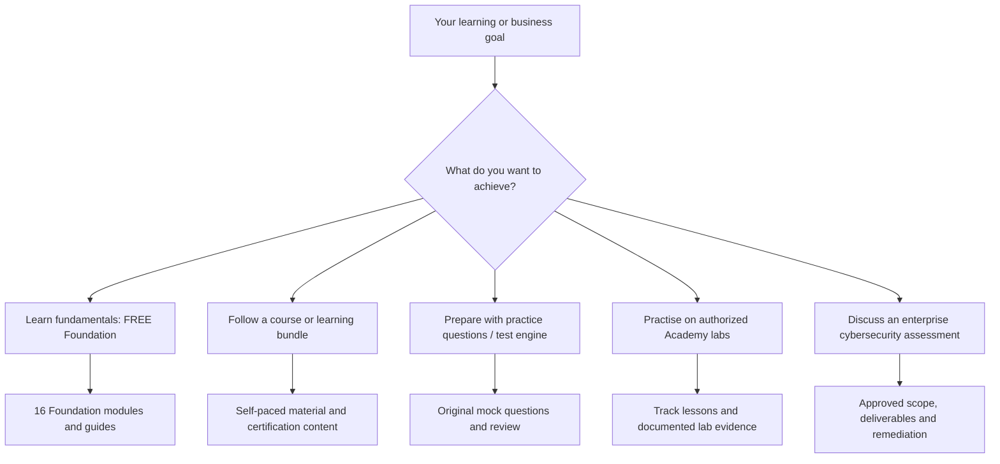
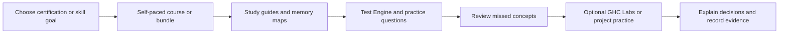
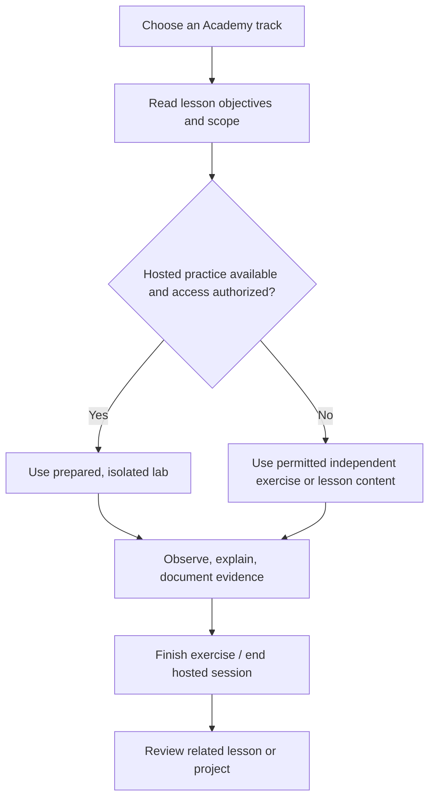
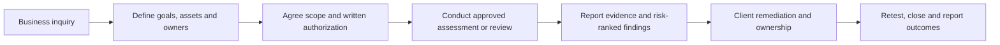

import FoundationExploreSectionNavigation from '../../../components/FoundationExploreSectionNavigation.astro';

import FoundationCatalogHero from '../../../components/FoundationCatalogHero.astro';
import FoundationCatalogChoices from '../../../components/FoundationCatalogChoices.astro';

<FoundationExploreSectionNavigation section="company" current="/about-gohackerscloud/catalog/" />

<FoundationCatalogHero />

## 1. Choose your GoHackersCloud experience

<FoundationCatalogChoices />

## 2. Course bundles & certification preparation

### GHC AWS Complete Learning Bundle — itemized contents

A previously prepared GoHackersCloud Classplus landing page identifies the **GHC AWS Complete Learning Bundle** and the following nine course areas.

| Course area | What you study |
|---|---|
| **AWS Cloud Practitioner** | Cloud concepts, AWS foundations, services, security and billing |
| **AWS Solutions Architect Associate** | Compute, networking, storage, availability and solution design |
| **AWS Developer** | Building and integrating applications with AWS services |
| **AWS SysOps** | Administration, monitoring and operations fundamentals |
| **AWS DevOps** | Deployment automation, delivery pipelines and operations |
| **AWS Security Specialty** | IAM, data protection, monitoring and AWS security design |
| **AWS Solutions Architect Professional** | More complex architectures and design decisions |
| **AWS Data Engineer** | Data pipelines and AWS-oriented data engineering topics |
| **AWS Machine Learning** | Machine-learning concepts and associated AWS material |

**[Previously published AWS Bundle Classplus listing](https://www.gohackerscloud.org/courses/905776?utm_source%3Dother%26utm_medium%3Dtutor-course-referral%26utm_campaign%3Dcourse-overview-webapp)** · **[Browse current offers](https://gohackerscloud.com/ghc-offers)**

**Availability note:** These nine names are grounded in the previously prepared bundle landing page, not an independently confirmed live Classplus inventory on this date. Review the current product description and checkout before making purchase or lifetime-access promises.

### Other previously promoted bundle families

| Bundle or preparation family | Topics to explore | Current listing |
|---|---|---|
| **CompTIA Certification Preparation Bundle** | IT fundamentals, networks, security and exam preparation | [Previously published bundle page](https://gohackerscloud.com/ghc-comptia-certification-preparation-bundle) |
| **Cloud Security Learning Bundle** | AWS, Google Cloud, CCSP, architecture and data protection | [Previously published bundle page](https://gohackerscloud.com/cloud-security-courses-bundle-aws-google-ccsp) |
| **Google Cloud Learning Bundle** | Cloud Architect, Cloud Developer, Network Engineer and DevOps Engineer paths | [Previously published bundle page](https://gohackerscloud.com/google-cloud-course-bundle) |
| **Master AI Learning Bundle** | AI fundamentals, prompting, projects and AI for cybersecurity | [Previously published bundle page](https://gohackerscloud.com/ai-course-bundle-prompt-engineering-course-ai-for-cybersecurity) |
| **ISC2 Preparation Bundle** | CISSP, CCSP and SSCP-oriented learning topics | [Previously shared Classplus listing](https://www.gohackerscloud.org/courses/905780?filterId=10&sortId=7) |

These are **historically promoted learning/bundle names**, not a claim that all five are presently active, available or contain every certification listed. All referenced bundle landing pages and the ISC2/AWS Classplus listings appeared in previously prepared GoHackersCloud marketing materials; their current public availability has not been independently verified. No fixed prices or certification pass guarantees are advertised here.

### Compare the learning formats

A course bundle is **not automatically** an Academy membership, a hosted lab entitlement or a vendor certification exam voucher. Check exact inclusions for each offer.

**[Course Catalog](https://www.gohackerscloud.org/courses)** · **[Offers & Bundles](https://gohackerscloud.com/ghc-offers)** · [How the Test Engine fits in](/about-gohackerscloud/test-engine/)

## 3. Test Engine & exam-style practice

GoHackersCloud describes practice questions and certification preparation across **AWS, Microsoft Azure, Google Cloud, CompTIA and broader cybersecurity learning**. The exact active question banks, simulator features, number of questions and paid/free eligibility vary by product.

| Preparation stage | Recommended activity |
|---|---|
| Learn fundamentals | Use Foundation lessons and a relevant course |
| Review objectives | Compare with the current official certification blueprint |
| Practise questions | Use original, scenario-based questions and any supported timed mode |
| Analyze gaps | Track why an answer is correct or incorrect |
| Apply knowledge | Draw architecture, document a case or use an authorized lab |
| Retest | Revisit weaker domains with new questions where available |

**[Explore Free Tests](https://www.gohackerscloud.org/freetest)** · **[View Test Engine overview](/about-gohackerscloud/test-engine/)** · **[Browse exam-preparation courses](https://www.gohackerscloud.org/courses)**

The mock exam experience is preparation material; it is not an official vendor examination or a guarantee of certification.

## 4. GHC Academy — all 13 published learning tracks

The Academy's canonical track directory contains 13 learner-facing tracks. These organize lessons, lab guides, projects and practice resources; **not every track guarantees an immediately launchable hosted environment**.

| Academy track | Practice focus | Entry |
|---|---|---|
| **CEH / Ethical Hacking** | Methodology, Kali, controlled exploration and reporting | [Explore track](https://academy.gohackerscloud.com/tracks/ceh/) |
| **Web Application Security** | DVWA, Juice Shop, web assessment and OWASP concepts | [Explore track](https://academy.gohackerscloud.com/tracks/webapp/) |
| **API Security** | Discovery, authentication, API authorization and protected endpoints | [Explore track](https://academy.gohackerscloud.com/tracks/api/) |
| **Network Penetration Testing** | Infrastructure discovery, enumeration and network assessment | [Explore track](https://academy.gohackerscloud.com/tracks/network/) |
| **OSCP-Style Practice** | Progressive technical methodology and reporting | [Explore track](https://academy.gohackerscloud.com/tracks/oscp/) |
| **AWS Security / AWS Goat** | AWS cloud identity, security configurations and cloud scenarios | [Explore track](https://academy.gohackerscloud.com/tracks/aws/) |
| **Application Security** | AppSec, application testing and DevSecOps | [Explore track](https://academy.gohackerscloud.com/tracks/appsec/) |
| **GHC Cloud Security** | Cloud security engineering and architecture | [Explore track](https://academy.gohackerscloud.com/tracks/cloud/) |
| **Ethical Hacking Tools** | Tool purposes, limitations and guided exercises where available | [Explore track](https://academy.gohackerscloud.com/tracks/tools/) |
| **CompTIA Practical** | Certification-aligned IT, security and systems practice | [Explore track](https://academy.gohackerscloud.com/tracks/comptia/) |
| **Career & Professional Paths** | Role-based learning and professional skills | [Explore track](https://academy.gohackerscloud.com/tracks/careers/) |
| **Projects & Capstones** | Multi-step technical projects and evidence | [Explore track](https://academy.gohackerscloud.com/tracks/projects/) |
| **90-Day Hackathon** | Progressive challenges using existing learning materials | [Explore track](https://academy.gohackerscloud.com/tracks/hackathon/) |

### Practical lab documentation inventory

The Academy repository currently contains **90 Markdown documents in the dedicated “03 GoHackersCloud Labs” curriculum**, grouped into seven areas. The documents include lab lessons, orientation material and projects. They are **not** a real-time count of running or provisionable lab environments.

| Dedicated GHC Labs curriculum | Document count | Relevant track |
|---|---:|---|
| CEH Track | 16 | [CEH](https://academy.gohackerscloud.com/tracks/ceh/) |
| Web Application Hacking | 20 | [WebApp](https://academy.gohackerscloud.com/tracks/webapp/) |
| API Security | 8 | [API](https://academy.gohackerscloud.com/tracks/api/) |
| Network PenTest | 10 | [Network](https://academy.gohackerscloud.com/tracks/network/) |
| OSCP Track | 19 | [OSCP](https://academy.gohackerscloud.com/tracks/oscp/) |
| AWS Goat | 12 | [AWS](https://academy.gohackerscloud.com/tracks/aws/) |
| Top 5 Projects | 5 | [Projects](https://academy.gohackerscloud.com/tracks/projects/) |
| **Total** | **90 documents** | |

**[Browse the detailed Academy lab lesson directory](/about-gohackerscloud/lab-directory/)** for individual curriculum names. This directory is a documentation snapshot, not a live laboratory availability service.

### How guided practice works

**[Watch the existing GHC Labs overview and demo area](/ghc-labs/)** · **[See official subscription/access terms](https://gohackerscloud.com/hands-on-cybersecurity-labs)**

## 5. Enterprise cloud & cybersecurity service catalog

GoHackersCloud's cybersecurity services project defines **eight business-facing modules**. These are service categories and potential engagement capabilities; actual scope, staffing, eligibility, accreditations and deliverables require a formal discussion rather than an automatic website entitlement.

| Service module | Example scope for consultation | Illustrative work product |
|---|---|---|
| **GRC & Compliance** | Governance, policies, risk and controls evidence | Readiness gaps and risk/compliance report |
| **Vulnerability Management** | Inventory, findings, prioritization and remediation tracking | Findings and remediation register |
| **Cloud Security** | AWS/Azure/GCP architecture, IAM, posture, storage, network and logging | Configuration review and hardening plan |
| **SOC & Managed Security** | Detection readiness, alert processes, response and monitoring | Operations assessment and metrics plan |
| **Application Security** | Web/API security and software delivery controls | Scoped application security findings |
| **Identity & PAM** | Role models, access reviews and privileged operations | Identity/access-control recommendations |
| **Incident Response** | Readiness, incident timeline and recovery | Response readiness or documented incident findings |
| **vCISO & Leadership** | Strategy, risk governance, executive prioritization | Security roadmap and leadership reporting |

Cloud-related service discussions may cover **identity architecture, network segmentation, storage permissions, cloud configuration and posture, logs/monitoring, application/DevSecOps controls, compliance readiness and recovery**. These are topics to scope, not a claim that every vendor accreditation or managed operation is currently available.

### Enterprise engagement model

**[View Cybersecurity Services](https://gohackerscloud.com/cybersecurity-services)** · **[Request a consultation](https://gohackerscloud.com/contact-gohackerscloud)** · [Services explained on Foundation](/about-gohackerscloud/cybersecurity-services/)

An assessment or preparatory review does **not** automatically grant a vendor certification, formal compliance attestation, PCI DSS QSA designation or other regulated authorization.

## 6. GoHackersCloud promotional video links

Videos help potential learners see an actual course offering before making decisions. The two links below were previously supplied for GoHackersCloud course promotion; **public watch-page access was not independently confirmed** through the available search tools.

| Video / promotional topic | Video link | Related offering |
|---|---|---|
| **Cloud Security Learning Bundle — AWS, Google Cloud & CCSP** | [Watch on YouTube](https://www.youtube.com/watch?v=Hibo0zLnKDM) | [Cloud Security & Offers](https://gohackerscloud.com/ghc-offers) |
| **ISC2 Preparation Bundle — CISSP, CCSP & SSCP** | [Watch on YouTube](https://www.youtube.com/watch?v=iT3ml297v4w) | [ISC2 course listing](https://www.gohackerscloud.org/courses/905780?filterId=10&sortId=7) |
| **AWS Complete Learning Bundle — Foundations, Architecture & DevOps** | Video URL not confirmed | [Previously published AWS landing page](https://gohackerscloud.com/aws-training-aws-certification-preparation) |
| **CompTIA Certification Preparation Bundle** | Video URL not confirmed | [CompTIA bundle page](https://gohackerscloud.com/ghc-comptia-certification-preparation-bundle) |
| **Master AI Learning Bundle** | Video URL not confirmed | [AI bundle page](https://gohackerscloud.com/ai-course-bundle-prompt-engineering-course-ai-for-cybersecurity) |
| **Google Cloud Learning Bundle** | Video URL not confirmed | [Google Cloud bundle page](https://gohackerscloud.com/google-cloud-course-bundle) |
| **Five-video GHC Labs learning series** | Five recording slots; publication pending | [Explore the video guide library](/ghc-labs/instructor-demo/) |

Where a video has not been verified, this catalog provides the related official offering rather than inventing a video ID or embedding a broken player. An administrator can replace a pending entry with a verified public watch URL when it is published.

## 7. Choose your next step

**For students:** [Start with Foundation](/start-here/) → [Choose one of nine career roadmaps](/learning-hub/career-paths/) → [Compare independent certification suggestions](/learning-hub/certification-paths/) → [Practise 54 role-specific interview questions](/learning-hub/interview-paths/) → [Discover GHC Labs](/ghc-labs/). Courses, test products and Academy access are separate offerings.

**For institutions:** [Explore the program overview](/about-gohackerscloud/) and [contact the team](https://gohackerscloud.com/contact-gohackerscloud) about appropriate educational arrangements.

**For businesses:** [Review the eight service categories](https://gohackerscloud.com/cybersecurity-services), define the assets and business goal, and [enquire about an authorized engagement](https://gohackerscloud.com/contact-gohackerscloud).

*Catalog source notes: course and test families are described on the public GoHackersCloud sites. The nine-course AWS bundle and two public-video identifiers originate from previously prepared GoHackersCloud materials. Academy track names and the dedicated lab lesson inventory come from the Academy GitHub repository; the eight service categories come from the services repository. Current storefront items and checkout terms have not all been independently verified.*
