# Courses, Certification Paths & Learning Bundles

**Choose the right learning format for your goal.** GoHackersCloud's wider education offering includes self-paced courses, certification-oriented study resources and grouped learning products. The Foundation curriculum remains free and gives learners the background needed to make good use of more advanced material.

  
Where are the current course bundles, prices and purchase links?

  The official [GoHackersCloud Offers catalog](https://gohackerscloud.com/ghc-offers) is the source for current bundles, individual product pages, promotional eligibility and checkout terms. The [Course Catalog](https://www.gohackerscloud.org/courses) provides another entry point. We intentionally do not copy prices or unverified individual checkout links into a static Foundation article.

**Need a consolidated course list?** See the [GoHackersCloud Complete Promotional Catalog](/about-gohackerscloud/catalog/) for the previously published AWS Bundle's nine individual course areas, other named bundle families and available promotional video references. It distinguishes historical marketing links from current verified store listings.

## Explore by technical interest

| Learning area | Topics and preparation themes | Good Foundation prerequisites |
|---|---|---|
| **AWS & cloud computing** | Cloud fundamentals, cloud architecture, cloud security, service selection and certification study | [Cloud Computing](/foundation/gohackerscloud-foundation/07-cloud-computing-fundamentals/01-cloud-computing/) |
| **Microsoft Azure & Google Cloud** | Platform fundamentals, cloud administration, identity, network and security concepts | [Networking](/core-it-devops/module-02/) and [Cloud](/foundation/gohackerscloud-foundation/07-cloud-computing-fundamentals/01-cloud-computing/) |
| **Cybersecurity & ethical hacking** | Threats, controls, web/API security, security operations and professional assessment methodology | [Cybersecurity Fundamentals](/foundation/gohackerscloud-foundation/08-cybersecurity-fundamentals/01-security-mindset/) |
| **Certification families** | CompTIA, ISC2 and ISACA-oriented knowledge, where currently represented in the catalog | [Certification guide](/learning-hub/aws-clf-c02/) and [Foundation modules](/curriculum/) |
| **AI, Python & DevOps** | Responsible AI, automation, programming, Git, containers and cloud delivery | [Programming](/core-it-devops/module-05/) and [DevOps](/core-it-devops/module-06/) |

These are **learning categories**, not a claim that every possible certification or course is in stock or currently purchasable. Always inspect the live product listing for exact titles, contents, access duration and availability.

## What's the difference between these resources?

**A self-paced course** organizes lessons and guided explanations into a topic or career outcome. The exact format (video, reading, project, mentoring or assessment) depends on the product.

**A study guide** helps you understand domains, vocabulary, concepts and decision criteria. Our [AWS CLF-C02 guide](/learning-hub/aws-clf-c02/) provides an example of a Foundation-hosted study resource.

**A memory map or revision aid**, where included with a product, highlights relationships and vocabulary for review. It is not a substitute for actually understanding why a technical decision is correct.

**A learning bundle** groups specified products or resources under a published offer. The current bundle page determines what is included; do not assume that a course bundle automatically includes lab subscriptions or access to every test.

**A mock test / Test Engine offering** supports exam-style practice and gap analysis. See [how exam practice works](/about-gohackerscloud/test-engine/).

**A hosted practical lab** provides a separate hands-on learning environment for supported Academy lessons. See [GHC Labs](/ghc-labs/) for practical access and subscription information.

## A practical study sequence

```mermaid
flowchart LR
    TARGET["Choose a role or certification goal"] --> BASE["Check fundamentals"]
    BASE --> CONTENT["Select matching course or bundle"]
    CONTENT --> NOTES["Read guides and create memory maps"]
    NOTES --> QUESTIONS["Practise original exam-style questions"]
    QUESTIONS --> GAPS["Review weak topics"]
    GAPS --> PRACTICE["Authorized labs or independent projects"]
    PRACTICE --> REVIEW["Explain evidence and revise"]
```

This sequence is optional. Some learners only need a specific course, while others benefit from assessment before purchasing more material.

## How to evaluate a course or bundle

Before enrollment, check the **exact course title, vendor exam version, covered domains, teaching format, access period, included tests and labs, support arrangements, refund terms and final checkout amount**. A promotional banner may have conditions; refer to the live published offer.

Independent certifications are awarded by their respective issuing bodies. GoHackersCloud preparation materials do not replace official examinations and do not claim vendor endorsement unless explicitly stated on an applicable product page.

## Browse the official catalog

**[View Course Bundles & Offers](https://gohackerscloud.com/ghc-offers)** · **[Explore the Course Catalog](https://www.gohackerscloud.org/courses)**

Not sure what fits? Begin with [Foundation's free 16-module syllabus](/curriculum/), review [Test Engine & Mock Exams](/about-gohackerscloud/test-engine/) or look at the [GHC Labs learning tracks](/ghc-labs/track-selection/).
