import FoundationExperiencePanel from '../../../components/FoundationExperiencePanel.astro';

**Education and professional services are different offerings.** Foundation and Academy help individuals learn and practise in authorized educational environments. GoHackersCloud's cybersecurity services are oriented toward organizations seeking a separately scoped discussion about security assessments, risks, improvements and operational readiness.

Start with the official **[GoHackersCloud Cybersecurity Services](https://gohackerscloud.com/cybersecurity-services)** page for the current service catalog and enquiry process. An enterprise assessment is **not** included in a student course or lab subscription.

For a complete overview of the eight service modules alongside courses, labs, certification practice and relevant promotional videos, see the [Unified GoHackersCloud Catalog](/about-gohackerscloud/catalog/). The service categories listed there are discussion areas; client engagements require explicit authorization, scoping and agreed deliverables.

<FoundationExperiencePanel variant="services" />

## Common areas for an enterprise security discussion

| Service area | What a scoping conversation may cover | Typical resulting work product |
|---|---|---|
| **Web application & API security** | Authentication, authorization, common application risks, attack surface and testing boundaries | Scoped findings and remediation guidance |
| **Vulnerability assessment and validation** | Asset inventory, exposure, technical findings and business prioritization | Risk-ranked findings and a remediation register |
| **Cloud & identity security** | Cloud IAM, account governance, configuration, logging, storage and network boundaries | Configuration review and prioritized improvement plan |
| **Architecture & DevSecOps security** | Security requirements, trust boundaries, CI/CD controls and service design | Architecture review or control-improvement recommendations |
| **Security operations & resilience** | Monitoring, incident-readiness processes, backup or recovery assumptions | Gap assessment, ownership and improvement roadmap |
| **Governance, risk & compliance readiness** | Policy, ownership, control evidence, gap analysis and preparation for an applicable framework | Readiness notes and evidence/action checklists |

These examples illustrate **possible scoping domains**, not a guarantee that every engagement type or qualification is available. The official services team must confirm precise scope, deliverables, commercial terms and any required external accreditation before work is agreed.

## How a professional engagement should work

```mermaid
flowchart LR
    ENQUIRY["Business enquiry"] --> SCOPE["Scope, authorization and objectives"]
    SCOPE --> METHOD["Agreed methodology and rules"]
    METHOD --> ASSESS["Approved assessment or review"]
    ASSESS --> EVIDENCE["Evidence and prioritized findings"]
    EVIDENCE --> FIX["Client-led remediation plan"]
    FIX --> RETEST["Scoped retest and closure"]
    RETEST --> REPORT["Management reporting"]
```

**Why scope matters:** testing systems without explicit authorization is inappropriate. Agreements should identify the assets in scope, testing windows, contacts, constraints, evidence protection and reporting responsibilities. The organization remains responsible for approving changes to its production systems.

## What clients should ask before starting

A useful discovery call identifies the business goal, systems involved, applicable legal or contractual requirements, data sensitivity, environment and access restrictions, preferred reporting format, deadlines and how evidence will be handled.

**Readiness is not certification.** A security assessment, vulnerability scan or consultancy report does not by itself grant PCI DSS QSA status, an ISO/IEC 27001 certification, a SOC 2 report or a regulator's approval. Applicable accreditation and independent assessment requirements must be verified separately.

## Who is this page for?

Security and IT leaders looking for an external view of an application or cloud environment; product teams reviewing architecture or DevSecOps controls; organizations preparing an evidence-backed remediation plan; and academic institutions discussing authorized enterprise security training or assessment programs.

## Speak with the services team

**[Explore current Cybersecurity Services](https://gohackerscloud.com/cybersecurity-services)** · **[Contact GoHackersCloud](https://gohackerscloud.com/contact-gohackerscloud)**

If your goal is personal practice rather than a business engagement, use the [free Foundation curriculum](/curriculum/) and [Academy GHC Labs](/ghc-labs/). Practical student labs are isolated training exercises, not client assessments.
