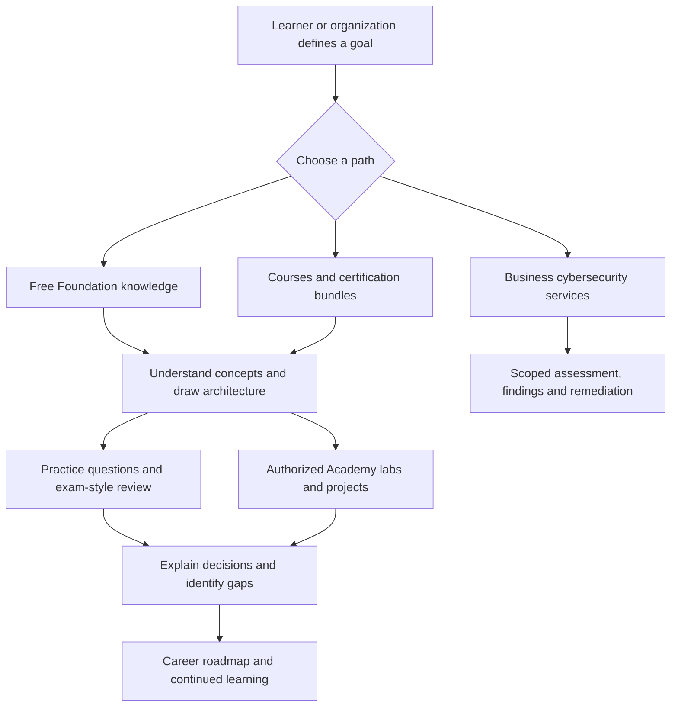

import FoundationExploreReturn from '../../../components/FoundationExploreReturn.astro';

import FoundationAboutLead from '../../../components/FoundationAboutLead.astro';
import FoundationAboutCards from '../../../components/FoundationAboutCards.astro';
import FoundationAboutDiagram from '../../../components/FoundationAboutDiagram.astro';

<FoundationExploreReturn />

<FoundationAboutLead />

## What GoHackersCloud offers

| Area | Purpose | Where to explore |
|---|---|---|
| **Free Foundation** | Read structured IT, cloud, security, DevOps, AI and professional concepts; complete independent exercises | [Begin Foundation](/start-here/) |
| **Courses & learning bundles** | Follow self-paced learning and certification-oriented preparation in relevant technology families | [Courses and bundles](/about-gohackerscloud/courses/) |
| **Test Engine & mock exams** | Practise original exam-style questions, identify weak domains and build exam-taking confidence | [Test Engine overview](/about-gohackerscloud/test-engine/) |
| **GoHackersCloud Academy & GHC Labs** | Explore advanced career tracks, practical exercises and hosted sandbox environments where supported | [GHC Labs and Academy](/ghc-labs/) |
| **Professional cybersecurity services** | Explore scoped enterprise security assessments, remediation support and governance-focused service discussions | [Cybersecurity services overview](/about-gohackerscloud/cybersecurity-services/) |

**Important:** Each offering has its own scope, eligibility, current pricing and terms. A free Foundation account or page view does not automatically grant a course, test subscription, mentoring session, hosted lab or professional service.

## How the learning ecosystem fits together

<FoundationAboutDiagram>

</FoundationAboutDiagram>

The diagram shows **possible pathways**, not mandatory purchases or a guaranteed sequence. A beginner can complete free Foundation exercises without subscribing to anything else. A working professional may go directly to a relevant exam-preparation product or Academy track. A business seeking an assessment should use the service enquiry path rather than a student lab.

## Learn, practise and explain

Our teaching approach puts understanding before tool memorization. Students benefit from being able to answer three questions: *What does this technology do? Why would a company use it? What evidence proves the system behaves as intended?*

A practical learning loop connects five activities. Each step below links to the relevant GoHackersCloud resource, with free Foundation learning and optional commercial products clearly distinguished.

<FoundationAboutCards variant="journey" />

Learning a concept and earning a vendor certification are different outcomes. GoHackersCloud learning content and mock tests are preparation resources, not official vendor examinations.

## The people we serve

| Audience | Common goals | Suggested starting point |
|---|---|---|
| Beginners and college students | Build a credible technical base and decide where to specialize | [Start Here](/start-here/) |
| Certification learners | Understand exam domains, practise questions and revise weak areas | [free certification pathway guides](/learning-hub/certification-paths/), [Courses](/about-gohackerscloud/courses/) and [Test Engine](/about-gohackerscloud/test-engine/) |
| Career switchers | Connect fundamentals to practical security and cloud workflows | [Core IT & DevOps](/core-it-devops/) and [nine career roadmaps](/learning-hub/career-paths/) |
| Developers and engineers | Strengthen application, API, cloud and DevSecOps capabilities | [Academy tracks](/ghc-labs/track-selection/) |
| Colleges and learning partners | Explore structured resources and practical education options | [Contact GoHackersCloud](https://gohackerscloud.com/contact-gohackerscloud) |
| Businesses | Discuss a scoped security review or services engagement | [Cybersecurity services](/about-gohackerscloud/cybersecurity-services/) |

## Choose the right GoHackersCloud site

Find the resource that matches your goal, whether you want free foundational study, a current course listing, guided lab information or an enterprise services enquiry.

<FoundationAboutCards variant="websites" />

Enrolled Academy learners can visit the [Academy learning experience](https://academy.gohackerscloud.com/) directly; access to individual lessons and labs may require sign-in or membership. The public Foundation site remains free.

## What to do next

**New to the ecosystem?** Start with the [free Foundation guide](/start-here/). **Exploring a cybersecurity career?** Compare the [nine roadmaps](/learning-hub/career-paths/), [matching certification options](/learning-hub/certification-paths/) and [role-specific interviews](/learning-hub/interview-paths/). **Ready to select a learning product?** Visit [Courses & Bundles](/about-gohackerscloud/courses/) or [Test Engine & Mock Exams](/about-gohackerscloud/test-engine/). **Looking for practical security environments?** Explore [GHC Labs](/ghc-labs/) and the [five-video guide series](/ghc-labs/instructor-demo/). **Representing a business?** Review [Cybersecurity Services](/about-gohackerscloud/cybersecurity-services/).

Our aim is to support meaningful technical understanding and practical decision-making. Completing a course or lab does not guarantee employment, a certification pass or authorization to test external systems.
