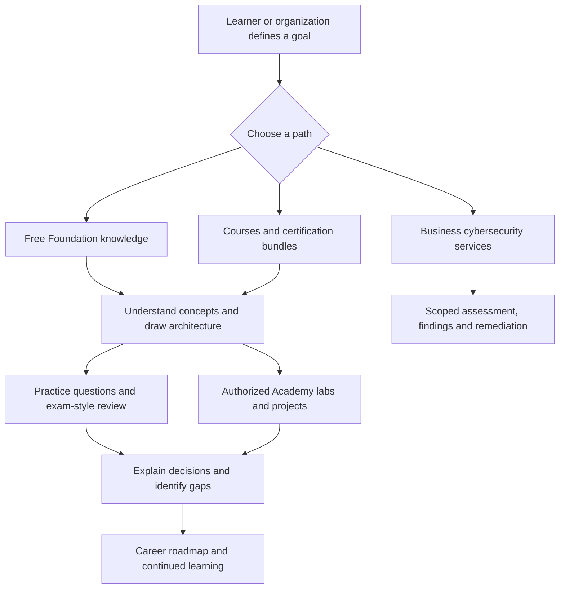

# About GoHackersCloud

**Learn the fundamentals. Study a specialization. Measure your understanding. Practise in authorized environments. Apply skills to real-world problems.**

GoHackersCloud brings together practical technology education and cybersecurity-focused professional services. Our learning resources span IT, networking, Linux, cloud platforms, security, AI and enterprise engineering. Rather than treating a certification, a video course or a laboratory as the entire journey, we connect different ways to develop and demonstrate technical skills.

This **Foundation** website is the *free* entry point. Courses and bundles, the test engine, hosted Academy labs and business cybersecurity services are **distinct offerings** accessed through their respective official pages.

**Explore the unified [GoHackersCloud promotional catalog](/about-gohackerscloud/catalog/)** for named course bundle families, the AWS nine-course learning set, exam preparation, all 13 Academy tracks, the documented lab curriculum, eight service modules and previously shared video links. Prices and currently active checkout availability are managed by the official storefronts.

## What GoHackersCloud offers

| Area | Purpose | Where to explore |
|---|---|---|
| **Free Foundation** | Read structured IT, cloud, security, DevOps, AI and professional concepts; complete independent exercises | [Begin Foundation](/start-here/) |
| **Courses & learning bundles** | Follow self-paced learning and certification-oriented preparation in relevant technology families | [Courses and bundles](/about-gohackerscloud/courses/) |
| **Test Engine & mock exams** | Practise original exam-style questions, identify weak domains and build exam-taking confidence | [Test Engine overview](/about-gohackerscloud/test-engine/) |
| **GoHackersCloud Academy & GHC Labs** | Explore advanced career tracks, practical exercises and hosted sandbox environments where supported | [GHC Labs and Academy](/ghc-labs/) |
| **Professional cybersecurity services** | Explore scoped enterprise security assessments, remediation support and governance-focused service discussions | [Cybersecurity services overview](/about-gohackerscloud/cybersecurity-services/) |

**Important:** Each offering has its own scope, eligibility, current pricing and terms. A free Foundation account or page view does not automatically grant a course, test subscription, mentoring session, hosted lab or professional service.

## How the learning ecosystem fits together

The diagram shows **possible pathways**, not mandatory purchases or a guaranteed sequence. A beginner can complete free Foundation exercises without subscribing to anything else. A working professional may go directly to a relevant exam-preparation product or Academy track. A business seeking an assessment should use the service enquiry path rather than a student lab.

## Learn, practise and explain

Our teaching approach puts understanding before tool memorization. Students benefit from being able to answer three questions: *What does this technology do? Why would a company use it? What evidence proves the system behaves as intended?*

A practical learning loop looks like this:

1. **Learn** — build the foundation in operating systems, networks, identities, applications and cloud concepts.
2. **Prepare** — select a focused course, certification guide, study notes or memory map where offered.
3. **Assess** — practise relevant exam-style questions and use answer explanations to find gaps.
4. **Apply** — use your own authorized systems or a separately accessed Academy lab, recording actual observations.
5. **Communicate** — turn findings into a diagram, troubleshooting note, project or professional report.

Learning a concept and earning a vendor certification are different outcomes. GoHackersCloud learning content and mock tests are preparation resources, not official vendor examinations.

## The people we serve

| Audience | Common goals | Suggested starting point |
|---|---|---|
| Beginners and college students | Build a credible technical base and decide where to specialize | [Start Here](/start-here/) |
| Certification learners | Understand exam domains, practise questions and revise weak areas | [Courses](/about-gohackerscloud/courses/) and [Test Engine](/about-gohackerscloud/test-engine/) |
| Career switchers | Connect fundamentals to practical security and cloud workflows | [Core IT & DevOps](/core-it-devops/) and [career roadmap](/learning-hub/cloud-security-roadmap/) |
| Developers and engineers | Strengthen application, API, cloud and DevSecOps capabilities | [Academy tracks](/ghc-labs/track-selection/) |
| Colleges and learning partners | Explore structured resources and practical education options | [Contact GoHackersCloud](https://gohackerscloud.com/contact-gohackerscloud) |
| Businesses | Discuss a scoped security review or services engagement | [Cybersecurity services](/about-gohackerscloud/cybersecurity-services/) |

## Choose the right GoHackersCloud site

- **[gohackerscloud.com](https://gohackerscloud.com/)** — main platform and business information.
- **[gohackerscloud.com/ghc-offers](https://gohackerscloud.com/ghc-offers)** — official offers and bundle listings; check each current item and checkout link there.
- **[gohackerscloud.org](https://www.gohackerscloud.org/)** — learning catalog and exam-practice entry points.
- **[foundation.gohackerscloud.com](https://foundation.gohackerscloud.com/)** — free foundational learning.
- **[academy.gohackerscloud.com](https://academy.gohackerscloud.com/)** — Academy learning experience (access may require sign-in or membership).
- **[GHC Labs overview](/ghc-labs/)** — guided introduction to supported hosted-practice workflows and terms.
- **[Cybersecurity services](https://gohackerscloud.com/cybersecurity-services)** — enterprise-oriented services information and enquiries.

## What to do next

**New to the ecosystem?** Start with the [free Foundation guide](/start-here/). **Ready to select a learning product?** Visit [Courses & Bundles](/about-gohackerscloud/courses/) or [Test Engine & Mock Exams](/about-gohackerscloud/test-engine/). **Looking for practical security environments?** Explore [GHC Labs](/ghc-labs/). **Representing a business?** Review [Cybersecurity Services](/about-gohackerscloud/cybersecurity-services/).

Our aim is to support meaningful technical understanding and practical decision-making. Completing a course or lab does not guarantee employment, a certification pass or authorization to test external systems.
