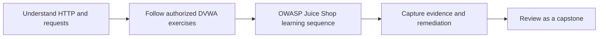
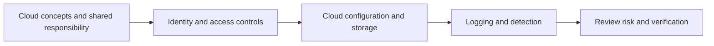

import FoundationExploreReturn from '../../../components/FoundationExploreReturn.astro';

import FoundationLabDirectoryNav from '../../../components/FoundationLabDirectoryNav.astro';

<FoundationExploreReturn />

**Build knowledge. Practice ethically. Document outcomes.**

This directory is sourced from the **GoHackersCloud Academy curriculum repository as of November 17, 2026**, rather than inferred from a generic cybersecurity catalog. It distinguishes the **90 documents in the dedicated GoHackersCloud Labs learning area** from other Academy lab-related resources.

**Important:** A lab document is not necessarily a unique hosted environment or an immediately available launch. Some documents are orientation guides, projects or exercises. Actual lab availability, membership eligibility, targets and session limits depend on each Academy lesson and the live platform.

[Explore Academy tracks](/ghc-labs/track-selection/) · [GHC Labs access and subscriptions](https://gohackerscloud.com/hands-on-cybersecurity-labs) · [Full promotional catalog](/about-gohackerscloud/catalog/)

<FoundationLabDirectoryNav />

## Dedicated GHC Labs learning documents

The dedicated Academy area contains the following sections:

| Section | Document entries | Related Academy track |
|---|---:|---|
| CEH / Ethical Hacking | 16 | [Explore](https://academy.gohackerscloud.com/tracks/ceh/) |
| Web Application Security | 20 | [Explore](https://academy.gohackerscloud.com/tracks/webapp/) |
| API Security | 8 | [Explore](https://academy.gohackerscloud.com/tracks/api/) |
| Network Penetration Testing | 10 | [Explore](https://academy.gohackerscloud.com/tracks/network/) |
| OSCP-Style Practice | 19 | [Explore](https://academy.gohackerscloud.com/tracks/oscp/) |
| AWS Security / AWS Goat | 12 | [Explore](https://academy.gohackerscloud.com/tracks/aws/) |
| Projects & Capstones | 5 | [Explore](https://academy.gohackerscloud.com/tracks/projects/) |
| **Total** | **90** | |

Each section below is a **curriculum title inventory**, not an active lab-launch listing.

## CEH / Ethical Hacking — 16 documents

[Open related Academy track](https://academy.gohackerscloud.com/tracks/ceh/)

- **Lab Rules & Troubleshooting** — *01 GoHackersCloud Academy*
- **Ethical Hacking Progressive Lab Pathway** — *01 GoHackersCloud Academy*
- **Lab 01 Build Your Ethical Hacking Lab Environment** — *02 Ethical Hacking Foundations*
- **Lab 02 Kali Linux Security Toolkit Orientation** — *02 Ethical Hacking Foundations*
- **Lab 03 Passive Reconnaissance and OSINT** — *02 Ethical Hacking Foundations*
- **Lab 04 Active Reconnaissance and Host Discovery** — *02 Ethical Hacking Foundations*
- **Lab 05 Port Scanning and Service Enumeration** — *02 Ethical Hacking Foundations*
- **Lab 06 Vulnerability Discovery and Prioritization** — *02 Ethical Hacking Foundations*
- **Lab 07 Web Application Reconnaissance** — *03 DVWA Web Hacking Fundamentals*
- **Lab 08 HTTP Request and Response Analysis** — *03 DVWA Web Hacking Fundamentals*
- **Lab 09 Authentication Testing Description** — *03 DVWA Web Hacking Fundamentals*
- **Lab 10 SQL Injection End to End** — *03 DVWA Web Hacking Fundamentals*
- **Lab 11 Cross-Site Scripting (XSS)** — *03 DVWA Web Hacking Fundamentals*
- **Lab 12 Command Injection** — *03 DVWA Web Hacking Fundamentals*
- **Lab 13 File Upload Security Testing** — *03 DVWA Web Hacking Fundamentals*
- **Lab 14 CSRF and Web Application Assessment** — *03 DVWA Web Hacking Fundamentals*

## Web Application Security — 20 documents

[Open related Academy track](https://academy.gohackerscloud.com/tracks/webapp/)

- **Lab 15 Juice Shop Reconnaissance** — *04 OWASP Juice Shop*
- **Lab 16 Content and Endpoint Discovery** — *04 OWASP Juice Shop*
- **Lab 17 Authentication Weakness Assessment** — *04 OWASP Juice Shop*
- **Lab 18 Password and Account Security Testing** — *04 OWASP Juice Shop*
- **Lab 19 Broken Access Control** — *04 OWASP Juice Shop*
- **Lab 20 IDOR Object-Level Authorization Testing** — *04 OWASP Juice Shop*
- **Lab 21 Injection Vulnerability Assessment** — *04 OWASP Juice Shop*
- **Lab 22 XSS Attack-Surface Assessment** — *04 OWASP Juice Shop*
- **Lab 23 Session, Token and JWT Security** — *04 OWASP Juice Shop*
- **Lab 24 Juice Shop End-to-End** — *04 OWASP Juice Shop*
- **Lab 25 Burp Suite Web PenTesting Workflow** — *05 Advanced Web Application PenTesting*
- **Lab 26 Advanced Authentication Testing** — *05 Advanced Web Application PenTesting*
- **Lab 27 Advanced Access-Control Testing** — *05 Advanced Web Application PenTesting*
- **Lab 28 Server-Side Request Forgery (SSRF)** — *05 Advanced Web Application PenTesting*
- **Lab 29 XML External Entity (XXE) Security Testing** — *05 Advanced Web Application PenTesting*
- **Lab 30 Server-Side Template Injection (SSTI)** — *05 Advanced Web Application PenTesting*
- **Lab 31 Insecure Deserialization** — *05 Advanced Web Application PenTesting*
- **Lab 32 HTTP Request Smuggling Concepts** — *05 Advanced Web Application PenTesting*
- **Lab 33 Business Logic Vulnerability Assessment** — *05 Advanced Web Application PenTesting*
- **Lab 34 Advanced Web Pentest Challenge Mission Information** — *05 Advanced Web Application PenTesting*

## API Security — 8 documents

[Open related Academy track](https://academy.gohackerscloud.com/tracks/api/)

- **Lab 35 API Reconnaissance and Endpoint Discovery** — *06 API Penetration Testing*
- **Lab 36 API Authentication Testing** — *06 API Penetration Testing*
- **Lab 37 BOLA and IDOR Testing** — *06 API Penetration Testing*
- **Lab 38 Broken Function-Level Authorization** — *06 API Penetration Testing*
- **Lab 39 Mass Assignment Vulnerabilities** — *06 API Penetration Testing*
- **Lab 40 JWT and API Token Security** — *06 API Penetration Testing*
- **Lab 41 Rate Limiting and Business Logic Testing** — *06 API Penetration Testing*
- **Lab 42 End-to-End REST API Penetration Test** — *06 API Penetration Testing*

## Network Penetration Testing — 10 documents

[Open related Academy track](https://academy.gohackerscloud.com/tracks/network/)

- **Phase 6 lab environment** — *06 Network & Infrastructure Pentesting*
- **Lab 43 Network Reconnaissance** — *06 Network & Infrastructure Pentesting*
- **Lab 44 Nmap Network Discovery and Enumeration** — *06 Network & Infrastructure Pentesting*
- **Lab 45 Service Enumeration** — *06 Network & Infrastructure Pentesting*
- **Lab 46 Web-Service Enumeration** — *06 Network & Infrastructure Pentesting*
- **Lab 47 SMB Security Assessment** — *06 Network & Infrastructure Pentesting*
- **Lab 48 FTP and Remote-Service Assessment** — *06 Network & Infrastructure Pentesting*
- **Lab 49 Vulnerability Identification and Validation** — *06 Network & Infrastructure Pentesting*
- **Lab 50 Controlled Service Exploitation** — *06 Network & Infrastructure Pentesting*
- **Lab 51 Service Remediation and Security Retesting** — *06 Network & Infrastructure Pentesting*

## OSCP-Style Practice — 19 documents

[Open related Academy track](https://academy.gohackerscloud.com/tracks/oscp/)

- **Lab 52 Linux Post-Exploitation Enumeration** — *07 Linux Privilege Escalation*
- **Lab 53 Linux Permissions and Sudo Misconfigurations** — *07 Linux Privilege Escalation*
- **Lab 54 SUID-SGID Security Assessment** — *07 Linux Privilege Escalation*
- **Lab 55 Scheduled Tasks and Service Misconfigurations** — *07 Linux Privilege Escalation*
- **Lab 56 Credential and Secret Discovery** — *07 Linux Privilege Escalation*
- **Lab 57 Linux Privilege-Escalation Challenge** — *07 Linux Privilege Escalation*
- **Lab 58 Windows Security Enumeration** — *08 Windows & Active Directory Pentesting*
- **Lab 59 Windows Privilege-Escalation Assessment** — *08 Windows & Active Directory Pentesting*
- **Lab 60 Active Directory Reconnaissance** — *08 Windows & Active Directory Pentesting*
- **Lab 61 Environment Build and Implementation** — *08 Windows & Active Directory Pentesting*
- **Lab 62 Windows Authentication Security** — *08 Windows & Active Directory Pentesting*
- **Lab 63 Active Directory Misconfiguration Assessment** — *08 Windows & Active Directory Pentesting*
- **Lab 64 Active Directory Privilege-Escalation Attack-Path Analysis** — *08 Windows & Active Directory Pentesting*
- **Lab 65 Active Directory Pentest Challenge** — *08 Windows & Active Directory Pentesting*
- **Lab 67 Web-to-System Compromise Challenge** — *09 VulnHub Black-Box Pentesting*
- **Lab 68 Linux Privilege-Escalation Machine** — *09 VulnHub Black-Box Pentesting*
- **Lab 69 Simple Two-Step Attack Chain** — *09 VulnHub Black-Box Pentesting*
- **Lab 70 Three-Stage Web-to-Root Attack Chain** — *09 VulnHub Black-Box Pentesting*
- **Lab 71 Full VulnHub Penetration-Test Assessment** — *09 VulnHub Black-Box Pentesting*

## AWS Security / AWS Goat — 12 documents

[Open related Academy track](https://academy.gohackerscloud.com/tracks/aws/)

- **Lab 72 AWS Attack-Surface Reconnaissance**
- **Lab 73 AWS IAM Enumeration**
- **Lab 74 Exposed Cloud Credentials Investigation**
- **Lab 75 IAM Misconfiguration Assessment**
- **Lab 76 IAM Privilege-Escalation Analysis**
- **Lab 77 Role and Trust-Policy Security Assessment**
- **Lab 78 Cloud Storage Security Assessment**
- **Lab 79 Cloud Attack-Path Analysis**
- **Lab 80 CloudGoat End to End AWS Pentest**
- **Lab 81 Cloud-Goat Guide Easy**
- **Lab 82 Cloud-Goat Guide Medium**
- **Lab 83 Cloud-Goat Guide Hard**

## Projects & Capstones — 5 documents

[Open related Academy track](https://academy.gohackerscloud.com/tracks/projects/)

- **Lab 84 External Web Application Penetration Test**
- **Lab 85 Internal Network Penetration Test**
- **Lab 86 API Security Assessment**
- **Lab 87 Cloud Security Penetration Test**
- **Lab 88 Enterprise Red-Team-Style Capstone**

## Other Academy lab-related documentation

Outside the dedicated Labs learning area, the Academy source repository contains additional lab, assessment and supporting documents in certification and career pathways. The following counts apply to **matching lab-related Markdown files**, not distinct hosted instances.

| Academy collection | Lab-related document entries | Learning topics |
|---|---:|---|
| [Certification-aligned lab collections](https://academy.gohackerscloud.com/tracks/comptia/) | 231 | CompTIA, EC-Council, AWS, Azure, Google, Cisco, ISC2 and other certification career paths |
| [Cloud Security Engineer](https://academy.gohackerscloud.com/tracks/cloud/) | 45 | Kubernetes security and practical cloud controls |
| [AI Security Engineer](https://academy.gohackerscloud.com/tracks/careers/) | 13 | AI attack surfaces, RAG, agents and threat modeling |
| [Application Security](https://academy.gohackerscloud.com/tracks/appsec/) | 20 | Container/Kubernetes security, DevSecOps and secure coding |
| [Specialist and consultant pathways](https://academy.gohackerscloud.com/tracks/careers/) | 80 | Cloud penetration testing, GRC, blue team and bug bounty |
| [GHC Cloud Security](https://academy.gohackerscloud.com/tracks/cloud/) | 6 | Architecture, identity, data, delivery and response |
| [CompTIA integrated practice](https://academy.gohackerscloud.com/tracks/comptia/) | 1 | Student kit and practical guide |
| [90-Day Hackathon](https://academy.gohackerscloud.com/tracks/hackathon/) | 2 | Progressive challenge pathways |
| **Other lab-related documents** | **398** | |
| **Total including dedicated Labs area** | **488** | |

## Example learning journeys

### Web Application Security

### Cloud Security Engineering

**Use only the targets and environments specified in each authorized lesson.** Do not test unrelated websites, accounts or networks.

## Lab documentation vs. provisioned runtime

| Term | What it means |
|---|---|
| **Lab lesson** | Written curriculum explaining an exercise, objective, expected evidence or environment |
| **Guided project** | A multi-step, often cross-topic activity that may not require a unique hosted target |
| **Hosted practice environment** | An eligible, authorized provisioned sandbox or tool workspace for a supported lesson |
| **Available now** | A real-time state that requires checking the authenticated Academy/lab system; this document cannot confirm it |

For the official learner flow, explore [How GHC Labs works](/ghc-labs/how-it-works/), [choose one of the 13 tracks](/ghc-labs/track-selection/) and review [current access terms](https://gohackerscloud.com/hands-on-cybersecurity-labs).

[Back to the unified GoHackersCloud catalog](/about-gohackerscloud/catalog/)
