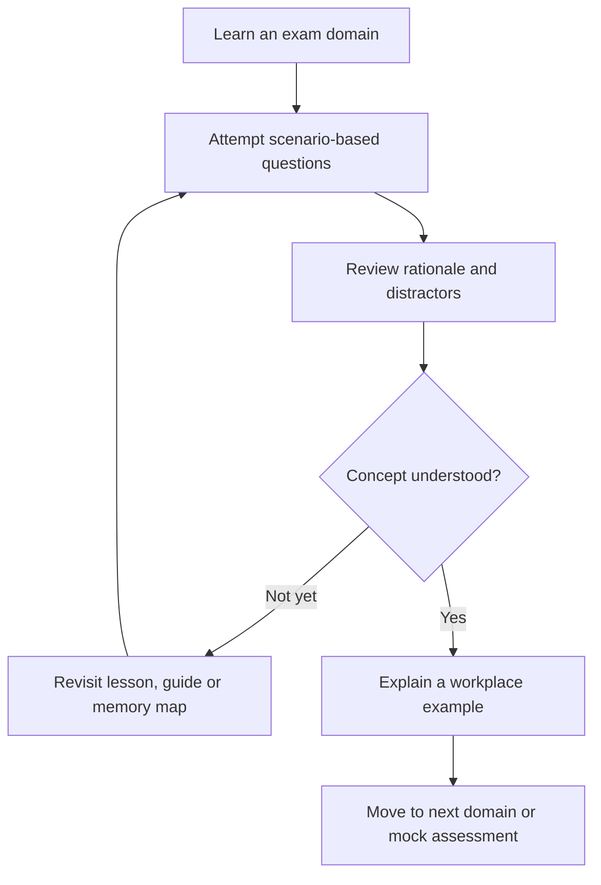

import FoundationDiscoveryPanel from '../../../components/FoundationDiscoveryPanel.astro';

**Know the concept. Test your reasoning. Learn from every mistake.**

GoHackersCloud's exam-preparation offering helps learners review technical topics through practice questions and exam-style assessments. It complements courses, study guides and practical labs; it does not replace hands-on understanding or official certification exams.

<FoundationDiscoveryPanel variant="tests" />

## Which type of assessment do you need?

| Assessment | Best use | Where to go |
|---|---|---|
| **Foundation self-checks** | Check whether you understand free lessons, diagrams and introductory technical concepts | [Explore free Foundation modules](/curriculum/) |
| **Free practice tests** | Sample the question format or practise available free topics | [GoHackersCloud Free Tests](https://www.gohackerscloud.org/freetest) |
| **Test Engine / mock exam preparation** | Work through structured exam-style questions and revision where offered by a particular product | [Courses and Offers](https://gohackerscloud.com/ghc-offers) |
| **Study guides and learning courses** | Learn the topic before testing or revisit weak areas | [Courses and Bundles](/about-gohackerscloud/courses/) |

The active test interface, question banks, timing, explanations, reporting and access terms depend on the specific live product. This page introduces the study workflow; it does **not** run an embedded test engine.

## A better way to prepare for certification

1. **Select your target.** Check the official vendor blueprint, objectives and current exam code.
2. **Establish baseline understanding.** Use Foundation or a relevant structured course to learn each concept.
3. **Practise.** Work through original, scenario-based questions; use any timed modes or review features the chosen product actually offers.
4. **Review reasoning.** Ask not only “Which answer is correct?” but also “Why are the alternatives not appropriate under these conditions?”
5. **Identify weak domains.** Make a personal error log grouped by topics and revisit the source explanation.
6. **Retest and apply.** Try a new practice set, draw an architecture or complete an authorized hands-on exercise.

## What strong exam practice measures

A useful practice question checks whether a learner can recognize the **scope of a problem, choose a proportionate control, compare alternatives, interpret an architectural trade-off and reason from the facts provided**.

For example, a cloud identity question might describe a workload needing temporary access to one storage resource. The important skill is understanding least privilege and temporary credentials, not memorizing every possible cloud product name.

### Try one original sample scenario

A web service can authenticate users successfully, but one student can access another student's protected record.

**Which area should the engineering team investigate first?**

A. Upgrade the desktop CPU.

B. Increase the public network bandwidth.

C. Review object-level authorization in the application/API.

D. Disable all activity logging.

  
Show reasoning

  **C is the most relevant answer.** Authentication establishes identity; authorization must still check whether that identity is allowed to read a particular resource. Increasing hardware capacity, changing bandwidth or disabling logs would not correct that access-control failure.

## Responsible exam preparation

Use **original practice questions and authorized study resources**, not leaked, copied or restricted examination content. A strong mock score does not guarantee passing an official exam. Exam bodies control their blueprints, policies, delivery and credential awards.

## Start practising

**[Explore Free Tests](https://www.gohackerscloud.org/freetest)** · **[Browse Test Products & Bundles](https://gohackerscloud.com/ghc-offers)** · [AWS Cloud Practitioner Study Guide](/learning-hub/aws-clf-c02/)

For career-focused study, use the [nine role-matched certification guides](/learning-hub/certification-paths/) to compare independent providers and official exam requirements. Prepare for technical hiring conversations with [54 original interview questions across nine cybersecurity roles](/learning-hub/interview-paths/). These interview exercises are **not** vendor exam questions or a substitute for assessed certification exams.

After studying and checking concepts, learners can explore [GHC Labs](/ghc-labs/) and its [five-video learning series](/ghc-labs/instructor-demo/) for separately available authorized practical exercises and recordings where supported.
