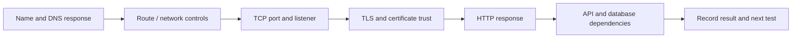

**Track:** Core IT & DevOps · **Level:** Beginner · **Suggested time:** 1–3 hours for this guide and practice; additional time for full lessons

Every cloud, web and security system relies on communication. This module teaches how requests travel, where they fail and how engineers prove the fault domain rather than changing settings randomly.

[Back to the Core IT & DevOps pathway](/core-it-devops/) · [Open the original Module 02 lesson](/foundation/gohackerscloud-foundation/02-networking-fundamentals/01-networking-basics/)

## What you will be able to demonstrate

- Explain the key concepts in your own words, not only repeat definitions.
- Draw or describe where this capability is used in real IT systems.
- Collect basic, authorized evidence from a guided exercise.
- Explain at least one common failure and the safest next troubleshooting step.

## Core concepts and why they matter

### Addresses and routes

IP addresses identify endpoints or interfaces in a network scope; routers forward traffic according to routing tables. A private address can reach the Internet through translation or a proxy but is not inherently publicly reachable.

### DNS and names

DNS maps a hostname to one or more records; it does not guarantee that an application is healthy. Failure might be with the local cache, resolver, record content, TCP path, TLS or the server.

### Transport and ports

TCP provides connection-oriented transport and reliability; UDP has different behavior. A listening process, firewall rule, route and valid application response are separate prerequisites.

### TLS and HTTP

TLS negotiates an encrypted, authenticated channel when correctly validated. HTTP sends application requests and responses. Status 404 means the requested resource was not found; 503 usually indicates service unavailability, not necessarily a routing failure.

## Architecture diagram — Network troubleshooting as a sequence of evidence



**How to interpret it:** A successful stage does not prove all later stages work. Engineers isolate the layer that first diverges from expected behavior.

**Diagram exercise:** Create an expected-result column for each hop, then explain which safe command would test it.

**Expected evidence:** A labeled architecture or flowchart plus one safe verification step. This is independent Foundation study; no paid Academy lab is required.

## Enterprise case study (hypothetical)

Students in one campus cannot open an HTTPS learning portal, while mobile data works. A support engineer checks whether campus DNS returns an address, whether TCP/443 is reachable, whether the certificate is valid and whether a proxy blocks the request. The report distinguishes facts from hypotheses.

### How the engineer should think

1. Confirm the scope and what you are authorized to access.
2. Separate facts, hypotheses and assumptions before recommending changes.
3. Choose one observation that can distinguish likely causes.
4. Record output, timestamps and the limitations of each test.
5. Escalate with evidence when a change requires production permission.

## Guided self-study exercise

Complete these tasks on your own system, in a classroom with permission, or using paper diagrams. Hosted Academy labs are not required for this free module.

1. Draw browser → DNS → router/firewall → TLS endpoint → application.
2. Run one name-resolution check on a system you own.
3. Run one HTTPS header check and describe the result.
4. Write a two-column fault table for connection timeout vs HTTP 404.

### Copyable practice commands

Windows PowerShell:

```powershell
Resolve-DnsName example.com
Test-NetConnection example.com -Port 443
```

Linux or macOS terminal:

```bash
getent hosts example.com
curl -I https://example.com
```

`getent` is Linux-specific; use `nslookup example.com` or `dig` on systems that support those tools.

### Expected observations and how to verify

A DNS answer identifies one or more addresses. A successful TCP test indicates that port 443 accepted a connection, while `curl -I` reports an HTTP response (possibly 200 or a redirect). Any failure should be recorded, not 'fixed' by changing network policy without authorization.

### Troubleshooting if results differ

Do not treat an error as failure of the learning goal. Check whether the command exists on your operating system, whether it needs permissions and whether the environment (desktop, WSL, container or VM) behaves differently. Record the observation without making unnecessary system changes.

## Common mistakes and professional judgment

- Treating DNS success as proof an application works
- Confusing timeout, certificate failure and HTTP 500
- Scanning networks or changing firewall rules without authorization

## Check your understanding

1. **Does resolving a hostname mean the website is online?**

   <details><summary>Show reasoning</summary>No. Name resolution precedes connectivity, TLS and application response.</details>

2. **What does a 503 response tell you?**

   <details><summary>Show reasoning</summary>An HTTP-speaking server or gateway responded with a service-unavailable status; inspect upstream health and context.</details>

3. **Why should a firewall rule be changed only after diagnosis?**

   <details><summary>Show reasoning</summary>It can expand exposure and may not address the actual root cause.</details>

## Portfolio-ready evidence

**Deliverable:** A layered network diagram and a five-step DNS/HTTPS troubleshooting runbook.

Store the exercise as a self-study artifact. Include purpose, scope, assumptions, tools, observations, conclusions and limitations. Do not call a simulated lab a production incident.

## Continue with Foundation and then practise further

The original [Module 02 lesson sequence](/foundation/gohackerscloud-foundation/02-networking-fundamentals/01-networking-basics/) contains the broader foundational syllabus; use the full [lesson directory](/curriculum/#module-02) to access other chapters.

For structured, authorized practical activities after the conceptual work, explore [Academy NETWORK-related learning](https://academy.gohackerscloud.com/tracks/network/), review the [GHC Labs experience](/ghc-labs/) and check [current lab subscription terms](https://gohackerscloud.com/hands-on-cybersecurity-labs). Foundation content itself remains free.

[← Core learning path](/core-it-devops/) · [Next: Module 03 — Linux Systems, Processes and Permissions](/core-it-devops/module-03/)
