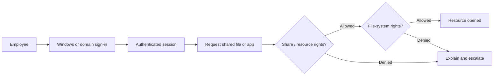

**Track:** Core IT & DevOps · **Level:** Beginner · **Suggested time:** 1–3 hours for this guide and practice; additional time for full lessons

Windows remains central to business endpoints and enterprise identity. The goal is to understand how services, event logs, access controls and directory services connect to an employee's work.

[Back to the Core IT & DevOps pathway](/core-it-devops/) · [Open the original Module 04 lesson](/foundation/gohackerscloud-foundation/04-windows-fundamentals/01-windows-architecture/)

## What you will be able to demonstrate

- Explain the key concepts in your own words, not only repeat definitions.
- Draw or describe where this capability is used in real IT systems.
- Collect basic, authorized evidence from a guided exercise.
- Explain at least one common failure and the safest next troubleshooting step.

## Core concepts and why they matter

### Operating system and services

Windows uses processes, services, the registry and file-system access controls. A running desktop does not guarantee that an application service is healthy.

### PowerShell as an inspection tool

PowerShell returns structured objects that can be filtered and formatted. Begin with read-only commands and understand whether results describe the local host or a remote enterprise environment.

### Local and domain identity

Local users and groups differ from Active Directory domain accounts. Authentication proves identity; authorization to a resource depends on effective group membership and permissions.

### Events and troubleshooting

Windows event logs record many system and application events. An event's severity and ID need the source, timeframe and system context before being treated as the root cause.

## Architecture diagram — Windows authentication and authorization



**How to interpret it:** Signing in is different from having permissions for a specific enterprise resource. Permissions may be layered, including share and file-system checks.

**Diagram exercise:** Write a safe diagnostic explanation for a user who signs in successfully but cannot open an approved share.

**Expected evidence:** A labeled architecture or flowchart plus one safe verification step. This is independent Foundation study; no paid Academy lab is required.

## Enterprise case study (hypothetical)

An employee can sign into Windows but cannot access an approved departmental shared folder. An administrator must consider network access, domain/group state, share permissions and NTFS authorization instead of repeatedly resetting passwords.

### How the engineer should think

1. Confirm the scope and what you are authorized to access.
2. Separate facts, hypotheses and assumptions before recommending changes.
3. Choose one observation that can distinguish likely causes.
4. Record output, timestamps and the limitations of each test.
5. Escalate with evidence when a change requires production permission.

## Guided self-study exercise

Complete these tasks on your own system, in a classroom with permission, or using paper diagrams. Hosted Academy labs are not required for this free module.

1. Inspect local Windows version, several services and recent system events.
2. Write a four-step decision tree for a failed shared-folder access.
3. Explain the role of a domain controller without requiring one for the exercise.
4. Describe how an approved change would be tested and rolled back.

### Copyable practice commands

Run these read-only examples in Windows PowerShell:

```powershell
Get-CimInstance Win32_OperatingSystem | Select-Object Caption,Version
Get-Process | Select-Object -First 8 Name,Id,CPU
Get-Service | Select-Object -First 8 Name,Status
Get-WinEvent -LogName System -MaxEvents 5 | Select-Object TimeCreated,Id,LevelDisplayName
```

Some event logs or remote computers may require additional rights. Do not elevate privileges just to complete this free exercise.

### Expected observations and how to verify

Observe OS version information, process identifiers, service states and event timestamps. Output depends on the local machine, access privileges and installed Windows version.

### Troubleshooting if results differ

Do not treat an error as failure of the learning goal. Check whether the command exists on your operating system, whether it needs permissions and whether the environment (desktop, WSL, container or VM) behaves differently. Record the observation without making unnecessary system changes.

## Common mistakes and professional judgment

- Equating a successful sign-in with file authorization
- Changing registry or firewall settings before collecting evidence
- Presenting an event log warning as proof of compromise without context

## Check your understanding

1. **Why might a user authenticate but still lack folder access?**

   <details><summary>Show reasoning</summary>NTFS or share permissions, group memberships or policy conditions can deny authorization.</details>

2. **What is a PowerShell object useful for?**

   <details><summary>Show reasoning</summary>It carries structured properties that can be selected, filtered and analyzed.</details>

3. **Are event logs sufficient for root-cause conclusions?**

   <details><summary>Show reasoning</summary>No. Correlate them with symptoms, service state, timing and other evidence.</details>

## Portfolio-ready evidence

**Deliverable:** A sanitized PowerShell observation report and enterprise file-access decision tree.

Store the exercise as a self-study artifact. Include purpose, scope, assumptions, tools, observations, conclusions and limitations. Do not call a simulated lab a production incident.

## Continue with Foundation and then practise further

The original [Module 04 lesson sequence](/foundation/gohackerscloud-foundation/04-windows-fundamentals/01-windows-architecture/) contains the broader foundational syllabus; use the full [lesson directory](/curriculum/#module-04) to access other chapters.

For structured, authorized practical activities after the conceptual work, explore [Academy COMPTIA-related learning](https://academy.gohackerscloud.com/tracks/comptia/), review the [GHC Labs experience](/ghc-labs/) and check [current lab subscription terms](https://gohackerscloud.com/hands-on-cybersecurity-labs). Foundation content itself remains free.

[← Core learning path](/core-it-devops/) · [Next: Module 05 — Python Programming and Practical Automation](/core-it-devops/module-05/)
