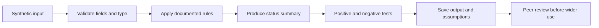

**Track:** Core IT & DevOps · **Level:** Beginner · **Suggested time:** 1–3 hours for this guide and practice; additional time for full lessons

Programming is how engineers transform observations into repeatable checks. Focus on understanding inputs, decisions, loops, data types and errors before building complex automation.

[Back to the Core IT & DevOps pathway](/core-it-devops/) · [Open the original Module 05 lesson](/foundation/gohackerscloud-foundation/05-programming-fundamentals/01-programming-concepts/)

## What you will be able to demonstrate

- Explain the key concepts in your own words, not only repeat definitions.
- Draw or describe where this capability is used in real IT systems.
- Collect basic, authorized evidence from a guided exercise.
- Explain at least one common failure and the safest next troubleshooting step.

## Core concepts and why they matter

### Data types and control flow

Strings, numbers, booleans, lists and dictionaries represent data; branches and loops define decisions and repetition. Type assumptions matter when parsing logs or API responses.

### Functions and repeatability

Functions separate one responsibility from another, make testing easier and improve readability. A clear input/output contract prevents hidden dependencies.

### JSON and APIs

JSON is a common format for API and log data. Never assume optional keys exist or that a value has the expected type. Learn safe validation and meaningful error reporting.

### Security-aware automation

Keep tokens out of code and logs, use read-only operations by default, and use synthetic datasets for initial practice. Automation can make an incorrect assumption at high speed.

## Architecture diagram — Safe automation from test data



**How to interpret it:** A useful script is understandable, verifiable and safe with unexpected input. Production changes require additional authorization and change controls.

**Diagram exercise:** Add one malformed event to the exercise and describe how a robust program should handle it.

**Expected evidence:** A labeled architecture or flowchart plus one safe verification step. This is independent Foundation study; no paid Academy lab is required.

## Enterprise case study (hypothetical)

A support engineer needs to summarize HTTP response codes from a synthetic log so a team can tell whether failures are increasing. A small Python script counts response classes and prints an understandable summary without uploading customer logs anywhere.

### How the engineer should think

1. Confirm the scope and what you are authorized to access.
2. Separate facts, hypotheses and assumptions before recommending changes.
3. Choose one observation that can distinguish likely causes.
4. Record output, timestamps and the limitations of each test.
5. Escalate with evidence when a change requires production permission.

## Guided self-study exercise

Complete these tasks on your own system, in a classroom with permission, or using paper diagrams. Hosted Academy labs are not required for this free module.

1. Run the sample and compare output with the expected counts.
2. Add a synthetic HTTP 404 event and predict the new summary before executing.
3. Wrap extraction so missing or non-integer status values are reported safely.
4. Document two tests demonstrating that the script handles malformed input.

### Copyable practice commands

Create a local file named `status_report.py`:

```python
from collections import Counter

sample_events = [
    {"path": "/login", "status": 200},
    {"path": "/login", "status": 401},
    {"path": "/api/orders", "status": 503},
    {"path": "/api/orders", "status": 200},
]
counts = Counter(event["status"] for event in sample_events)
for status, count in sorted(counts.items()):
    print(f"HTTP {status}: {count}")
```

Run on your own system with Python 3:

```bash
python status_report.py
```


### Expected observations and how to verify

The script prints HTTP 200: 2, HTTP 401: 1 and HTTP 503: 1. It analyzes only the synthetic events shown above and does not make network requests.

### Troubleshooting if results differ

Do not treat an error as failure of the learning goal. Check whether the command exists on your operating system, whether it needs permissions and whether the environment (desktop, WSL, container or VM) behaves differently. Record the observation without making unnecessary system changes.

## Common mistakes and professional judgment

- Treating a working script as trustworthy without testing bad input
- Hard-coding API secrets or customer credentials
- Copying automation into production without scope, rollback and peer review

## Check your understanding

1. **Why is 401 not the same as 503?**

   <details><summary>Show reasoning</summary>401 means authentication is required or insufficient; 503 signals service unavailability.</details>

2. **What does `Counter` provide here?**

   <details><summary>Show reasoning</summary>It tallies the number of occurrences of each status value.</details>

3. **What happens if a log record lacks `status`?**

   <details><summary>Show reasoning</summary>A direct key lookup raises a KeyError; production-quality code should validate and handle missing values.</details>

## Portfolio-ready evidence

**Deliverable:** A small Python program with sample input, expected output and two validation tests.

Store the exercise as a self-study artifact. Include purpose, scope, assumptions, tools, observations, conclusions and limitations. Do not call a simulated lab a production incident.

## Continue with Foundation and then practise further

The original [Module 05 lesson sequence](/foundation/gohackerscloud-foundation/05-programming-fundamentals/01-programming-concepts/) contains the broader foundational syllabus; use the full [lesson directory](/curriculum/#module-05) to access other chapters.

For structured, authorized practical activities after the conceptual work, explore [Academy TOOLS-related learning](https://academy.gohackerscloud.com/tracks/tools/), review the [GHC Labs experience](/ghc-labs/) and check [current lab subscription terms](https://gohackerscloud.com/hands-on-cybersecurity-labs). Foundation content itself remains free.

[← Core learning path](/core-it-devops/) · [Next: Module 06 — Git, Version Control and the DevOps Workflow](/core-it-devops/module-06/)
