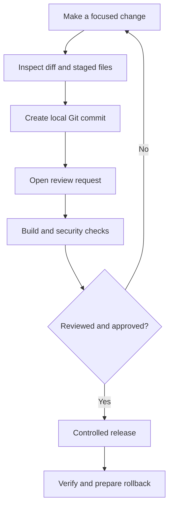

**Track:** Core IT & DevOps · **Level:** Beginner · **Suggested time:** 1–3 hours for this guide and practice; additional time for full lessons

DevOps is not a single tool. It is the disciplined collaboration, automation, review and feedback used to change systems safely. Git records how a change evolved; CI/CD helps test and deliver it.

[Back to the Core IT & DevOps pathway](/core-it-devops/) · [Open the original Module 06 lesson](/foundation/gohackerscloud-foundation/06-devops--version-control/01-git/)

## What you will be able to demonstrate

- Explain the key concepts in your own words, not only repeat definitions.
- Draw or describe where this capability is used in real IT systems.
- Collect basic, authorized evidence from a guided exercise.
- Explain at least one common failure and the safest next troubleshooting step.

## Core concepts and why they matter

### Working tree, staging and commit history

The working tree contains current files, the index stages intended changes, and commits save named snapshots in history. `git status` and `git diff` help prevent accidental additions.

### Pull requests and reviews

A pull request gives colleagues context to validate code, security impact, documentation and tests. A review should ask what changed, why, how it was tested and how to roll back.

### CI, delivery and operations

CI validates changes through builds and tests. Deployment and delivery processes differ by organization. The pipeline should not be given unrestricted production credentials just for convenience.

### Security and secrets hygiene

Never commit actual secrets or sensitive customer logs. Use `.gitignore` for local files, protected credentials for pipelines, least-privileged identities and appropriate approvals for risky changes.

## Architecture diagram — Reviewable source-control lifecycle



**How to interpret it:** Local Git snapshots, remote reviews, CI and production deployment are different steps. Tests reduce risk but do not eliminate uncertainty.

**Diagram exercise:** Write a short PR description for an updated troubleshooting runbook: why, what changed, tests and rollback.

**Expected evidence:** A labeled architecture or flowchart plus one safe verification step. This is independent Foundation study; no paid Academy lab is required.

## Enterprise case study (hypothetical)

A team modifies a service configuration. The developer makes a focused commit, opens a review with expected behavior, runs tests and checks monitoring after release. When a regression appears, the team can trace which revision was deployed and decide on a controlled rollback.

### How the engineer should think

1. Confirm the scope and what you are authorized to access.
2. Separate facts, hypotheses and assumptions before recommending changes.
3. Choose one observation that can distinguish likely causes.
4. Record output, timestamps and the limitations of each test.
5. Escalate with evidence when a change requires production permission.

## Guided self-study exercise

Complete these tasks on your own system, in a classroom with permission, or using paper diagrams. Hosted Academy labs are not required for this free module.

1. Create the local repository using the provided commands.
2. Add a short note explaining a DNS problem and commit the change.
3. Use `git log` and `git show` to review the history.
4. Write a sample pull request description with scope, tests and rollback plan.

### Copyable practice commands

On your own machine with Git installed (Git Bash or Linux/macOS shell):

```bash
mkdir foundation-change-practice
cd foundation-change-practice
git init -b main
git config user.name "Foundation Learner"
git config user.email "learner@example.invalid"
printf '# My Learning Notes\n' > README.md
git status
git add README.md
git diff --cached
git commit -m "docs: start Foundation learning notebook"
git log -1 --oneline
```

The `.invalid` address is intentionally non-deliverable. Use your own identity if you prefer; a public GitHub account is not required.

### Expected observations and how to verify

You should see a new local repository, a staged README diff and one commit in the history. The exact commit hash and timestamp will differ on each machine.

### Troubleshooting if results differ

Do not treat an error as failure of the learning goal. Check whether the command exists on your operating system, whether it needs permissions and whether the environment (desktop, WSL, container or VM) behaves differently. Record the observation without making unnecessary system changes.

## Common mistakes and professional judgment

- Accidentally committing access tokens or `.env` files
- Using `git add .` without reviewing the change set
- Assuming green CI means every production security risk has been addressed

## Check your understanding

1. **Does a Git commit automatically deploy software?**

   <details><summary>Show reasoning</summary>No. Deployment requires an additional workflow, pipeline or manual process.</details>

2. **Why review `git diff --cached`?**

   <details><summary>Show reasoning</summary>It shows precisely which changes are staged for the next commit.</details>

3. **Can Git history replace a backup strategy?**

   <details><summary>Show reasoning</summary>Not by itself; a local Git repository can still be lost and may exclude external data.</details>

## Portfolio-ready evidence

**Deliverable:** A local version-controlled Foundation notebook and a simulated pull-request review.

Store the exercise as a self-study artifact. Include purpose, scope, assumptions, tools, observations, conclusions and limitations. Do not call a simulated lab a production incident.

## Continue with Foundation and then practise further

The original [Module 06 lesson sequence](/foundation/gohackerscloud-foundation/06-devops--version-control/01-git/) contains the broader foundational syllabus; use the full [lesson directory](/curriculum/#module-06) to access other chapters.

For structured, authorized practical activities after the conceptual work, explore [Academy PROJECTS-related learning](https://academy.gohackerscloud.com/tracks/projects/), review the [GHC Labs experience](/ghc-labs/) and check [current lab subscription terms](https://gohackerscloud.com/hands-on-cybersecurity-labs). Foundation content itself remains free.

[← Core learning path](/core-it-devops/) · [Explore Cloud & Cybersecurity Foundation](/curriculum/)
