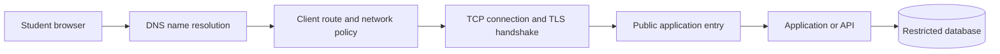
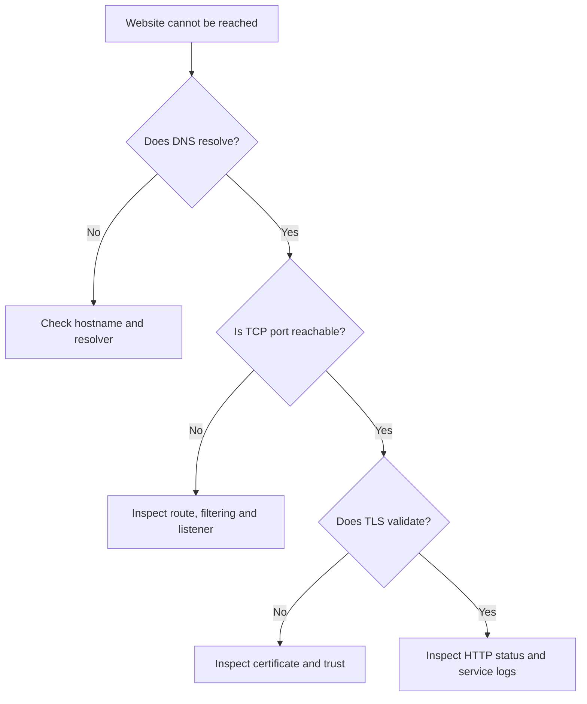

> **Foundation workshop:** [View the full Module 02 learning guide](/core-it-devops/module-02/) for prerequisite skills, a professional scenario, expected observations and exercises.

## Lesson Overview

Every modern technology depends on networking.

When you browse a website, stream a video, connect to AWS, send an email, use Microsoft Teams, or access an AI application, thousands of devices communicate across networks in just a few milliseconds.

Networking is the language that allows computers to communicate.

Without networking:

- Websites cannot be accessed.
- Cloud platforms cannot operate.
- Applications cannot communicate.
- Databases cannot share information.
- Businesses cannot function.

Whether your goal is to become a Cloud Engineer, Cloud Security Engineer, DevOps Engineer, SOC Analyst, or Solutions Architect, networking is one of the most important skills you will ever learn.

This module builds the networking foundation that you'll use throughout every GoHackersCloud learning path.

---

## Learning Objectives

After completing this lesson, you will be able to:

- Explain what networking is.
- Understand why networking is important.
- Identify different types of networks.
- Understand how devices communicate.
- Recognize common networking devices.
- Explain how networking supports Cloud Computing and Cybersecurity.

---

## Architecture and workplace practice — How a browser reaches a service

These are **conceptual** diagrams for the free Foundation lesson. They help you reason about an enterprise system; they are not records of a production deployment.

### End-to-end request path



**How to read the diagram:** The diagram separates naming, transport, encrypted communication and application requests. A successful DNS answer does not prove TCP/HTTPS or the application is healthy.

### Connectivity diagnostic decision path



**How to read the diagram:** Each safe observation narrows a different fault domain. An HTTP 503 response is different from a DNS failure or a TLS certificate validation error.

### Workplace scenario

Students on one office network cannot access a training portal, while mobile users can. A technician records DNS and HTTPS observations and escalates only the relevant failure layer.

### Independent exercise

On a device you control, run a DNS lookup for example.com and a harmless HTTPS header request; draw where each observation fits on the diagram.

**Expected evidence:** A simple fault tree identifying DNS, transport, TLS and HTTP separately, with actual or sample observations clearly labeled.

### Check your understanding

- **D**

  <details><summary>Show suggested reasoning</summary>o</details>

- **N**

  <details><summary>Show suggested reasoning</summary>o</details>

- **W**

  <details><summary>Show suggested reasoning</summary>h</details>

- **C**

  <details><summary>Show suggested reasoning</summary>o</details>

**Continue learning:** [Open the Module 02 deep-dive](/core-it-devops/module-02/) or [see GHC Labs and its optional advanced practice](/ghc-labs/). Foundation lessons remain free; hosted labs have separate access terms.

---

## What is Computer Networking?

Computer networking is the process of connecting multiple devices so they can communicate and exchange information.

These devices may include:

- Desktop Computers
- Laptops
- Servers
- Mobile Phones
- Tablets
- Printers
- IoT Devices
- Firewalls
- Cloud Servers
- Databases

Networking allows these devices to send and receive information efficiently and securely.

---

## Why Networking Matters

Modern businesses rely entirely on networking.

Without networking, organizations would be unable to:

- Access websites
- Send emails
- Share files
- Connect remote employees
- Access cloud platforms
- Use collaboration tools
- Process online payments
- Communicate with customers

Every cloud platform—including AWS, Microsoft Azure, and Google Cloud—is built on networking principles.

---

## A Simple Networking Example

Imagine two computers connected together.

```text
Computer A

⇄

Computer B
```

Computer A sends information.

Computer B receives the information.

This simple communication is the foundation of all networking.

Now imagine millions of computers communicating simultaneously across the Internet.

That is modern networking.

---

## How Information Travels

Whenever you visit a website, information travels through multiple networking devices.

```text
Your Computer

↓

Home Router

↓

Internet Service Provider

↓

Internet

↓

Cloud Network

↓

Web Server

↓

Application

↓

Response Returned
```

This entire process usually happens in less than one second.

---

## Types of Networks

Networks can be classified based on their size and purpose.

### Personal Area Network (PAN)

A PAN connects devices around a single person.

Examples include:

- Bluetooth Headphones
- Smart Watches
- Mobile Phones
- Wireless Keyboards

---

### Local Area Network (LAN)

A LAN connects devices within a limited area.

Examples:

- Home Networks
- School Networks
- Office Networks

Characteristics:

- High speed
- Low latency
- Privately managed

---

### Wide Area Network (WAN)

A WAN connects multiple LANs across large geographic locations.

Examples:

- Corporate Branch Offices
- International Organizations
- Internet Connections

The Internet is the world's largest WAN.

---

### Metropolitan Area Network (MAN)

A MAN connects multiple locations within a city.

Examples:

- University Campuses
- Government Networks
- City-wide Fibre Networks

---

## Common Networking Devices

Modern networks use specialized devices.

### Router

A router connects different networks together.

Responsibilities:

- Route traffic
- Connect to the Internet
- Forward packets
- Select the best path

---

### Switch

A switch connects devices within the same network.

Responsibilities:

- Connect computers
- Connect servers
- Improve LAN performance
- Forward traffic efficiently

---

### Firewall

A firewall protects networks.

Responsibilities:

- Allow trusted traffic
- Block malicious traffic
- Inspect packets
- Enforce security policies

Firewalls are one of the most important security controls in enterprise environments.

---

### Wireless Access Point

A Wireless Access Point (WAP) provides Wi-Fi connectivity.

Examples:

- Office Wi-Fi
- University Wi-Fi
- Airport Wi-Fi

---

## Clients and Servers

Networking is based on communication between clients and servers.

### Client

A client requests services.

Examples:

- Laptop
- Smartphone
- Web Browser

---

### Server

A server provides services.

Examples:

- Web Server
- Database Server
- File Server
- Email Server

Example:

```text
Web Browser (Client)

↓

Website Server

↓

HTML Page Returned
```

This client-server model powers almost every application on the Internet.

---

## Enterprise Networking

Large organizations have much more complex networks.

```text
Users

↓

Switches

↓

Routers

↓

Firewalls

↓

Load Balancers

↓

Application Servers

↓

Database Servers

↓

Storage Systems
```

Each component has a specific role in ensuring secure and reliable communication.

---

## Networking in Cloud Computing

Cloud platforms are built entirely on networking.

Examples include:

- AWS VPC
- Azure Virtual Network
- Google Cloud VPC
- VPN Connections
- Internet Gateways
- Private Endpoints
- Load Balancers

As a Cloud Engineer, you'll configure these services regularly.

---

## Networking in Cybersecurity

Cybersecurity professionals rely on networking knowledge to:

- Analyze traffic
- Detect attacks
- Configure firewalls
- Investigate incidents
- Monitor networks
- Secure cloud environments

Networking is one of the most important skills in cybersecurity.

---

## Common Networking Terms

| Term | Description |
|------|-------------|
| Network | Connected devices that communicate |
| Client | Device requesting a service |
| Server | Device providing a service |
| Router | Connects multiple networks |
| Switch | Connects devices within a LAN |
| Firewall | Filters and protects network traffic |
| Packet | Small unit of transmitted data |
| Bandwidth | Maximum amount of data transferred |
| Latency | Time taken for data to travel |

These terms will appear throughout this module and your future learning paths.

---

## Real-World Example

Imagine you're opening **www.gohackerscloud.com**.

Behind the scenes:

1. Your laptop connects to your Wi-Fi router.
2. The router forwards your request to your ISP.
3. The ISP sends the request across the Internet.
4. DNS finds the server.
5. The request reaches the web server.
6. The server processes your request.
7. The webpage is returned to your browser.

All of this happens in a matter of milliseconds.

---

## Best Practices

As an IT professional:

- Understand how devices communicate.
- Learn networking fundamentals before cloud technologies.
- Document network diagrams.
- Follow secure networking practices.
- Monitor network health.
- Troubleshoot methodically.
- Keep networking devices updated.

Strong networking knowledge makes every other IT skill easier to learn.

---

### Extended Foundation Workshop — Trace an HTTPS request

An IT or security professional should avoid treating every website error as a networking failure. This safe exercise shows how different technologies contribute to one familiar action: loading a web page.

#### Workplace scenario

Employees report that `https://example.com` opens on some devices but not others. You have permission to inspect your own workstation but not to change corporate DNS or firewall rules.

#### The investigation flow

```text
Browser URL
    |
DNS hostname -> address
    |
IP route and network policy
    |
TCP connection on port 443
    |
TLS certificate and handshake
    |
HTTP request and response
    |
Browser renders document
```

A successful DNS lookup proves only that a resolver returned records. A completed TCP handshake does not prove that TLS trust succeeds; and a valid TLS session does not guarantee HTTP 200.

#### Perform two harmless observations

On Windows PowerShell:

```powershell
Resolve-DnsName example.com
Test-NetConnection example.com -Port 443
```

On Linux or macOS (where supported):

```bash
nslookup example.com
curl -I https://example.com
```

**Expected observations:** a name-resolution answer; and, if the network allows the request, a successful port test or HTTP headers. A response such as HTTP 200 or 301 is not the only possible outcome. Record errors as evidence without attempting to bypass network restrictions.

#### Turn observations into professional reasoning

| Symptom | Likely diagnostic layer | Safe next question |
|---|---|---|
| DNS returns NXDOMAIN | Naming | Is the hostname correct and publicly defined? |
| Name resolves, TCP times out | Route, firewall, listener | Is port 443 reachable from this network? |
| TCP works, TLS validation fails | Certificates and trust | Which certificate or trust condition failed? |
| HTTP 503 | Application or upstream | What is the server's health and response history? |

#### Knowledge check

1. **Why does a DNS answer not establish HTTPS availability?**

   <details><summary>Suggested answer</summary>DNS is only name resolution. Routing, TCP transport, TLS validation and HTTP application behavior must work separately.</details>

2. **Can a firewall change be justified by a single failed browser request?**

   <details><summary>Suggested answer</summary>No. Establish scope and evidence first; an unreviewed firewall change can expand exposure without addressing the root cause.</details>

#### Deliverable and next stage

Produce a **five-step browser connectivity runbook** containing the suspected layer, safe observation, expected result and escalation decision. Then review the [Module 02 guided workshop](/core-it-devops/module-02/) and explore [Network Security learning](https://academy.gohackerscloud.com/tracks/network/) when you want authorized, more advanced practice.

---

## Key Takeaways

After completing this lesson, you should understand:

- What computer networking is.
- Why networking is essential.
- The different types of networks.
- The role of routers, switches, and firewalls.
- How clients and servers communicate.
- Why networking underpins Cloud Computing and Cybersecurity.

---

## Summary

Networking is the foundation of modern Information Technology.

Every cloud service, enterprise application, cybersecurity solution, AI platform, and DevOps pipeline depends on reliable network communication.

By mastering networking fundamentals, you'll build a strong foundation that will support everything you learn throughout GoHackersCloud Academy.

---

## Next Lesson

➡️ **Lesson 02 — The OSI Model**

In the next lesson, you'll explore the **OSI (Open Systems Interconnection) Model**, understand its seven layers, and learn how it helps IT professionals design, troubleshoot, and secure modern computer networks.