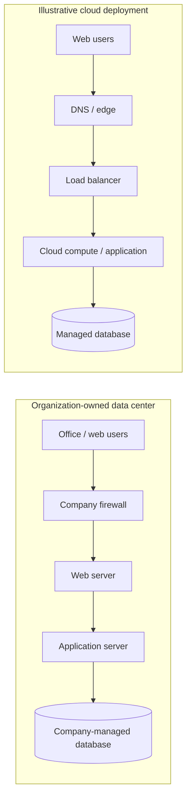
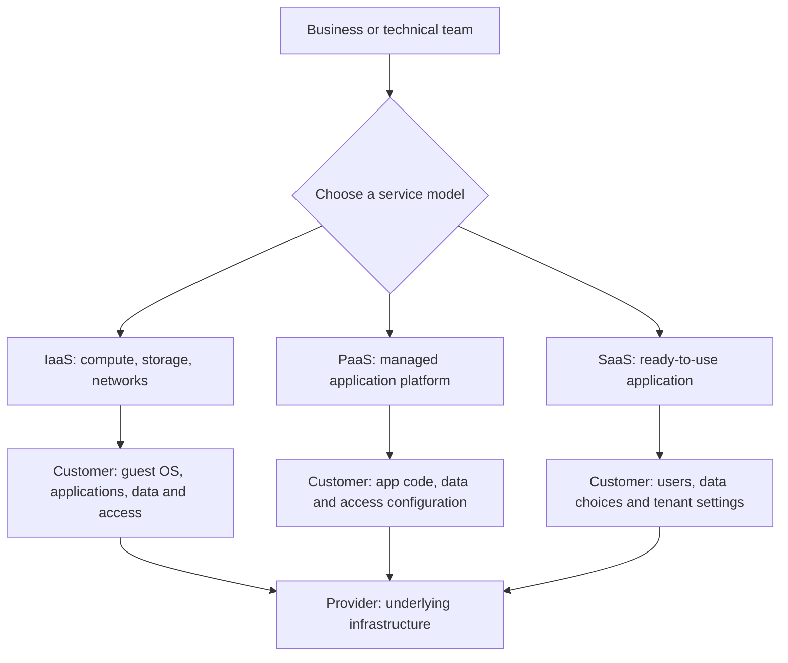
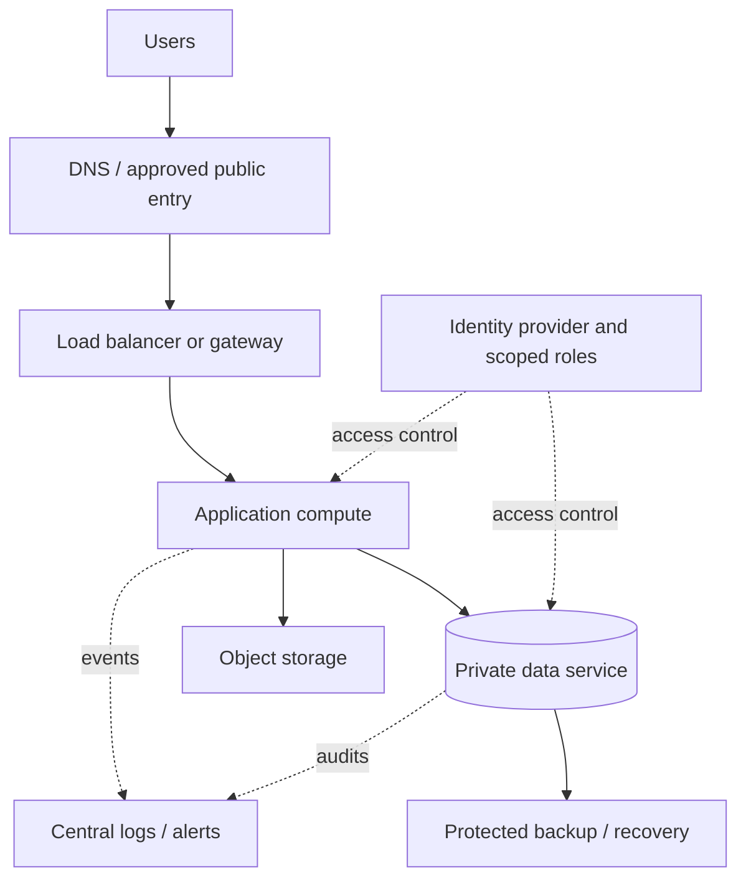

## Lesson Overview

Imagine you're starting a new company.

You need:

- Servers
- Storage
- Networking
- Firewalls
- Databases
- Backup Systems

Twenty years ago, you would have needed to:

- Purchase physical servers
- Rent data center space
- Install networking equipment
- Configure power and cooling
- Hire infrastructure engineers
- Wait weeks or months before launching your application

Today, the process is very different.

Within minutes, you can log in to a cloud platform like AWS, Microsoft Azure, or Google Cloud Platform and provision all of these resources with just a few clicks—or even automatically using code.

This transformation is called **Cloud Computing**.

Cloud Computing has changed the way organizations build, deploy, and manage applications by providing computing resources on demand over the Internet.

Whether you're pursuing a career in Cloud Engineering, DevOps, AI, Cybersecurity, or Software Development, understanding Cloud Computing is an essential first step.

---

## Learning Objectives

After completing this lesson, you will be able to:

- Understand Cloud Computing.
- Learn the evolution of computing.
- Understand cloud characteristics.
- Explore cloud service models.
- Understand deployment models.
- Learn cloud benefits and challenges.
- Explore common cloud use cases.
- Apply Cloud Computing concepts in enterprise environments.

---

## What is Cloud Computing?

Cloud Computing is the delivery of computing services over the Internet.

Instead of purchasing and maintaining physical infrastructure, organizations rent computing resources from cloud providers.

These resources include:

- Compute
- Storage
- Networking
- Databases
- Security
- Analytics
- Artificial Intelligence
- Machine Learning

Resources are available whenever they are needed and customers pay only for what they use.

---

## Evolution of Computing

Computing has evolved significantly over time.

```text
Mainframe Computing

↓

Client-Server Computing

↓

Virtualization

↓

Cloud Computing

↓

Serverless Computing

↓

AI Cloud Platforms
```

Cloud Computing represents the next major evolution in enterprise IT.

---

## Traditional IT Infrastructure

In traditional environments, organizations managed everything themselves.

```text
Company

↓

Data Center

↓

Servers

↓

Networking

↓

Applications

↓

Users
```

Challenges included:

- High capital costs
- Long deployment times
- Hardware maintenance
- Limited scalability
- Disaster recovery complexity

---

## Cloud Computing Model

Cloud providers manage the underlying infrastructure.

```text
Users

↓

Internet

↓

Cloud Provider

↓

Compute

Storage

Networking

Security

Applications
```

Organizations focus on their applications instead of managing physical hardware.

---

## Essential Characteristics of Cloud Computing

According to the National Institute of Standards and Technology (NIST), Cloud Computing has five essential characteristics.

They are:

- On-Demand Self-Service
- Broad Network Access
- Resource Pooling
- Rapid Elasticity
- Measured Service

These characteristics distinguish cloud environments from traditional infrastructure.

---

## On-Demand Self-Service

Users can provision computing resources whenever they need them.

Example:

A developer launches a virtual machine in minutes without contacting the IT department.

Automation accelerates software delivery.

---

## Broad Network Access

Cloud services are accessible over the Internet.

Users can connect using:

- Laptops
- Mobile Devices
- Tablets
- Thin Clients
- APIs

This enables global accessibility.

---

## Resource Pooling

Cloud providers share infrastructure across multiple customers while securely isolating workloads.

Resources include:

- CPU
- Memory
- Storage
- Networking

This model improves efficiency and reduces costs.

---

## Rapid Elasticity

Resources can automatically scale based on demand.

Example:

```text
100 Users

↓

1 Server

↓

10,000 Users

↓

Auto Scaling

↓

20 Servers
```

Organizations pay only for the resources they actually use.

---

## Measured Service

Cloud providers measure resource usage.

Examples include:

- CPU Hours
- Storage Used
- Data Transfer
- Database Requests
- API Calls

Billing is based on actual consumption.

---

## Benefits of Cloud Computing

Organizations adopt cloud technologies because they provide:

- Faster deployment
- Lower infrastructure costs
- High availability
- Global accessibility
- Automatic scaling
- Disaster recovery
- Improved security
- Continuous innovation

Cloud Computing enables businesses to innovate rapidly.

---

## Challenges of Cloud Computing

Despite its advantages, cloud adoption introduces challenges.

Common concerns include:

- Cost management
- Vendor lock-in
- Security
- Compliance
- Data privacy
- Skills shortages
- Governance

Understanding these challenges helps organizations adopt cloud technologies successfully.

---

## Cloud Service Models

Cloud providers offer different service models.

The three primary models are:

- Infrastructure as a Service (IaaS)
- Platform as a Service (PaaS)
- Software as a Service (SaaS)

These models will be explored in the following lessons.

---

## Cloud Deployment Models

Organizations deploy cloud environments in different ways.

Common deployment models include:

- Public Cloud
- Private Cloud
- Hybrid Cloud
- Multi-Cloud

Each model addresses different business requirements.

---

## Major Cloud Providers

The largest cloud providers include:

- Amazon Web Services (AWS)
- Microsoft Azure
- Google Cloud Platform (GCP)
- Oracle Cloud Infrastructure (OCI)
- IBM Cloud

Each provider offers a broad portfolio of cloud services.

---

## Common Cloud Services

Examples of cloud services include:

- Virtual Machines
- Object Storage
- Databases
- Networking
- Identity Management
- Artificial Intelligence
- Monitoring
- Security Services

These services form the foundation of cloud platforms.

---

## Cloud Computing in Everyday Life

Many everyday applications rely on cloud infrastructure.

Examples include:

- Netflix
- YouTube
- Gmail
- Microsoft 365
- Google Drive
- Dropbox
- Spotify
- Zoom

Cloud Computing powers billions of users worldwide.

---

## Cloud Computing in Business

Organizations use cloud platforms for:

- Website Hosting
- Enterprise Applications
- Disaster Recovery
- Data Analytics
- Artificial Intelligence
- DevOps Pipelines
- Cybersecurity Operations
- Business Continuity

Cloud technologies support organizations of every size.

---

## Cloud Computing in DevOps

DevOps Engineers use cloud platforms to:

- Deploy applications
- Automate infrastructure
- Build CI/CD pipelines
- Monitor workloads
- Scale applications

Cloud platforms accelerate software delivery.

---

## Cloud Computing in Cybersecurity

Security teams leverage cloud services for:

- Identity Management
- Security Monitoring
- Threat Detection
- Log Management
- Incident Response
- Compliance

Cloud-native security services simplify enterprise security operations.

---

## Cloud Computing in Artificial Intelligence

AI Engineers use cloud platforms for:

- Model Training
- GPU Computing
- Data Storage
- Machine Learning Services
- AI APIs
- Model Deployment

Cloud Computing enables scalable AI development.

---

## Cloud Computing Best Practices

Organizations should:

- Design for scalability.
- Automate infrastructure.
- Monitor resource usage.
- Secure identities.
- Enable backups.
- Apply least privilege.
- Optimize costs.
- Continuously review architectures.

Good cloud practices improve reliability and efficiency.

---

## Common Beginner Mistakes

Avoid:

- Launching resources without planning.
- Ignoring cloud costs.
- Misconfiguring permissions.
- Leaving unused resources running.
- Skipping backups.
- Assuming the cloud is automatically secure.

Cloud resources require proper planning and governance.

---

## Real-World Example

A startup launches a new web application.

Workflow:

```text
Developer

↓

Cloud Platform

↓

Virtual Servers

↓

Storage

↓

Database

↓

Load Balancer

↓

Users
```

Instead of spending months building a physical data center, the company deploys its entire infrastructure within hours using cloud services.

---

## Architecture workshop — Understand how cloud systems fit together

The diagrams below are **conceptual architectures**, not a prescription to deploy every service. Use them to recognize the service boundaries, identify the teams responsible for each layer and explain why cloud architecture differs from buying servers.

### Diagram 1 — Traditional data center versus a cloud application



**What this diagram shows:** Both designs serve users through an application and data tier. The difference is how the infrastructure is provided and operated. In the traditional example, an organization manages the physical environment and usually the operating systems. In a cloud design, the provider operates underlying infrastructure; the customer still owns many identity, application, data and configuration decisions.

**Why it matters at work:** A startup may need to serve unexpected traffic. A cloud platform can reduce the need to buy physical servers first, but engineers must still design authentication, backup, cost controls and fault tolerance.

**Security question:** Which tier contains customer information, who can administer it, and where would you collect audit evidence?

### Diagram 2 — IaaS, PaaS and SaaS responsibilities



**What this diagram shows:** A service model determines which layers the customer operates. IaaS offers flexibility and generally requires more OS-level work; PaaS reduces runtime administration; SaaS provides an application while leaving tenant configuration, user access and appropriate data-handling responsibilities with the customer.

**Why it matters at work:** A team may choose IaaS for specialized operating-system control, PaaS for a managed application runtime or SaaS for collaboration. “Managed” does not mean “secure by default for every customer configuration.” [Study IaaS in Lesson 02](/foundation/gohackerscloud-foundation/07-cloud-computing-fundamentals/02-iaas/).

### Diagram 3 — An enterprise cloud application and its operational controls



**What this diagram shows:** A real service also depends on identities, restricted data access, monitoring and recoverability. The dotted lines represent supporting controls and telemetry, not unrestricted application traffic. Not all services need to be provisioned for every project.

**Why it matters at work:** If the application stops serving requests, the team can separate an entry-point issue, application failure, database problem or capacity constraint. A security engineer asks whether IAM is scoped, logs arrive, backup restoration is tested and the data tier remains private.

### Workplace exercise — Design a learning portal

A fictional training platform wants to serve students around the world and preserve lesson progress securely. No cloud account or payment is required for this exercise.

1. Redraw Diagram 3 using your own labels for users, web application, database and logs.
2. Identify which component must accept public HTTPS requests and which must remain private.
3. Describe one expected-allow connection and one expected-deny connection.
4. Add a backup requirement and explain how the team would verify restoration.
5. Write down three likely cost drivers, such as compute hours, storage use and network transfer.

**Expected deliverable:** one readable architecture diagram, an access matrix with two flows, and a short operations/security review. Explain assumptions; do not present the fictional design as an actual customer deployment.

### Knowledge check

1. **Does using a managed database remove the need to control data access?**

   <details><summary>Suggested answer</summary>No. The provider generally operates more of the database infrastructure, but customer identities, permissions, data classification and workload configuration still need controls.</details>

2. **Why does an autoscaling group not guarantee a reliable application?**

   <details><summary>Suggested answer</summary>Scaling compute does not automatically address database limits, faulty code, network paths, identity restrictions, resilience or tested recovery.</details>

3. **What is the difference between a diagram and a tested architecture?**

   <details><summary>Suggested answer</summary>A diagram records design intent. Tests provide evidence that security, functional and recovery requirements hold in an actual, authorized environment.</details>

**Continue:** [IaaS foundations](/foundation/gohackerscloud-foundation/07-cloud-computing-fundamentals/02-iaas/) · [Shared responsibility](/foundation/gohackerscloud-foundation/07-cloud-computing-fundamentals/11-shared-responsibility/) · [GHC Labs overview](/ghc-labs/). Foundation remains free; hosted Academy labs have separate access terms.

---

# Key Takeaways

After completing this lesson, you should understand:

- Cloud Computing fundamentals.
- Evolution of computing.
- Essential cloud characteristics.
- Cloud service models.
- Deployment models.
- Benefits and challenges.
- Enterprise cloud use cases.
- Cloud best practices.

---

# Summary

Cloud Computing has fundamentally transformed modern IT by providing scalable, reliable, and on-demand access to computing resources over the Internet.

Organizations no longer need to purchase and maintain expensive physical infrastructure. Instead, they can focus on innovation while cloud providers manage the underlying technology.

A solid understanding of Cloud Computing forms the foundation for learning AWS, Microsoft Azure, Google Cloud Platform, Cloud Security, Kubernetes, DevOps, and Artificial Intelligence.

---

# Next Lesson

➡️ **Lesson 02 — Infrastructure as a Service (IaaS)**

In the next lesson, you'll explore **Infrastructure as a Service (IaaS)**, the cloud service model that provides virtual machines, networking, storage, and infrastructure resources on demand. You'll learn how organizations build scalable cloud environments without owning physical hardware.