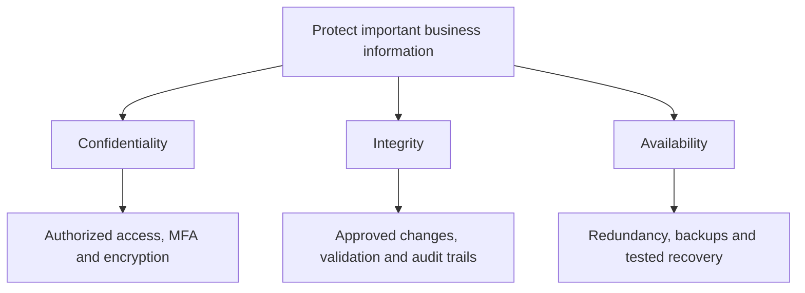
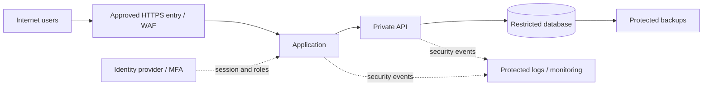
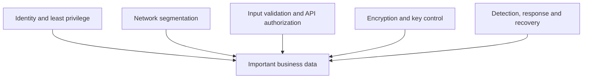

## Lesson Overview

Technology powers nearly every aspect of modern life.

Organizations rely on technology to:

- Store customer information
- Process financial transactions
- Deliver healthcare
- Operate cloud platforms
- Manage critical infrastructure
- Build Artificial Intelligence systems
- Support remote work

As technology grows, so do cyber threats.

Every day, organizations face attacks such as:

- Ransomware
- Data breaches
- Phishing
- Insider threats
- Cloud attacks
- Supply chain attacks
- Credential theft

Cybersecurity is no longer just an IT responsibility—it's a business responsibility.

The first step toward becoming a cybersecurity professional is developing the **Security Mindset**.

A Security Mindset means thinking beyond functionality and always asking:

> **"What could go wrong, and how can I protect against it?"**

This lesson introduces the mindset used by Security Engineers, Cloud Security Engineers, Penetration Testers, SOC Analysts, DevSecOps Engineers, and Security Architects around the world.

---

## Learning Objectives

After completing this lesson, you will be able to:

- Understand the Security Mindset.
- Learn why cybersecurity matters.
- Think like both an attacker and defender.
- Understand the CIA Triad.
- Recognize common security risks.
- Learn security principles used in enterprise environments.
- Understand ethical responsibilities.
- Prepare for advanced cybersecurity topics.

---

## What is a Security Mindset?

A Security Mindset is the habit of continuously evaluating systems for potential risks, weaknesses, and opportunities to improve security.

Instead of asking:

> "Does the application work?"

A security professional asks:

- Is it secure?
- Can it be abused?
- Can someone bypass authentication?
- What happens if a server fails?
- How is sensitive data protected?

Security becomes part of every decision.

---

## Why Cybersecurity Matters

Cyber attacks can lead to:

- Financial loss
- Business disruption
- Data breaches
- Legal penalties
- Reputational damage
- Loss of customer trust

Even small organizations are targeted by attackers.

Cybersecurity protects:

- People
- Data
- Applications
- Infrastructure
- Businesses
- Governments

---

## Think Like an Attacker

Professional attackers ask questions such as:

- Can I gain unauthorized access?
- Are passwords weak?
- Is software outdated?
- Can I exploit a vulnerability?
- Can I steal sensitive data?
- Can I remain undetected?

Understanding the attacker's mindset helps defenders build stronger security.

---

## Think Like a Defender

Defenders focus on:

- Preventing attacks.
- Detecting suspicious activity.
- Responding quickly.
- Recovering systems.
- Improving security continuously.

Every successful defense starts with understanding potential risks.

---

## Security is Everyone's Responsibility

Cybersecurity is not limited to security teams.

Every department contributes.

Examples include:

- Developers write secure code.
- Cloud Engineers secure infrastructure.
- System Administrators manage patches.
- Employees recognize phishing emails.
- Managers enforce security policies.
- Executives support security investments.

Security is a shared organizational responsibility.

---

## The Security Lifecycle

Enterprise security is a continuous process.

```text
Identify Assets

↓

Assess Risks

↓

Protect Systems

↓

Detect Threats

↓

Respond to Incidents

↓

Recover Operations

↓

Improve Security
```

Security is never "finished."

---

## Core Principles of Security

Professional security teams focus on:

- Confidentiality
- Integrity
- Availability
- Accountability
- Authentication
- Authorization
- Least Privilege

These principles appear throughout every cybersecurity discipline.

---

## Security in Modern IT

Security is integrated into:

- Cloud Computing
- DevOps
- Artificial Intelligence
- Networking
- Software Development
- Mobile Applications
- Containers
- Kubernetes

Modern cybersecurity protects every technology platform.

---

## Security Throughout the Software Lifecycle

Security should begin during planning—not after deployment.

```text
Plan

↓

Design

↓

Develop

↓

Test

↓

Deploy

↓

Monitor

↓

Improve
```

This approach is often called **Shift Left Security**.

---

## Security Mindset in Cloud Computing

Cloud Security Engineers ask:

- Is the storage bucket public?
- Are IAM permissions excessive?
- Is encryption enabled?
- Is Multi-Factor Authentication configured?
- Are logs being monitored?

Security begins before resources are deployed.

---

## Security Mindset in DevOps

DevSecOps integrates security into automation.

Examples include:

- Secure CI/CD Pipelines
- Code Scanning
- Dependency Scanning
- Container Security
- Infrastructure as Code Validation
- Automated Compliance Checks

Security becomes part of software delivery.

---

## Security Mindset in Artificial Intelligence

AI introduces new risks.

Security professionals protect:

- AI Models
- Training Data
- APIs
- Model Outputs
- Sensitive Information

Responsible AI requires strong security practices.

---

## Ethical Responsibility

Cybersecurity professionals must always act ethically.

Always:

- Follow laws and regulations.
- Obtain authorization before testing systems.
- Protect confidential information.
- Report security issues responsibly.
- Respect privacy.

Ethics are fundamental to every cybersecurity career.

---

## Enterprise Security Culture

Successful organizations promote:

- Security Awareness
- Continuous Learning
- Responsible Disclosure
- Collaboration
- Accountability
- Continuous Improvement

A strong security culture reduces organizational risk.

---

## Common Beginner Mistakes

Avoid:

- Thinking cybersecurity is only about hacking.
- Ignoring software updates.
- Reusing passwords.
- Assuming cloud providers secure everything.
- Sharing administrator accounts.
- Treating security as an afterthought.

Developing the right mindset prevents many common security failures.

---

## Enterprise Best Practices

Professional organizations:

- Build security into every project.
- Train employees regularly.
- Follow security frameworks.
- Implement Least Privilege.
- Enable Multi-Factor Authentication.
- Continuously monitor systems.
- Conduct security assessments.
- Learn from every security incident.

Security is a continuous journey rather than a one-time activity.

---

## Real-World Example

A company plans to launch a new cloud application.

Instead of focusing only on functionality, the security team asks:

```text
Who can access the application?

↓

How is data protected?

↓

What happens if credentials are stolen?

↓

How will attacks be detected?

↓

How will the system recover after an incident?
```

By thinking about security early, the organization reduces risk before deployment.

---

## Architecture workshop — Think in assets, boundaries and controls

Security is not a single firewall or a tool. An engineer begins by mapping **what matters**, **who can reach it**, **how it could fail** and **which observations would show a problem**. Use these diagrams as small models for reasoning; the controls shown are examples, not an automatically secure final design.

### Diagram 1 — The CIA triad and its purpose



**How to read it:** Confidentiality limits inappropriate disclosure. Integrity protects against unauthorized or unintended changes. Availability keeps information and systems usable when needed. A control can support more than one objective.

**Workplace example:** If an academic portal exposes student records, confidentiality is affected. If unauthorized edits change assessment results, integrity is affected. If the portal cannot be accessed before an exam, availability is affected.

**Question to ask:** Which of the three is most critical in your chosen scenario, and what evidence would show the safeguard actually works?

### Diagram 2 — Example enterprise web application trust boundaries



**What this diagram shows:** Public, application, service and data areas have different trust assumptions. HTTPS termination, access enforcement and monitoring must be designed for the actual workload. A WAF can filter supported HTTP traffic but does not replace secure API authorization. The dotted lines represent supporting identity or logging relationships rather than direct user requests.

**Why it matters at work:** A user may be legitimately logged in but still must not access another user's personal records. That is an **authorization** problem at the application/API layer, not something the public firewall can solve by itself.

**Security review prompts:** Is the database reachable directly from the Internet? Which identities can read sensitive records? Who reviews security alerts? Is recovery periodically tested?

### Diagram 3 — Security controls provide overlapping protection



**How to read it:** These are complementary layers, **not** a fixed sequence through which all attackers must pass. If one preventive control fails, other preventive or detective controls may reduce impact and improve response.

**Why it matters at work:** A stolen password might be blocked by MFA, restricted by narrow permissions, detected through unusual events or contained through an incident response procedure. No single layer guarantees safety.

### Practical assignment — A student-records portal

Use a hypothetical university portal, not any real institution's system.

1. List three assets: student records, staff sign-in and the portal's availability.
2. Draw a simplified trust-boundary diagram using Diagram 2 as a guide.
3. Identify one plausible risk for each CIA objective.
4. Choose one preventive and one detective control for the most important risk.
5. Write an **expected-deny** security test in plain language, such as “student A must not read student B's record.”
6. State who should review evidence and who may authorize a configuration change.

**Expected deliverable:** an asset–risk–control table, a readable architecture diagram and one short security verification plan. No scanning, attacking or account creation is required.

### Knowledge check with reasoning

1. **Why doesn't TLS alone protect a user's record from another logged-in user?**

   <details><summary>Suggested reasoning</summary>TLS protects the network channel. The application still needs correct authentication, session handling and per-record authorization.</details>

2. **What is a trust boundary?**

   <details><summary>Suggested reasoning</summary>A point where the level of trust, identity, ownership or permissions changes—for example, from a public request to a private API or database.</details>

3. **Are backups a preventive control against every cyberattack?**

   <details><summary>Suggested reasoning</summary>No. Backups chiefly support recovery and availability, and they must be protected and tested. Identity, access and detection controls remain necessary.</details>

**Continue:** [Lesson 02 — CIA Triad](/foundation/gohackerscloud-foundation/08-cybersecurity-fundamentals/02-cia-triad/) and [Defense in Depth](/foundation/gohackerscloud-foundation/08-cybersecurity-fundamentals/08-defense-in-depth/) for deeper explanations. When ready for authorized practice, explore [GHC Labs](/ghc-labs/) and [current subscription options](https://gohackerscloud.com/hands-on-cybersecurity-labs).

---

# Key Takeaways

After completing this lesson, you should understand:

- Security Mindset
- Attacker vs Defender Thinking
- Security Lifecycle
- Shared Responsibility
- Enterprise Security Culture
- Ethical Responsibilities
- Security Principles
- Security Across Cloud, DevOps, and AI

---

# Summary

A Security Mindset is the foundation of every successful cybersecurity career.

Rather than focusing only on how systems work, security professionals continuously evaluate how systems could fail, be misused, or be attacked—and how those risks can be reduced.

This way of thinking supports every cybersecurity discipline, including Cloud Security, DevSecOps, SOC Operations, Penetration Testing, Security Architecture, and Digital Forensics.

Developing this mindset early will help you build secure systems, protect organizations, and become a trusted cybersecurity professional.

---

# Next Lesson

➡️ **Lesson 02 — CIA Triad**

In the next lesson, you'll learn about the **CIA Triad**—Confidentiality, Integrity, and Availability—the three foundational principles that guide every cybersecurity strategy, security control, and enterprise security program.