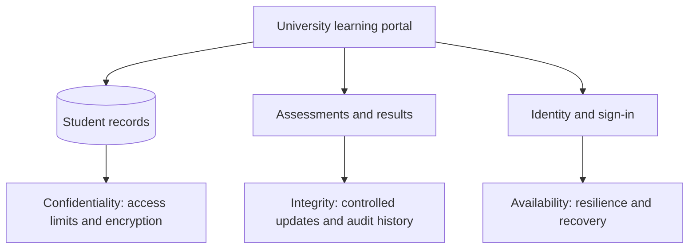

## Lesson Overview

Imagine an online banking application.

Customers expect that:

- Their account information remains private.
- Their account balances cannot be modified without authorization.
- The banking application is available whenever they need it.

If any one of these expectations fails, the business may experience:

- Financial loss
- Regulatory penalties
- Loss of customer trust
- Service disruption
- Reputation damage

Cybersecurity professionals use a simple but powerful framework to protect information systems.

This framework is known as the **CIA Triad**.

The CIA Triad consists of:

- **Confidentiality**
- **Integrity**
- **Availability**

Every security control, policy, and technology ultimately supports one or more of these three principles.

Whether you're protecting cloud environments, enterprise applications, Kubernetes clusters, or AI systems, the CIA Triad forms the foundation of cybersecurity.

---

## Learning Objectives

After completing this lesson, you will be able to:

- Understand the CIA Triad.
- Explain Confidentiality, Integrity, and Availability.
- Identify security controls supporting each principle.
- Apply the CIA Triad to enterprise systems.
- Understand real-world examples.
- Recognize threats affecting each principle.
- Apply enterprise security best practices.

---

## What is the CIA Triad?

The **CIA Triad** is a security model that defines the three primary objectives of information security.

```text
Confidentiality

↓

Integrity

↓

Availability
```

Together, these principles guide the design, implementation, and operation of secure systems.

---

## Why the CIA Triad Matters

Every cybersecurity decision should support at least one of these objectives.

The CIA Triad helps organizations:

- Protect sensitive information.
- Maintain accurate data.
- Ensure systems remain operational.
- Meet compliance requirements.
- Reduce business risk.

It serves as the foundation for enterprise security programs.

---

## Confidentiality

### Definition

Confidentiality ensures that information is accessible **only to authorized users**.

Sensitive information should never be disclosed to unauthorized individuals.

Examples include:

- Customer records
- Financial information
- Medical records
- Passwords
- Encryption keys
- Intellectual property

---

## Threats to Confidentiality

Common threats include:

- Data breaches
- Insider threats
- Phishing
- Credential theft
- Misconfigured cloud storage
- Weak passwords

Any unauthorized disclosure of information violates confidentiality.

---

## Security Controls for Confidentiality

Organizations protect confidentiality using:

- Encryption
- Multi-Factor Authentication (MFA)
- Identity & Access Management (IAM)
- Role-Based Access Control (RBAC)
- Least Privilege
- Data Classification
- Data Loss Prevention (DLP)

These controls ensure only authorized users access sensitive information.

---

## Real-World Example — Confidentiality

A hospital stores patient medical records.

Only:

- Doctors
- Nurses
- Authorized Administrators

can access patient information.

Unauthorized employees are denied access.

This protects patient confidentiality.

---

## Integrity

### Definition

Integrity ensures that information remains:

- Accurate
- Complete
- Reliable
- Unmodified unless properly authorized

Users must be able to trust the data they use.

---

## Threats to Integrity

Examples include:

- Unauthorized data modification
- Malware
- SQL Injection
- Insider attacks
- File corruption
- Human error

Even accidental changes can compromise data integrity.

---

## Security Controls for Integrity

Organizations protect integrity through:

- Hashing
- Digital Signatures
- Checksums
- Version Control
- Audit Logs
- File Integrity Monitoring

These controls help detect unauthorized changes.

---

## Real-World Example — Integrity

An employee's salary information is stored in an HR database.

Only authorized HR personnel may update salary records.

Every change is logged and verified.

This ensures the integrity of employee data.

---

## Availability

### Definition

Availability ensures that systems and data remain accessible whenever authorized users need them.

Critical systems should remain operational even during failures or cyberattacks.

---

## Threats to Availability

Examples include:

- Denial of Service (DoS)
- Distributed Denial of Service (DDoS)
- Hardware failures
- Power outages
- Ransomware
- Natural disasters

Any event preventing legitimate access affects availability.

---

## Security Controls for Availability

Organizations improve availability using:

- Backups
- Disaster Recovery
- Load Balancers
- Auto Scaling
- High Availability
- Redundant Infrastructure
- Monitoring
- Incident Response

These controls minimize downtime.

---

## Real-World Example — Availability

An online shopping platform experiences heavy traffic during a holiday sale.

Auto Scaling launches additional servers automatically.

Load Balancers distribute traffic evenly.

Customers continue shopping without interruption.

Availability is maintained.

---

## Understanding the CIA Triad Together

Consider an online banking system.

#### Confidentiality

Only customers can view their accounts.

#### Integrity

Transactions cannot be modified without authorization.

#### Availability

Customers can access online banking 24/7.

All three principles work together to secure the application.

---

## CIA Triad in Cloud Computing

Cloud Engineers apply the CIA Triad by:

- Encrypting cloud storage.
- Using IAM and Least Privilege.
- Enabling backups.
- Designing highly available architectures.
- Monitoring cloud environments.

The CIA Triad is integrated into cloud architecture design.

---

## CIA Triad in DevOps

DevSecOps teams protect:

#### Confidentiality

Secrets Management

#### Integrity

Code Signing

Pipeline Validation

#### Availability

CI/CD Redundancy

Automated Recovery

Security becomes part of the software development lifecycle.

---

## CIA Triad in Artificial Intelligence

AI platforms require:

#### Confidentiality

Protect training datasets.

#### Integrity

Prevent model tampering.

#### Availability

Ensure AI services remain accessible.

As AI adoption grows, these principles become increasingly important.

---

## CIA Triad in Enterprise Security

Enterprise security teams use the CIA Triad when designing:

- Identity Management
- Security Monitoring
- Cloud Security
- Network Security
- Data Protection
- Compliance Programs

The CIA Triad influences every security decision.

---

## Common Beginner Mistakes

Avoid:

- Focusing only on confidentiality.
- Ignoring backups.
- Using excessive permissions.
- Forgetting to verify data integrity.
- Assuming availability only means uptime.
- Neglecting disaster recovery planning.

All three principles are equally important.

---

## Enterprise Best Practices

Professional organizations:

- Encrypt sensitive data.
- Apply Least Privilege.
- Enable Multi-Factor Authentication.
- Monitor systems continuously.
- Implement backups and disaster recovery.
- Validate data integrity.
- Perform regular security assessments.
- Test business continuity plans.

These practices strengthen confidentiality, integrity, and availability.

---

## Real-World Enterprise Scenario

A financial institution protects its online banking platform.

```text
Customers

↓

Identity & MFA

↓

Encrypted Application

↓

Database

↓

Backups

↓

Disaster Recovery Site

↓

Continuous Monitoring
```

This architecture protects:

- Confidentiality through encryption and IAM.
- Integrity through audit logs and validation.
- Availability through redundancy and disaster recovery.

---

## Security architecture exercise — CIA objectives in a learning portal



**What this diagram shows:** Security priorities depend on the business asset. Confidentiality, integrity and availability can each apply to *all* assets; the arrows highlight one illustrative priority per component, not a hard rule.

**Workplace example:** A student can read their own grade but not another student's records. Authorized faculty can change grades through an approved workflow, and the service should remain available during exam periods.

### Practise mapping controls to evidence

1. **Confidentiality:** write an expected-deny test for student A attempting to access student B's record. Do not attempt this against a real school system.
2. **Integrity:** describe how an authorized grade correction should be logged and later verified.
3. **Availability:** propose a safe disaster recovery tabletop scenario and a restore-validation criterion.

| Goal | Control category | Evidence to collect |
|---|---|---|
| Confidentiality | Authentication and per-record authorization | Denied test for an unauthorized identity |
| Integrity | Role approvals and change records | Authorized change audit trail |
| Availability | Monitored service and tested recovery | Recovery walkthrough against stated objective |

**Expected deliverable:** an asset–control–evidence table. This is a free, scenario-based exercise requiring no production access or subscription.

---

## Key Takeaways

After completing this lesson, you should understand:

- CIA Triad
- Confidentiality
- Integrity
- Availability
- Security Controls
- Enterprise Applications
- Cloud Security
- DevSecOps
- AI Security
- Enterprise Best Practices

---

## Summary

The CIA Triad is the foundation of modern cybersecurity.

Confidentiality protects sensitive information, Integrity ensures data remains accurate and trustworthy, and Availability keeps systems operational for authorized users.

Every security technology—from encryption and IAM to backups, monitoring, and disaster recovery—supports one or more of these three principles.

A solid understanding of the CIA Triad prepares you for advanced topics in Cloud Security, Network Security, DevSecOps, Security Operations, Digital Forensics, and Enterprise Security Architecture.

---

## Next Lesson

➡️ **Lesson 03 — Risk Management**

In the next lesson, you'll learn how organizations identify, assess, prioritize, and manage cybersecurity risks. You'll explore risk assessment methodologies, risk treatment strategies, business impact analysis, and enterprise risk management practices used across modern organizations.