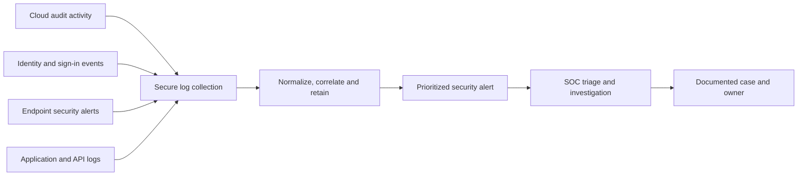
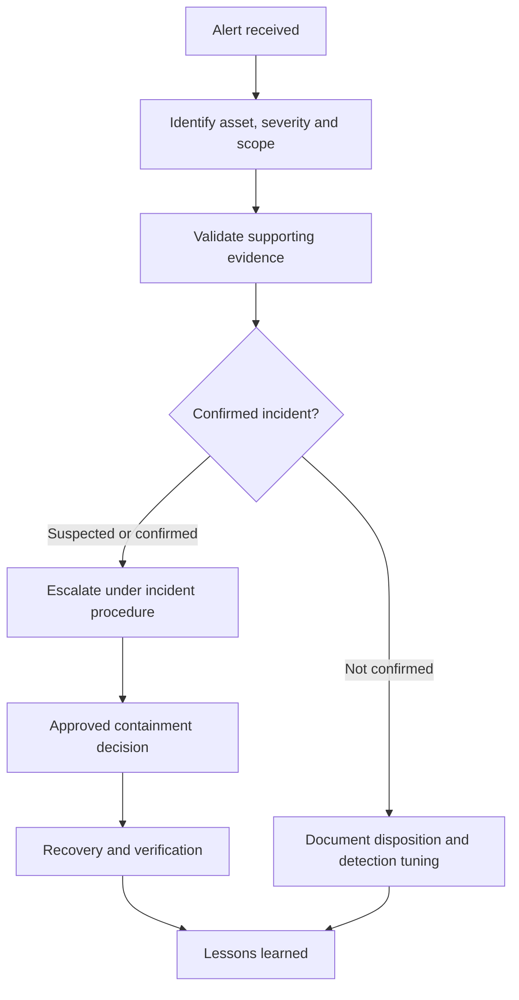
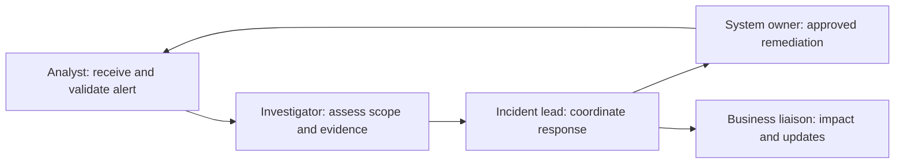

## Lesson Overview

Imagine you are working as a **Cloud Security Engineer** at **CloudNova Technologies**.

At 2:15 AM, the company's monitoring platform generates multiple alerts:

- Failed administrator login attempts
- Suspicious API calls
- Malware detected on an endpoint
- Large outbound data transfer
- Privileged IAM role modification

Someone must quickly determine:

- Is this a real attack?
- Which systems are affected?
- Has data been compromised?
- Should incident response begin?

This responsibility belongs to the **Security Operations Center (SOC).**

A SOC continuously monitors an organization's infrastructure, detects threats, investigates suspicious activity, and coordinates incident response to minimize business impact.

Whether protecting cloud infrastructure, enterprise networks, or web applications, the SOC serves as the organization's cybersecurity command center.

---

## Learning Objectives

After completing this lesson, you will be able to:

- Understand Security Operations Centers (SOC).
- Learn the purpose of enterprise SOCs.
- Explore SOC roles and responsibilities.
- Understand SOC operating models.
- Learn SOC technologies.
- Explore SOC workflows.
- Understand modern SOC architecture.
- Apply enterprise SOC best practices.

---

## What is a Security Operations Center?

A **Security Operations Center (SOC)** is a centralized team responsible for continuously monitoring, detecting, investigating, and responding to cybersecurity threats.

The SOC operates 24×7 to protect:

- Cloud Infrastructure
- Corporate Networks
- Endpoints
- Web Applications
- APIs
- Identity Systems
- Critical Business Assets

---

## Why SOCs Matter

Enterprise SOCs help organizations:

- Detect attacks quickly
- Reduce incident response time
- Minimize business disruption
- Improve visibility
- Meet compliance requirements
- Protect sensitive information
- Monitor cloud environments
- Improve overall security posture

---

## Primary Responsibilities

SOC teams perform activities including:

- Security Monitoring
- Threat Detection
- Alert Triage
- Incident Investigation
- Threat Hunting
- Malware Analysis
- Digital Forensics
- Incident Response
- Vulnerability Monitoring
- Security Reporting

---

## SOC Operating Models

Organizations may operate:

| Model | Description |
|---------|-------------|
| Internal SOC | Built and managed by the organization |
| Managed SOC (MSSP) | Outsourced to a third-party provider |
| Hybrid SOC | Shared responsibilities between internal teams and providers |
| Global SOC | Multiple SOCs operating across different regions |

The choice depends on business size, budget, and operational requirements.

---

## SOC Team Structure

A typical enterprise SOC includes:

- SOC Manager
- Tier 1 Analyst (Alert Monitoring)
- Tier 2 Analyst (Incident Investigation)
- Tier 3 Analyst (Advanced Threat Analysis)
- Incident Responder
- Threat Hunter
- Malware Analyst
- Digital Forensics Specialist
- Security Engineer
- Security Architect

Each role contributes to the organization's ability to detect and respond to cyber threats.

---

## SOC Workflow

```text
Security Logs

↓

Monitoring

↓

Alert Generated

↓

Alert Triage

↓

Investigation

↓

Containment

↓

Eradication

↓

Recovery

↓

Lessons Learned
```

This workflow forms the foundation of modern incident response operations.

---

## Security Data Sources

A SOC collects telemetry from:

- Firewalls
- Endpoint Detection & Response (EDR)
- Cloud Platforms
- Identity Providers
- Web Application Firewalls (WAF)
- Network Devices
- Servers
- Kubernetes Clusters
- SaaS Applications
- APIs

Centralized visibility improves threat detection.

---

## Core SOC Technologies

Modern SOCs commonly use:

- SIEM Platforms
- SOAR Platforms
- EDR/XDR Solutions
- Threat Intelligence Platforms
- Ticketing Systems
- Vulnerability Management Tools
- Digital Forensics Tools
- Cloud Security Monitoring Platforms

These technologies work together to provide comprehensive security monitoring.

---

## SOC in Cloud Environments

Cloud SOC teams monitor services such as:

#### AWS

- CloudTrail
- GuardDuty
- Security Hub
- Detective
- Config
- IAM
- VPC Flow Logs

#### Microsoft Azure

- Microsoft Defender for Cloud
- Azure Monitor
- Microsoft Sentinel

#### Google Cloud

- Security Command Center
- Cloud Logging
- Cloud Monitoring

---

## Common Enterprise Use Cases

SOC teams investigate:

- Account Compromise
- Malware Infections
- Phishing Campaigns
- Ransomware
- Insider Threats
- Data Exfiltration
- Privilege Escalation
- Cloud Misconfigurations
- API Abuse
- Suspicious Administrative Activity

---

## Common Beginner Mistakes

Avoid:

- Ignoring low-severity alerts.
- Closing alerts without investigation.
- Failing to document incidents.
- Monitoring only on-premises systems.
- Ignoring cloud telemetry.
- Not validating alert sources.

Effective SOC operations require consistent monitoring and thorough investigation.

---

## Enterprise Best Practices

Professional organizations:

- Operate 24×7 monitoring.
- Centralize security logging.
- Automate repetitive tasks using SOAR.
- Integrate threat intelligence.
- Continuously tune detection rules.
- Conduct regular threat hunting.
- Measure response metrics (MTTD and MTTR).
- Perform post-incident reviews.

These practices improve detection accuracy and response efficiency.

---

## Real-World Example

CloudNova Technologies operates a hybrid SOC.

```text
Cloud Infrastructure

↓

Security Logs

↓

SIEM

↓

Alert Correlation

↓

SOC Analyst

↓

Incident Investigation

↓

Incident Response Team

↓

Recovery

↓

Lessons Learned
```

The SOC continuously monitors enterprise systems, enabling rapid detection and response to cyber threats.

---

## Architecture workshop — How a modern SOC operates

A Security Operations Center is a **people, process and technology capability**. A SIEM can help collect and correlate telemetry, but the SOC must still decide whether an alert is meaningful, who is accountable and how to respond without creating unnecessary disruption.

### Diagram 1 — Enterprise telemetry to security investigation



**What this shows:** Signals originate in different systems, pass through controlled ingestion and correlation, and become evidence for an analyst. Logging coverage, data quality, retention and alert ownership are separate responsibilities. An alert is a **hypothesis requiring investigation**, not proof of compromise.

**Real work:** A support engineer receives an identity alert after a deployment. The SOC compares the change window, sign-in context, identity privileges and subsequent actions before classifying the event.

### Diagram 2 — A safe incident decision path



**Why this matters:** A false positive and a verified incident should not trigger the same destructive action. Triage documents facts and uncertainties; approved responders contain the issue; recovery requires validation. Do not delete an affected system merely to clear an alert.

### Diagram 3 — Responsibilities and handoffs



**What this shows:** Role boundaries are about **accountability**, not a universal job-title hierarchy. Smaller organizations may combine roles. Technical owners implement changes, incident leads coordinate decisions and business stakeholders receive factual impact updates.

### Free self-study — A synthetic privileged-access alert

Assume a fictional organization has a security alert at 02:15 showing a privileged role was used from an unfamiliar network. You have these **invented** details:

| Field | Example observation |
|---|---|
| Alert | Privileged role assumption outside change window |
| User | automation-deploy-role |
| Time | 02:15 UTC |
| Change ticket | Not yet confirmed |
| Related events | Three configuration reads, one denied write |
| Business impact | Unknown; no disruption confirmed |

1. Write three **facts** and three **unanswered questions**.
2. Identify the system owner and the next safe evidence source.
3. Draft a short escalation message: scope, observation, priority, uncertainty and next action.
4. List evidence you would preserve and a reason not to immediately revoke all production identities.

**Expected deliverable:** a one-page SOC triage note and escalation path. It is not a real customer alert and does not require access to a SIEM.

### Knowledge check

1. **Can a SIEM alert alone establish that an account has been compromised?**

   <details><summary>Suggested answer</summary>No. The alert must be validated against identity context, authorized activity, supporting events and other evidence.</details>

2. **Why should a responder distinguish detection from containment?**

   <details><summary>Suggested answer</summary>Detection signals a possible problem; containment changes system state and requires severity assessment, authority, coordination and evidence preservation.</details>

3. **Who should approve a risky action during an incident?**

   <details><summary>Suggested answer</summary>The designated incident authority and service owner under the organization's approved response procedure, with escalation as needed.</details>

**Continue:** [Enterprise SIEM](/foundation/gohackerscloud-foundation/12-enterprise-security-operations/03-security-information-and-event-management-siem/) · [Vulnerability Management](/foundation/gohackerscloud-foundation/12-enterprise-security-operations/05-vulnerability-management/) · [GHC Labs overview](/ghc-labs/). Advanced hosted labs have separate terms.

---

## Key Takeaways

After completing this lesson, you should understand:

- Security Operations Center (SOC)
- SOC Roles
- SOC Operating Models
- Security Monitoring
- Alert Triage
- Incident Investigation
- SOC Technologies
- Cloud SOC Operations
- Enterprise Security Monitoring
- SOC Best Practices

---

## Summary

A Security Operations Center (SOC) is the operational heart of an organization's cybersecurity program. By continuously monitoring systems, analyzing security events, investigating incidents, and coordinating responses, SOC teams help organizations reduce risk and maintain business continuity.

Understanding SOC operations is a foundational skill for Cloud Security Engineers, SOC Analysts, Incident Responders, Threat Hunters, Security Engineers, and Security Architects responsible for defending modern enterprise environments.

---

## Next Lesson

➡️ **Lesson 02 — Enterprise Logging & Monitoring**

In the next lesson, you'll learn how enterprise organizations collect, centralize, retain, and analyze logs from cloud platforms, endpoints, applications, networks, and identity systems to support threat detection, incident investigation, compliance, and security operations.