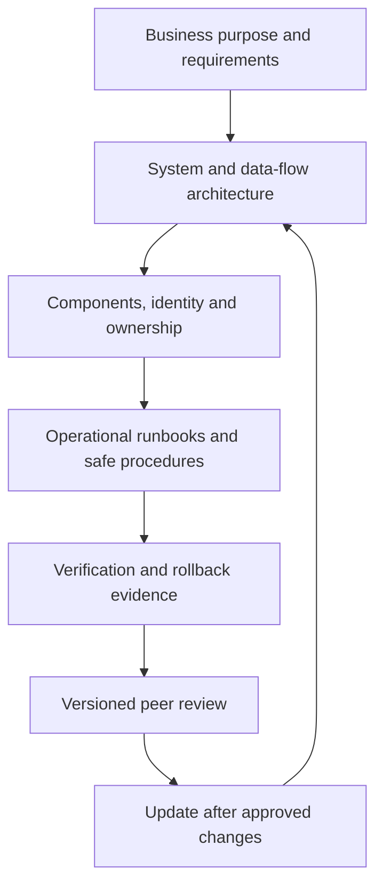
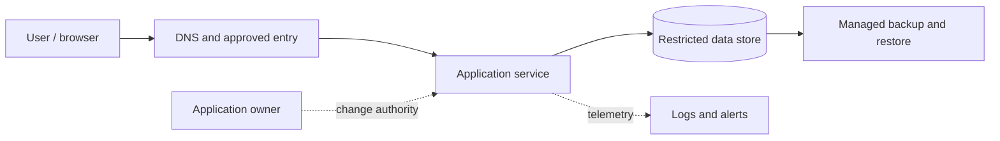
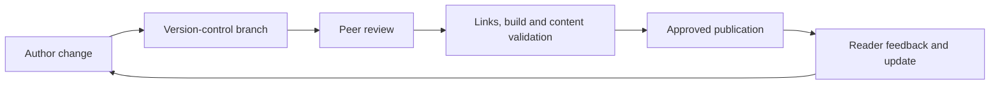

## Lesson Overview

Imagine you've joined **CloudNova Technologies** as a **Cloud Security Engineer**.

Your manager asks you to investigate why a production Kubernetes cluster stopped processing customer requests overnight.

You open the project repository and discover:

- No architecture diagram
- No deployment guide
- No runbook
- No infrastructure documentation
- No troubleshooting guide
- No network diagram

The engineer who built the platform left the company six months ago.

Although the infrastructure still exists, nobody understands how it works.

After several hours of investigation, the team finally restores the environment.

The outage wasn't caused by technology.

It was caused by **poor documentation**.

Enterprise organizations invest heavily in technical documentation because knowledge should remain with the organization—not with individuals.

Good documentation enables engineers to deploy faster, troubleshoot efficiently, reduce operational risk, and transfer knowledge across teams.

---

## Learning Objectives

After completing this lesson, you will be able to:

- Understand technical documentation.
- Learn why documentation is important.
- Explore different documentation types.
- Understand architecture documentation.
- Learn operational documentation.
- Explore knowledge management.
- Understand documentation lifecycle.
- Apply enterprise documentation best practices.

---

## What is Technical Documentation?

**Technical Documentation** is structured information that describes systems, infrastructure, applications, processes, and operational procedures.

It enables engineers to:

- Understand systems
- Deploy environments
- Troubleshoot issues
- Perform maintenance
- Share knowledge
- Maintain consistency

Documentation is an essential part of enterprise engineering.

---

## Why Documentation Matters

Organizations create documentation to:

- Reduce operational risk
- Preserve organizational knowledge
- Improve collaboration
- Support onboarding
- Accelerate troubleshooting
- Standardize processes
- Meet compliance requirements
- Improve business continuity

Well-maintained documentation saves significant time during incidents and operational activities.

---

## Characteristics of Good Documentation

Professional documentation should be:

- Accurate
- Complete
- Easy to understand
- Consistently formatted
- Version controlled
- Regularly updated
- Searchable
- Accessible

Clear documentation improves engineering efficiency.

---

## Common Types of Documentation

Enterprise organizations maintain:

- System Documentation
- Network Documentation
- Cloud Architecture Documentation
- Security Documentation
- API Documentation
- Infrastructure Documentation
- User Documentation
- Operational Documentation

Each serves a different audience and purpose.

---

## Architecture Documentation

Architecture documentation typically includes:

- Solution Architecture
- Network Diagrams
- Security Architecture
- Data Flow Diagrams
- Identity Architecture
- Cloud Architecture
- Kubernetes Architecture

Architecture documentation explains how systems are designed and connected.

---

## Operational Documentation

Operational teams commonly create:

- Standard Operating Procedures (SOPs)
- Runbooks
- Playbooks
- Deployment Guides
- Recovery Procedures
- Maintenance Guides

These documents ensure consistent execution of operational tasks.

---

## Runbooks

A **Runbook** provides step-by-step instructions for performing operational activities.

Examples include:

- Restarting Services
- Restoring Backups
- Deploying Infrastructure
- Rotating Certificates
- Recovering Kubernetes Clusters

Runbooks reduce operational errors during high-pressure situations.

---

## Standard Operating Procedures (SOPs)

SOPs document repeatable business and operational processes.

Examples:

- User Provisioning
- Patch Management
- Backup Verification
- Change Management
- Vulnerability Reviews

SOPs improve consistency across teams.

---

## Knowledge Base

Organizations maintain centralized knowledge bases containing:

- Troubleshooting Guides
- Frequently Asked Questions
- Lessons Learned
- Technical Standards
- Best Practices
- Internal Documentation

Knowledge bases reduce duplicated effort and improve self-service.

---

## Infrastructure Documentation

Infrastructure documentation should describe:

- Servers
- Virtual Machines
- Cloud Resources
- Networks
- Firewalls
- Load Balancers
- Storage
- Kubernetes Clusters

This information supports operations, security, and disaster recovery.

---

## Security Documentation

Security teams maintain:

- Security Policies
- Incident Response Plans
- Risk Assessments
- Security Standards
- Audit Reports
- Compliance Documentation

These documents support governance and regulatory requirements.

---

## Documentation Lifecycle

```text
Create

↓

Review

↓

Approve

↓

Publish

↓

Use

↓

Maintain

↓

Update

↓

Archive
```

Documentation should evolve as systems and processes change.

---

## Documentation in Cloud Computing

Cloud documentation commonly includes:

#### AWS

- Architecture Diagrams
- IAM Designs
- VPC Layouts
- CloudFormation Documentation
- Disaster Recovery Plans

#### Microsoft Azure

- Landing Zone Documentation
- Resource Architecture
- Network Design

#### Google Cloud

- Project Structure
- Security Architecture
- Deployment Documentation

Cloud environments should always be accompanied by accurate documentation.

---

## Documentation in DevSecOps

DevSecOps teams document:

- CI/CD Pipelines
- Infrastructure as Code
- Security Controls
- Container Registries
- Kubernetes Deployments
- Automation Workflows

Documentation supports collaboration and repeatable deployments.

---

## Version Control

Documentation should be stored alongside source code whenever possible.

Benefits include:

- Version History
- Change Tracking
- Collaboration
- Peer Review
- Rollback Capability

Git-based documentation has become an enterprise best practice.

---

## Common Documentation Mistakes

Avoid:

- Outdated documents
- Missing diagrams
- No ownership
- Inconsistent formatting
- Missing revision history
- Overly complex explanations
- Undocumented changes

Poor documentation increases operational risk.

---

## Enterprise Best Practices

Professional organizations:

- Document every production system.
- Keep architecture diagrams current.
- Maintain version-controlled documentation.
- Assign documentation owners.
- Review documentation regularly.
- Standardize templates.
- Record lessons learned after incidents.
- Integrate documentation into change management.

These practices improve knowledge sharing and operational resilience.

---

## Real-World Example

CloudNova Technologies stores engineering documentation in a centralized documentation platform.

```text
Cloud Infrastructure

↓

Architecture Diagrams

↓

Runbooks

↓

SOPs

↓

Knowledge Base

↓

Version Control

↓

Engineering Teams

↓

Operations

↓

Incident Response
```

When a production issue occurs, engineers immediately access current documentation, reducing troubleshooting time and improving service restoration.

---

## Architecture workshop — Documentation that engineers can use

Professional documentation is not a long list of screenshots. It should explain **what a system does, how it is connected, who owns it, how to change it safely and what to do when it fails**. Well-maintained docs reduce onboarding risk and allow teams to make decisions without relying on a single person's memory.

### Diagram 1 — Document a system from purpose to operations



**How to read it:** A useful document describes the service in business terms, draws the system boundaries, lists dependencies, and explains what operators can verify. Documentation must be updated when a change invalidates an assumption. Diagram-only documentation is not enough if no one knows who owns the system.

### Diagram 2 — Example application architecture for a runbook



**What it shows:** The user's request path, the private data dependency and supporting operational controls. Dotted links show ownership or telemetry relationships; they are not necessarily network requests.

**Real-world use:** When a service appears down, an engineer should identify the first failing component, inspect health and relevant logs, and escalate to the correct owner. A trustworthy diagram reduces speculative changes.

### Diagram 3 — Documentation-as-code review loop



**How it works:** Markdown in Git can be reviewed alongside code, but documentation also needs technical ownership, periodic review and tested instructions. Publishing a page successfully does not prove that its commands or operational procedures are correct.

### Guided exercise — Write an operational quick-start

Use a *fictional* employee portal. No live system access is needed.

1. Define audience (junior support engineer), purpose and application owner.
2. Draw the system in Diagram 2 with a public entry and a restricted database.
3. Write a five-step **read-only** troubleshooting procedure: symptoms, scope, status, logging and escalation.
4. Add a **rollback and safety note**: which actions require approval, and what evidence should be preserved?
5. Add a document version, review date and assumptions. Explain how changes would be reviewed.

**Expected deliverable:** a one-page system diagram plus a reviewable runbook. Include a section titled “What this document does not cover” rather than pretending to know unverified production details.

### Knowledge check

1. **Why can't an architecture diagram replace a runbook?**

   <details><summary>Suggested answer</summary>A diagram shows components and relationships; a runbook gives authorized, tested steps and conditions for operational decisions.</details>

2. **What makes a screenshot inadequate as the only evidence of a tested procedure?**

   <details><summary>Suggested answer</summary>It may lack environment, timestamp, scope, command, expected result, verification and limitations.</details>

3. **Why is documentation review part of engineering change management?**

   <details><summary>Suggested answer</summary>Changes may invalidate diagrams, access paths and recovery steps. Versioned review keeps operational knowledge aligned with the deployed system.</details>

**Continue:** [Professional Report Writing](/foundation/gohackerscloud-foundation/13-professional-skills/02-report-writing/) · [IT Interview Preparation](/learning-hub/it-interview/) · [GHC Labs overview](/ghc-labs/). Use only authorized and sanitized evidence when documenting exercises.

---

## Key Takeaways

After completing this lesson, you should understand:

- Technical Documentation
- Documentation Types
- Architecture Documentation
- Runbooks
- Standard Operating Procedures (SOPs)
- Knowledge Bases
- Documentation Lifecycle
- Version Control
- Cloud Documentation
- Enterprise Documentation Best Practices

---

## Summary

Technical documentation is a critical component of enterprise engineering. It enables organizations to preserve knowledge, improve collaboration, standardize operations, accelerate troubleshooting, and reduce operational risk.

Mastering documentation practices is an essential skill for Cloud Engineers, Cloud Security Engineers, DevSecOps Engineers, Security Architects, Infrastructure Engineers, Site Reliability Engineers (SREs), and cybersecurity professionals working in modern enterprise environments.

---

## Next Lesson

➡️ **Lesson 02 — Report Writing**

In the next lesson, you'll learn how to write professional technical reports, vulnerability assessment reports, incident reports, audit findings, executive summaries, and security recommendations that effectively communicate technical information to both technical and business stakeholders.                                                                                                                                                       