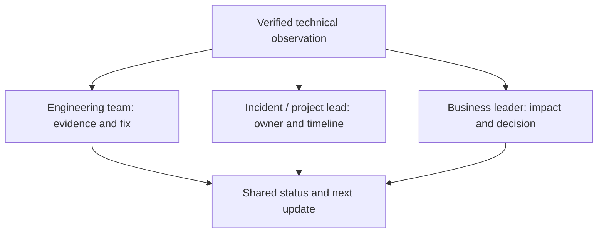

## Lesson Overview

Imagine you've recently joined **CloudNova Technologies** as a **Cloud Security Engineer**.

During a routine security review, you discover:

- An Internet-facing Kubernetes Dashboard
- Administrator accounts without MFA
- Multiple critical vulnerabilities
- Public cloud storage buckets
- Weak firewall rules

The technical solution is straightforward.

However, the real challenge is communicating the issue effectively.

You must explain the risks to:

- Infrastructure Engineers
- Application Developers
- Project Managers
- Executives
- Compliance Teams
- Customers

Each audience requires a different communication style.

Technical knowledge alone isn't enough to become a successful engineer.

The ability to communicate clearly, professionally, and confidently is one of the most valuable skills in enterprise IT.

---

## Learning Objectives

After completing this lesson, you will be able to:

- Understand professional communication.
- Learn verbal and written communication techniques.
- Communicate with technical and non-technical audiences.
- Improve meeting and presentation skills.
- Write professional emails.
- Communicate during incidents.
- Handle difficult conversations professionally.
- Apply enterprise communication best practices.

---

## Why Communication Matters

Strong communication helps organizations:

- Resolve incidents faster.
- Reduce misunderstandings.
- Improve teamwork.
- Increase customer confidence.
- Improve project delivery.
- Strengthen leadership.
- Support business decision-making.

Many security incidents become worse because of poor communication rather than technical failures.

---

## Types of Communication

Enterprise communication generally includes:

- Verbal Communication
- Written Communication
- Visual Communication
- Technical Communication
- Executive Communication
- Customer Communication

Each serves a different purpose.

---

## Verbal Communication

Verbal communication occurs during:

- Meetings
- Daily Stand-ups
- Incident Calls
- Technical Discussions
- Customer Meetings
- Executive Briefings

Good verbal communication should be:

- Clear
- Concise
- Confident
- Professional
- Respectful

---

## Written Communication

Written communication includes:

- Emails
- Reports
- Documentation
- Chat Messages
- Change Requests
- Incident Updates
- Ticket Comments

Good writing prevents confusion and creates a permanent record.

---

## Technical vs Business Communication

Engineers often communicate with different audiences.

#### Technical Audience

Use:

- Technical terminology
- Architecture details
- Commands
- Logs
- Configurations

#### Business Audience

Focus on:

- Business impact
- Risks
- Cost
- Customer impact
- Recovery timelines

Always adapt your communication to your audience.

---

## Active Listening

Communication is not just speaking—it is also listening.

Practice active listening by:

- Paying full attention.
- Asking clarifying questions.
- Avoiding interruptions.
- Confirming understanding.
- Taking notes.

Listening carefully reduces mistakes and improves collaboration.

---

## Asking Effective Questions

Good engineers ask questions such as:

- What problem are we trying to solve?
- When did the issue begin?
- Has anything changed recently?
- Who is affected?
- What is the business impact?
- Can you provide logs or screenshots?

Well-structured questions speed up troubleshooting.

---

## Professional Email Writing

Professional emails should include:

- Clear subject line
- Brief introduction
- Purpose
- Supporting information
- Requested action
- Professional closing

Example:

```text
Subject: Critical IAM Security Finding

Hello Team,

During today's security review, we identified administrator accounts without Multi-Factor Authentication (MFA).

Recommendation:
• Enable MFA for all privileged accounts by Friday.
• Review existing administrator permissions.

Please let me know if additional assistance is required.

Regards,
Cloud Security Team
```

Keep emails clear and actionable.

---

## Communication During Incidents

During security incidents:

- Remain calm.
- Communicate facts.
- Avoid assumptions.
- Provide regular updates.
- Record important decisions.
- Escalate appropriately.

Accurate communication reduces confusion during high-pressure situations.

---

## Status Updates

Good status updates answer:

- What happened?
- What is affected?
- What actions have been taken?
- What are the next steps?
- When is the next update?

Example:

```text
Current Status:

• Incident identified
• Investigation ongoing
• Customer impact limited
• Next update in 30 minutes
```

Regular updates build trust.

---

## Meeting Best Practices

Professional meetings should have:

- Agenda
- Objectives
- Time Management
- Action Items
- Meeting Notes
- Assigned Owners

Well-managed meetings save time and improve productivity.

---

## Presenting Technical Information

When presenting:

- Start with the problem.
- Explain the impact.
- Present evidence.
- Recommend solutions.
- Allow time for questions.

Avoid overwhelming audiences with unnecessary technical details.

---

## Communicating Risk

Rather than saying:

❌ "The firewall configuration is incorrect."

Say:

✅ "The current firewall configuration exposes internal services to the Internet, increasing the likelihood of unauthorized access."

Communicate business risk, not just technical issues.

---

## Collaboration

Enterprise engineers regularly collaborate with:

- Cloud Engineers
- Network Engineers
- SOC Analysts
- DevSecOps Teams
- Developers
- Project Managers
- Auditors
- Business Leaders

Respectful collaboration improves outcomes.

---

## Giving and Receiving Feedback

Professional feedback should be:

- Respectful
- Constructive
- Specific
- Timely
- Focused on improvement

Accept feedback with an open mind and use it to grow professionally.

---

## Conflict Resolution

Disagreements happen in every organization.

Handle conflicts by:

- Staying professional.
- Listening carefully.
- Focusing on facts.
- Avoiding blame.
- Working toward solutions.

Professional behavior builds trust.

---

## Communication in Cloud Projects

Cloud engineers regularly communicate about:

#### AWS

- Infrastructure Deployments
- IAM Changes
- Security Findings
- Cloud Costs
- Architecture Reviews

#### Azure

- Resource Deployments
- Security Policies
- Identity Management

#### Google Cloud

- Project Architecture
- Security Reviews
- Infrastructure Changes

Clear communication reduces operational risk.

---

## Communication in DevSecOps

DevSecOps teams communicate through:

- Pull Requests
- Code Reviews
- CI/CD Notifications
- Deployment Updates
- Security Findings
- Change Approvals

Effective communication supports faster and safer software delivery.

---

## Common Communication Mistakes

Avoid:

- Using unnecessary jargon.
- Providing incomplete information.
- Making assumptions.
- Sending emotional responses.
- Ignoring feedback.
- Poor meeting preparation.
- Delayed communication.

Professional communication is proactive, respectful, and solution-oriented.

---

## Enterprise Best Practices

Professional organizations:

- Communicate clearly and respectfully.
- Tailor messages to the audience.
- Document important decisions.
- Share timely status updates.
- Encourage active listening.
- Use standardized communication templates.
- Practice transparency during incidents.
- Continuously improve communication skills.

These practices strengthen teamwork and operational effectiveness.

---

## Real-World Example

CloudNova Technologies experiences a critical cloud security incident.

```text
Security Alert

↓

SOC Investigation

↓

Technical Analysis

↓

Incident Update

↓

Management Briefing

↓

Customer Communication

↓

Resolution

↓

Lessons Learned

↓

Process Improvement
```

Clear communication ensures every stakeholder understands the situation, enabling a coordinated response and minimizing business impact.

---

## Architecture workshop — Communicate the same fact to different stakeholders



**Explanation:** Stakeholders do not need identical amounts of detail, but messages must remain consistent. An engineer should share reproducible facts and configuration dependencies; a team lead needs scope, ownership and next steps; a business leader needs the operational impact, uncertainty, options and decision required.

**Enterprise scenario:** A staging application has a misconfigured access policy. The engineer must not describe the finding as a confirmed production breach. The owner needs a reproducible test; the manager needs a remediation commitment; an executive needs the actual business exposure, not frightening language.

### Practise the three-message technique

Take this *invented* fact: “An authorized staging review found overly broad read permissions; production impact has not been assessed.”

1. **Technical update (3–5 sentences):** identify the affected staging policy, expected restriction, current evidence and safe verification.
2. **Project update (2–3 sentences):** describe priority, responsible team, planned assessment and next communication checkpoint.
3. **Executive update (two sentences):** distinguish confirmed facts, possible business risk and the approval or decision needed.

**Expected outcome:** all three messages remain factual, appropriately scoped and free of unsupported claims. Never include credentials or personally identifying data in a presentation or email.

**Knowledge check:** If the evidence covers only staging, can you say that production data was exposed? **No**. State the limitation, assign a production review, and update conclusions only after collecting evidence.

---

## Key Takeaways

After completing this lesson, you should understand:

- Professional Communication
- Verbal Communication
- Written Communication
- Active Listening
- Professional Email Writing
- Incident Communication
- Risk Communication
- Collaboration
- Conflict Resolution
- Enterprise Communication Best Practices

---

## Summary

Communication is one of the most valuable professional skills in cloud computing and cybersecurity. Engineers who communicate clearly, collaborate effectively, and explain technical concepts in business language become trusted advisors and future leaders within their organizations.

Mastering communication skills is essential for Cloud Engineers, Cloud Security Engineers, DevSecOps Engineers, Security Architects, SOC Analysts, Consultants, Project Managers, and IT professionals working in modern enterprise environments.

---

## Next Lesson

➡️ **Lesson 04 — Presentation Skills**

In the next lesson, you'll learn how to confidently deliver technical presentations, explain architectures, present security findings, demonstrate cloud solutions, and communicate effectively with engineering teams, executives, customers, and stakeholders.