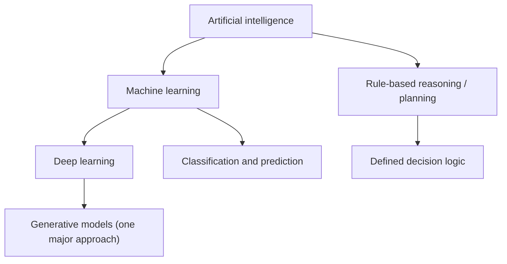
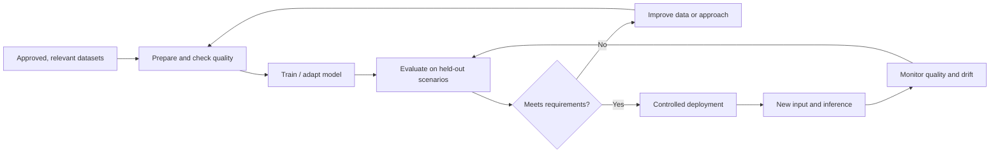
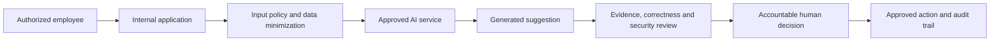

## Lesson Overview

Imagine you're working as a **Cloud Security Engineer** at **CloudNova Technologies**.

One morning your manager asks:

> "Can we use AI to investigate security incidents faster?"

Another engineer asks:

> "Can AI automatically generate Infrastructure as Code?"

The SOC team asks:

> "Can AI identify suspicious login activity?"

The development team asks:

> "Can AI help write secure code?"

Almost every department is now discussing Artificial Intelligence.

To use AI effectively, every technology professional must first understand what AI actually is—and what it is not.

Artificial Intelligence is no longer a future technology.

It has become part of everyday work across cloud computing, cybersecurity, software engineering, DevSecOps, and enterprise operations.

Understanding AI fundamentals is now an essential skill for modern IT professionals.

---

## Learning Objectives

After completing this lesson, you will be able to:

- Understand Artificial Intelligence (AI).
- Learn how AI systems work.
- Explore different types of AI.
- Differentiate AI, Machine Learning, and Deep Learning.
- Understand common AI applications.
- Recognize AI limitations.
- Explore enterprise AI adoption.
- Apply AI concepts to Cloud and Cybersecurity.

---

## What is Artificial Intelligence?

**Artificial Intelligence (AI)** is the ability of computer systems to perform tasks that normally require human intelligence.

Examples include:

- Understanding language
- Recognizing images
- Making recommendations
- Detecting fraud
- Identifying cyber threats
- Answering questions
- Predicting outcomes
- Automating repetitive work

AI helps computers make decisions using data rather than explicit instructions for every scenario.

---

## Why AI Matters

Organizations use AI to:

- Improve productivity
- Automate repetitive work
- Enhance customer experience
- Detect cyber threats
- Analyze massive datasets
- Improve cloud operations
- Reduce operational costs
- Support better decision making

AI enables teams to work faster while focusing more on complex problems.

---

## Examples of AI in Daily Life

You already interact with AI every day.

Examples include:

- Voice Assistants
- Email Spam Filtering
- Recommendation Systems
- Language Translation
- Facial Recognition
- Chatbots
- Smart Search
- Navigation Apps

Many AI systems operate behind the scenes without users noticing.

---

## AI vs Automation

Automation follows predefined rules.

Example:

```text
IF CPU > 90%

THEN Send Alert
```

AI can learn from data and make predictions.

Example:

```text
Analyze historical CPU usage

↓

Predict future resource demand

↓

Recommend scaling before performance issues occur
```

Automation follows rules.

AI learns patterns.

---

## AI vs Machine Learning vs Deep Learning

```text
Artificial Intelligence

↓

Machine Learning

↓

Deep Learning
```

- **Artificial Intelligence (AI)** is the broad field of building intelligent systems.
- **Machine Learning (ML)** allows systems to learn from data.
- **Deep Learning (DL)** uses neural networks to solve complex problems such as image recognition and language understanding.

---

## Types of AI

AI is commonly categorized into:

#### Narrow AI

Designed for one specific task.

Examples:

- Chatbots
- Voice Assistants
- Spam Filters
- Recommendation Engines

This is the type of AI used today.

---

#### General AI (AGI)

A theoretical AI capable of performing any intellectual task a human can perform.

Characteristics include:

- General reasoning
- Learning across domains
- Problem solving
- Adaptability

AGI has not yet been achieved.

---

#### Super AI

A hypothetical form of AI that would surpass human intelligence in every domain.

This remains a research concept and is not currently available.

---

## How AI Learns

AI systems learn by analyzing data.

The process generally follows:

```text
Collect Data

↓

Train Model

↓

Learn Patterns

↓

Make Predictions

↓

Improve with Feedback
```

The quality of data significantly influences AI performance.

---

## Enterprise AI Applications

Organizations commonly use AI for:

- Customer Support
- Fraud Detection
- Threat Detection
- Predictive Maintenance
- Document Analysis
- Code Assistance
- Security Monitoring
- Business Intelligence

AI is increasingly integrated into enterprise workflows.

---

## AI in Cloud Computing

Cloud providers offer managed AI services.

#### AWS

- Amazon Bedrock
- Amazon SageMaker
- Amazon Rekognition
- Amazon Comprehend
- Amazon Textract

#### Microsoft Azure

- Azure AI Services
- Azure Machine Learning
- Azure OpenAI Service

#### Google Cloud

- Vertex AI
- Gemini Models
- Vision AI
- Speech-to-Text

These services allow organizations to build AI-powered applications without managing underlying infrastructure.

---

## AI in Cybersecurity

AI supports cybersecurity by:

- Detecting anomalies
- Identifying malware
- Prioritizing vulnerabilities
- Investigating alerts
- Analyzing logs
- Threat Intelligence
- Phishing Detection
- Security Automation

AI assists analysts but does not replace human decision-making.

---

## Benefits of AI

AI helps organizations:

- Improve efficiency
- Reduce manual work
- Process large datasets
- Detect patterns
- Improve decision-making
- Increase operational speed
- Enhance customer experiences

Used responsibly, AI becomes a powerful productivity tool.

---

## Limitations of AI

AI also has limitations.

Examples include:

- Incorrect outputs
- Hallucinations
- Biased results
- Data dependency
- Lack of human judgment
- Privacy concerns
- Security risks

Human oversight remains essential.

---

## Common AI Terminology

Become familiar with terms such as:

- Artificial Intelligence (AI)
- Machine Learning (ML)
- Deep Learning (DL)
- Neural Networks
- Large Language Models (LLMs)
- Prompt
- Training Data
- Inference
- Model

Understanding these terms prepares you for advanced AI topics.

---

## Enterprise Best Practices

Organizations adopting AI should:

- Protect sensitive data.
- Validate AI-generated content.
- Monitor AI outputs.
- Keep humans involved in important decisions.
- Train employees on responsible AI usage.
- Follow governance and compliance requirements.
- Continuously evaluate AI systems.

Responsible AI adoption builds trust and reduces risk.

---

## Real-World Example

CloudNova Technologies introduces AI into its Security Operations Center.

```text
Security Logs

↓

AI Analysis

↓

Threat Detection

↓

SOC Analyst Review

↓

Incident Investigation

↓

Response

↓

Continuous Learning
```

AI helps analysts process thousands of security events more efficiently while human experts validate findings and make final decisions.

---

## Architecture workshop — Where AI fits in enterprise technology

AI is a family of techniques, not a replacement for engineering judgment. A useful first step is to distinguish **deterministic automation**, **statistical prediction**, and **generative systems**, then understand how each is evaluated and governed.

### Diagram 1 — AI, machine learning and generative AI



**Explanation:** Machine learning is a subset of AI. Deep learning is a subset of machine learning; many contemporary generative AI systems are deep-learning models. Not all AI relies on neural networks, and not every use of automation is AI.

**Workplace decision:** Use a deterministic rule when the required decision has a clear, reliable specification. Consider learned models when patterns are complex and enough appropriate data and evaluation exist. A generative assistant may summarize text, but the resulting recommendations still need validation.

### Diagram 2 — Training, evaluation and inference



**What it shows:** Training produces or adapts a model; inference uses an existing model on new inputs. Evaluation must use appropriate data and success criteria. Real operations also require access control, monitoring, change ownership and safe rollback.

**Important:** A model can be accurate on historical examples yet unreliable on new cases because data, user behavior or operating conditions change.

### Diagram 3 — A governed AI-assisted IT workflow



**How it works:** AI can help summarize a synthetic incident or suggest troubleshooting steps. The organization must decide which data is allowed in prompts, how outputs are checked, what actions are permitted and who remains responsible. A plausible answer is not proof of correctness.

### Safe classroom scenario — AI for support triage

A fictional support team receives six synthetic tickets: login failure, DNS timeout, missing access, storage quota warning, slow service and printer issue.

1. Choose which parts can be handled by **rules** (for example, routing tickets by category).
2. Choose which parts could use **machine learning** (for example, predicting likely categories from descriptions), stating risks.
3. Choose a **generative AI** task, such as drafting a summary from invented ticket details.
4. For every AI task, define one expected quality criterion and one privacy or safety control.
5. Describe a human review step before modifying any production system.

**Expected deliverable:** an AI use-case matrix with data inputs, intended benefit, validation, risks, owner and limitations. Do not upload real workplace logs, employee records or customer data into an unapproved AI service.

### Knowledge check

1. **Does a generated answer prove a system is configured correctly?**

   <details><summary>Suggested answer</summary>No. Generated output is a hypothesis or draft; verify it with permitted authoritative sources, tests and system evidence.</details>

2. **What is the difference between training and inference?**

   <details><summary>Suggested answer</summary>Training creates or adapts model parameters; inference applies the trained model to new inputs.</details>

3. **When is a deterministic rule preferable to a model?**

   <details><summary>Suggested answer</summary>When the task has a well-defined, testable rule and model uncertainty would introduce unnecessary risk or complexity.</details>

**Continue:** [Machine Learning Basics](/foundation/gohackerscloud-foundation/14-ai-fundamentals/02-machine-learning-basics/) · [Generative AI](/foundation/gohackerscloud-foundation/14-ai-fundamentals/03-generative-ai/) · [Responsible AI & Governance](/foundation/gohackerscloud-foundation/14-ai-fundamentals/09-responsible-ai-ai-governance/).

---

## Key Takeaways

After completing this lesson, you should understand:

- Artificial Intelligence (AI)
- AI vs Automation
- AI vs Machine Learning vs Deep Learning
- Types of AI
- AI Learning Process
- Enterprise AI Applications
- AI in Cloud Computing
- AI in Cybersecurity
- AI Benefits
- AI Limitations

---

## Summary

Artificial Intelligence is becoming a core capability across modern technology. Understanding AI concepts enables Cloud Engineers, Cybersecurity Professionals, DevSecOps Engineers, Developers, and IT leaders to responsibly adopt AI, improve productivity, automate repetitive tasks, and build intelligent enterprise solutions.

This foundational knowledge prepares you for the next lessons, where you'll explore Machine Learning, Generative AI, Prompt Engineering, AI productivity, AI security, and practical AI applications in cloud computing and cybersecurity.

---

## Next Lesson

➡️ **Lesson 02 — Machine Learning Basics**

In the next lesson, you'll learn how Machine Learning works, explore supervised, unsupervised, and reinforcement learning, understand training data and models, and discover how machine learning powers modern AI systems used across cloud computing, cybersecurity, and enterprise applications.