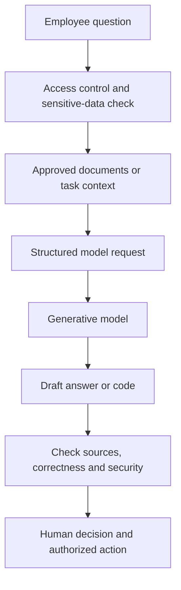

## Lesson Overview

Imagine you're working as a **Cloud Security Engineer** at **CloudNova Technologies**.

Your organization has recently adopted an enterprise AI assistant.

Throughout the day, different teams use it to:

- Generate Infrastructure as Code
- Summarize security incidents
- Write Python automation scripts
- Review IAM policies
- Create documentation
- Analyze logs
- Explain Kubernetes errors
- Generate executive reports

Instead of searching documentation for hours, engineers now receive intelligent answers within seconds.

This technology is called **Generative AI**.

Unlike traditional AI systems that classify or predict information, Generative AI creates entirely new content including text, code, images, audio, videos, and even software.

Understanding Generative AI is now an essential skill for every Cloud Engineer, Cybersecurity Professional, DevOps Engineer, Software Developer, and IT professional.

---

## Learning Objectives

After completing this lesson, you will be able to:

- Understand Generative AI.
- Learn how Large Language Models (LLMs) work.
- Explore Foundation Models.
- Understand prompts and responses.
- Learn enterprise Generative AI use cases.
- Explore multimodal AI.
- Understand limitations and risks.
- Apply Generative AI safely in Cloud and Cybersecurity.

---

## What is Generative AI?

**Generative AI** is a type of Artificial Intelligence capable of creating new content based on patterns learned from massive datasets.

Generative AI can produce:

- Text
- Images
- Code
- Audio
- Video
- Documents
- Presentations
- Reports

Instead of selecting predefined answers, Generative AI creates new outputs for each request.

---

## Why Generative AI Matters

Organizations use Generative AI to:

- Increase productivity
- Automate documentation
- Assist software development
- Improve customer support
- Analyze security events
- Generate reports
- Summarize information
- Accelerate decision-making

Generative AI enables professionals to spend more time solving problems and less time performing repetitive work.

---

## How Generative AI Works

The process typically follows:

```text
User Prompt

↓

Large Language Model (LLM)

↓

Pattern Analysis

↓

Response Generation

↓

User Review

↓

Refinement
```

The quality of the output often depends on the quality of the prompt.

---

## What is a Large Language Model (LLM)?

A **Large Language Model (LLM)** is an AI model trained on massive amounts of text to understand and generate human language.

LLMs can:

- Answer questions
- Write code
- Explain concepts
- Summarize documents
- Translate languages
- Generate reports
- Assist troubleshooting

They predict the most likely sequence of words based on the user's request.

---

## What is a Foundation Model?

A **Foundation Model** is a large AI model trained on diverse datasets that can be adapted for many different tasks.

Examples include:

- Conversational AI
- Code Generation
- Document Analysis
- Image Understanding
- Security Assistance
- Business Automation

Foundation Models become specialized through prompting or additional training.

---

## Prompts

A **Prompt** is the instruction given to an AI model.

Example:

```text
Explain the AWS Shared Responsibility Model.

```

Better Prompt:

```text
Explain the AWS Shared Responsibility Model for a beginner Cloud Security Engineer. Include real-world examples and a comparison table.
```

Detailed prompts usually produce better results.

---

## Prompt → Response Workflow

```text
Prompt

↓

Model Processing

↓

Context Understanding

↓

Knowledge Retrieval

↓

Response Generation

↓

Human Verification
```

Human review remains essential before using AI-generated outputs.

---

## Types of Generative AI

Modern Generative AI systems can generate:

#### Text

- Emails
- Documentation
- Reports
- Blogs

#### Code

- Python
- Bash
- Terraform
- CloudFormation
- PowerShell
- SQL

#### Images

- Diagrams
- Architecture Images
- Marketing Graphics

#### Audio

- Voice Generation
- Speech Recognition

#### Video

- Training Videos
- AI Presenters
- Product Demonstrations

---

## Multimodal AI

Modern AI systems understand multiple content types.

Examples:

- Text
- Images
- Audio
- Video
- Documents
- Diagrams

Example:

```text
Upload Architecture Diagram

↓

AI Explains Design

↓

Suggests Improvements

↓

Generates Documentation
```

Multimodal AI enables more natural interaction.

---

## Enterprise Use Cases

Organizations commonly use Generative AI for:

- Documentation
- Meeting Summaries
- Code Generation
- Security Investigations
- Cloud Architecture Reviews
- Customer Support
- Compliance Reporting
- Knowledge Management

AI assists professionals rather than replacing them.

---

## Generative AI in Cloud Computing

Cloud engineers use AI to:

- Generate Infrastructure as Code
- Explain AWS services
- Troubleshoot deployments
- Create architecture documentation
- Optimize cloud costs
- Review configurations

AI accelerates cloud engineering tasks while engineers validate the results.

---

## Generative AI in Cybersecurity

Security teams use AI to:

- Analyze logs
- Investigate incidents
- Summarize vulnerabilities
- Generate SIEM queries
- Review IAM policies
- Explain malware behavior
- Draft incident reports
- Create detection rules

AI improves analyst productivity but should not replace human judgment.

---

## Generative AI for DevSecOps

DevSecOps teams leverage AI for:

- Writing CI/CD pipelines
- Creating Terraform templates
- Reviewing code
- Generating test cases
- Explaining deployment failures
- Producing documentation
- Automating repetitive tasks

AI complements existing engineering workflows.

---

## Benefits of Generative AI

Organizations gain:

- Faster documentation
- Increased productivity
- Better knowledge sharing
- Faster coding
- Reduced repetitive work
- Improved collaboration
- Accelerated troubleshooting

Responsible use leads to significant efficiency gains.

---

## Limitations of Generative AI

Generative AI is powerful but not perfect.

Limitations include:

- Hallucinations
- Outdated knowledge
- Incorrect code
- Fabricated references
- Security risks
- Privacy concerns
- Bias

Always verify AI-generated content before production use.

---

## Responsible AI Usage

Professionals should:

- Verify AI outputs.
- Protect sensitive information.
- Avoid uploading confidential data.
- Review generated code.
- Validate technical recommendations.
- Maintain human oversight.

AI should assist—not replace—professional judgment.

---

## Common Enterprise AI Tools

Organizations commonly use:

- AI Chat Assistants
- Enterprise Knowledge Assistants
- AI Coding Assistants
- AI Document Analysis Tools
- AI Security Assistants
- AI Meeting Assistants

Different tools specialize in different business functions.

---

## Enterprise Best Practices

Professional organizations:

- Define AI usage policies.
- Protect confidential information.
- Review AI-generated content.
- Train employees on responsible AI.
- Monitor AI usage.
- Validate technical outputs.
- Integrate AI into existing workflows.
- Continuously improve AI governance.

These practices maximize AI benefits while minimizing risk.

---

## Real-World Example

CloudNova Technologies integrates Generative AI into daily engineering workflows.

```text
Engineer Prompt

↓

Enterprise AI Assistant

↓

Generate Documentation

↓

Generate Code

↓

Security Review

↓

Engineer Validation

↓

Production Deployment
```

By combining AI with human expertise, CloudNova improves productivity while maintaining security, quality, and compliance.

---

## Architecture workshop — Enterprise generative AI with human verification



**How to read it:** An enterprise assistant can combine a user's question with approved context and a model. If retrieval is used, the documents returned still need permission checks and careful handling: retrieved text may contain errors or malicious instructions. The model response must be validated rather than trusted as an operational command.

**Security example:** A learner asks an assistant to produce a Linux service troubleshooting note. The assistant may draft read-only checks, but the learner must inspect their meaning, confirm system compatibility and avoid running unreviewed destructive instructions.

### Practical exercise — Source-aware answer review

Create this **synthetic** prompt: “Summarize a service outage using these facts: requests timed out at 11:02; the service recovered at 11:08; root cause is not confirmed.” Request a short incident note.

Evaluate the draft:

1. Does it preserve the **actual timestamps**?
2. Does it avoid inventing a cause or claiming a security breach?
3. Does it clearly distinguish facts, uncertainty and next checks?
4. Does it avoid disclosing personally identifying or secret information?
5. Is a human owner identified for approval before publication?

**Expected deliverable:** a corrected incident summary and a five-point review checklist. This task can be done on paper; no AI account is required.

**Key takeaway:** Retrieval, guardrails and human review can reduce risks, but no single component guarantees accuracy, privacy or compliance.

---

## Key Takeaways

After completing this lesson, you should understand:

- Generative AI
- Large Language Models (LLMs)
- Foundation Models
- Prompts
- Multimodal AI
- Enterprise AI Use Cases
- AI in Cloud Computing
- AI in Cybersecurity
- AI Benefits
- Responsible AI Usage

---

## Summary

Generative AI is transforming the way technology professionals work by generating text, code, documentation, reports, and other content from natural language prompts. When used responsibly, it improves productivity, accelerates problem-solving, and enhances collaboration across cloud computing, cybersecurity, DevSecOps, and software engineering.

Mastering Generative AI fundamentals prepares Cloud Engineers, Cybersecurity Professionals, DevSecOps Engineers, Developers, Architects, and IT leaders to safely adopt AI-powered tools while maintaining security, quality, and human oversight.

---

## Next Lesson

➡️ **Lesson 04 — Prompt Engineering**

In the next lesson, you'll learn how to write effective prompts, structure AI conversations, improve response quality, use prompting frameworks, and apply Prompt Engineering techniques to cloud computing, cybersecurity, DevSecOps, automation, and enterprise productivity.