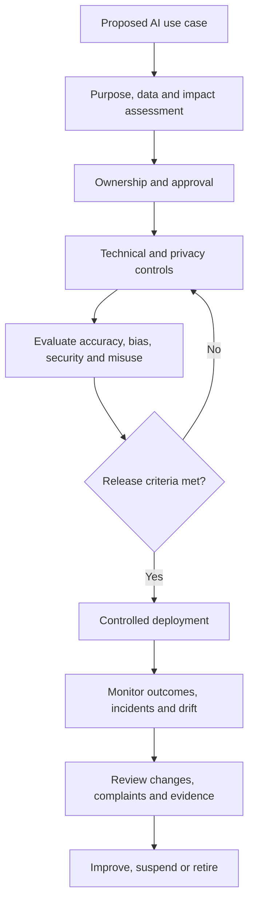

## Lesson Overview

Imagine you're working as a **Cloud Security Engineer** at **CloudNova Technologies**.

Your company has successfully deployed AI across multiple departments.

AI now helps with:

- Security Operations
- Software Development
- Customer Support
- Cloud Infrastructure
- Financial Reporting
- Human Resources
- Business Intelligence

Everything seems to be working well.

Then one day...

A developer uploads confidential source code into a public AI chatbot.

An HR AI system makes biased hiring recommendations.

An AI assistant generates inaccurate compliance advice.

An employee blindly follows an AI recommendation that causes a production outage.

Management realizes something important:

**AI must be governed just like any other enterprise technology.**

Technology alone isn't enough.

Organizations need policies, security controls, governance, accountability, and human oversight to ensure AI is used responsibly.

This is the purpose of **Responsible AI** and **AI Governance**.

---

## Learning Objectives

After completing this lesson, you will be able to:

- Understand Responsible AI.
- Learn AI Governance principles.
- Explore AI ethics.
- Understand AI risk management.
- Learn AI privacy and security.
- Understand fairness and bias.
- Explore AI compliance.
- Apply enterprise AI governance best practices.

---

## What is Responsible AI?

**Responsible AI** is the practice of designing, developing, deploying, and using Artificial Intelligence in a way that is:

- Safe
- Secure
- Ethical
- Fair
- Transparent
- Accountable
- Privacy-Preserving
- Human-Centered

Responsible AI ensures technology benefits people while minimizing potential harm.

---

## Why AI Governance Matters

Organizations implement AI Governance to:

- Reduce business risk
- Protect sensitive data
- Maintain regulatory compliance
- Ensure trustworthy AI
- Prevent misuse
- Improve transparency
- Protect customer trust
- Support responsible innovation

AI should align with both business objectives and ethical standards.

---

## AI Governance Framework

Enterprise AI Governance typically follows this lifecycle:

```text
Business Requirement

↓

Risk Assessment

↓

AI Development

↓

Security Review

↓

Compliance Review

↓

Deployment

↓

Continuous Monitoring

↓

Periodic Audits

↓

Continuous Improvement
```

Governance is an ongoing process throughout the AI lifecycle.

---

## Core Principles of Responsible AI

Most enterprise AI programs are built on these principles:

- Fairness
- Transparency
- Accountability
- Privacy
- Security
- Reliability
- Human Oversight
- Compliance

Together, these principles create trustworthy AI systems.

---

## Fairness

AI systems should make decisions without unfair discrimination.

Organizations should regularly test AI models for:

- Gender Bias
- Age Bias
- Cultural Bias
- Language Bias
- Geographic Bias

Fair AI improves trust and supports ethical decision-making.

---

## Transparency

Users should understand:

- When AI is being used
- What data AI uses
- How recommendations are generated
- What limitations exist

Transparent AI improves user confidence and accountability.

---

## Explainability

Organizations should be able to explain:

- Why an AI recommendation was made
- Which factors influenced the decision
- What data was considered
- What limitations may exist

Explainability is especially important for high-impact decisions.

---

## Accountability

Organizations should clearly define:

- AI Owners
- Data Owners
- Security Teams
- Compliance Teams
- Business Stakeholders

Humans—not AI—remain accountable for business decisions.

---

## Human Oversight

AI should support—not replace—human judgment.

Examples requiring human approval include:

- Security Incidents
- Financial Decisions
- Legal Advice
- Medical Decisions
- Production Infrastructure Changes
- Compliance Approvals

Critical decisions should always involve qualified professionals.

---

## AI Risk Management

Organizations should identify risks such as:

- Data Leakage
- Hallucinations
- Prompt Injection
- Model Poisoning
- Privacy Violations
- Bias
- Inaccurate Recommendations
- Regulatory Violations

Managing these risks is a core governance responsibility.

---

## AI Privacy

AI systems often process sensitive information.

Organizations should protect:

- Personal Data
- Customer Information
- Financial Records
- Healthcare Data
- Source Code
- Intellectual Property
- Business Documents

Privacy controls should follow organizational policies and applicable regulations.

---

## AI Security

Enterprise AI security includes:

- Identity and Access Management (IAM)
- Multi-Factor Authentication (MFA)
- Encryption
- Secure APIs
- Audit Logging
- Monitoring
- Vulnerability Management
- Incident Response

AI systems should follow the same security standards as other enterprise systems.

---

## AI Compliance

Organizations may need to comply with regulations such as:

- GDPR
- HIPAA
- PCI DSS
- ISO/IEC 27001
- SOC 2
- NIST AI Risk Management Framework

Compliance requirements vary depending on industry and geography.

---

## AI Lifecycle Governance

Governance applies throughout the AI lifecycle.

```text
Planning

↓

Data Collection

↓

Model Development

↓

Testing

↓

Deployment

↓

Monitoring

↓

Review

↓

Retirement
```

Every phase should include security and governance controls.

---

## AI Monitoring

Organizations continuously monitor:

- Model Performance
- Security Events
- Data Quality
- Prompt Activity
- API Usage
- User Feedback
- Compliance Metrics
- System Availability

Continuous monitoring helps identify emerging risks.

---

## AI in Cloud Computing

Cloud providers offer governance capabilities.

#### AWS

- Amazon Bedrock Guardrails
- IAM
- CloudTrail
- AWS Config
- Amazon CloudWatch

#### Microsoft Azure

- Azure AI Foundry Governance
- Microsoft Purview
- Azure Policy
- Microsoft Defender for Cloud

#### Google Cloud

- Vertex AI Governance
- Cloud Audit Logs
- IAM
- Security Command Center

Cloud-native services help organizations govern AI responsibly.

---

## AI in Cybersecurity

Security teams use governance to:

- Approve AI tools
- Monitor AI usage
- Protect confidential data
- Investigate AI misuse
- Review AI-generated recommendations
- Secure AI infrastructure

Governance ensures AI strengthens security without introducing unnecessary risk.

---

## Common AI Governance Challenges

Organizations often face:

- Shadow AI
- Lack of AI Policies
- Unapproved AI Tools
- Poor Data Quality
- Weak Security Controls
- Insufficient Human Oversight
- Regulatory Uncertainty

Governance programs should evolve as AI capabilities change.

---

## Common Mistakes

Avoid:

- Blindly trusting AI.
- Uploading confidential information.
- Deploying AI without governance.
- Ignoring privacy requirements.
- Failing to review AI outputs.
- Assuming AI decisions are always correct.
- Neglecting employee training.

Responsible AI requires both technology and organizational processes.

---

## Enterprise Best Practices

Professional organizations:

- Establish AI governance committees.
- Define acceptable AI use policies.
- Classify and protect sensitive data.
- Perform AI risk assessments.
- Monitor AI systems continuously.
- Train employees on responsible AI.
- Maintain human oversight.
- Review AI governance regularly.

These practices help organizations adopt AI securely and responsibly.

---

## Real-World Example

CloudNova Technologies launches an enterprise AI governance program.

```text
Business Requirement

↓

AI Risk Assessment

↓

Security Review

↓

Compliance Validation

↓

Responsible AI Deployment

↓

Continuous Monitoring

↓

Regular Audits

↓

Improved Trust

↓

Responsible Innovation
```

By implementing governance, security, privacy controls, and continuous monitoring, CloudNova enables employees to safely leverage AI while maintaining regulatory compliance and protecting business assets.

---

## Architecture workshop — Governing AI from idea to retirement



**Explanation:** Responsible AI is a governance and engineering lifecycle, not a disclaimer. Intended purpose, lawful data use, risk classification, evaluation, human accountability, change control and monitoring should be adapted to the system and its impact. The framework alone is not proof of legal compliance.

### Example: an AI tool that drafts customer support messages

A fictional company proposes an assistant that reads support tickets and drafts responses. The design team must define approved data categories, access controls, accuracy metrics, prompt-injection handling, escalation for sensitive cases, retention and customer-impact monitoring.

| Review area | Question | Example evidence |
|---|---|---|
| Purpose and owner | Who is accountable for the decision? | Approved use-case description |
| Data use | What input may be processed and retained? | Data classification and retention decision |
| Reliability | How are incorrect suggestions found? | Evaluation cases and error review |
| Security | Can untrusted inputs influence privileged actions? | Threat model and authorization tests |
| Monitoring | What happens after an incident or model change? | Change log and response procedure |

### Free governance exercise

Choose the support-message assistant and write a **one-page risk register**: five plausible problems, affected people or data, controls, accountable owner and an evidence-based evaluation step. Include at least one fairness or accessibility consideration and a **human escalation path**.

**Expected deliverable:** a governance decision record with limitations and review date. Never claim that completing this worksheet certifies an AI system or satisfies a particular law.

**Continue:** [GRC Foundations](/foundation/gohackerscloud-foundation/15-enterprise-grc/01-introduction-to-grc/) to connect AI governance with enterprise policy, risk and audit evidence.

---

## Key Takeaways

After completing this lesson, you should understand:

- Responsible AI
- AI Governance
- AI Ethics
- Fairness
- Transparency
- Explainability
- Accountability
- AI Risk Management
- AI Compliance
- Enterprise AI Governance Best Practices

---

## Summary

Responsible AI and AI Governance ensure that Artificial Intelligence is developed, deployed, and used in a secure, ethical, transparent, and compliant manner. As AI becomes deeply integrated into cloud computing, cybersecurity, software development, and enterprise operations, organizations must combine technical controls with governance processes, human oversight, and regulatory compliance.

Mastering Responsible AI prepares Cloud Engineers, Cloud Security Engineers, AI Engineers, DevSecOps Engineers, Security Architects, Compliance Professionals, and Technology Leaders to safely adopt AI while building trust with customers, regulators, and stakeholders.

---

## Next Lesson

➡️ **Lesson 10 — AI Trends & The Future of Work**

In the next lesson, you'll explore emerging AI technologies, AI agents, autonomous systems, multimodal AI, industry trends, future career opportunities, and how cloud, cybersecurity, and AI professionals can prepare for the next generation of intelligent enterprise technologies.