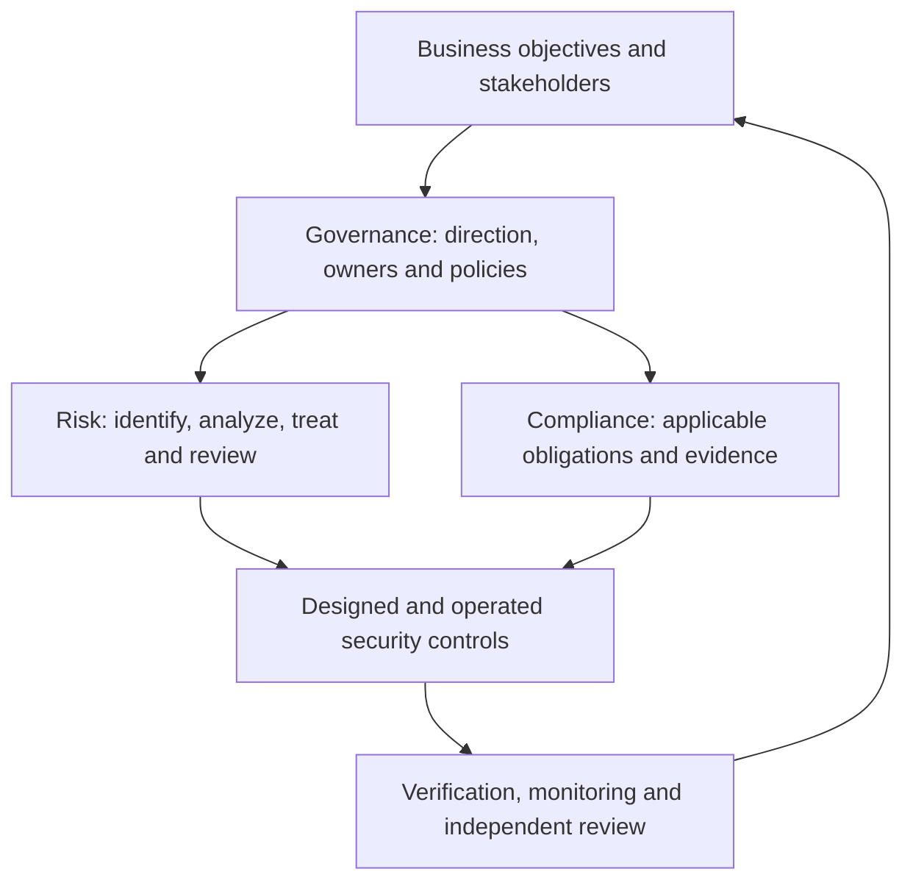
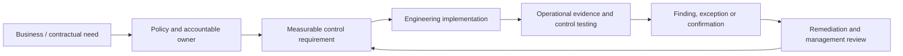
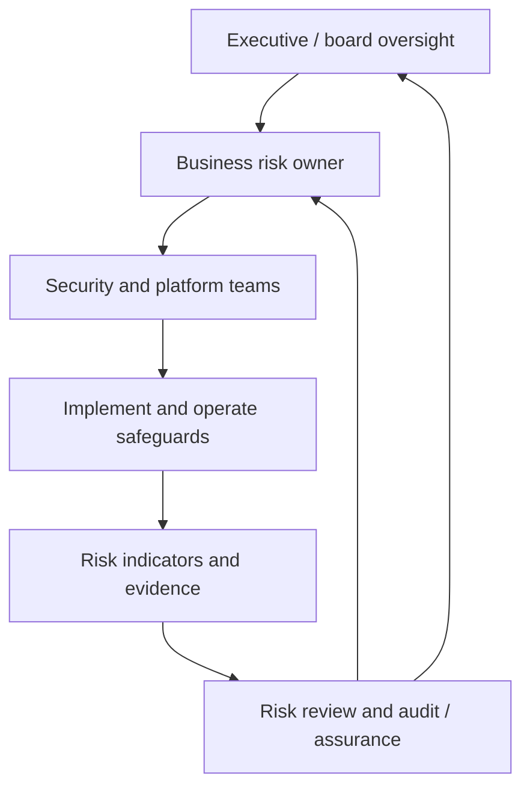

## Lesson Overview

Imagine you've recently joined **CloudNova Technologies** as a **Cloud Security Engineer**.

During your first week, you complete several technical tasks:

- Configure IAM Roles
- Deploy Security Groups
- Enable AWS CloudTrail
- Configure Amazon GuardDuty
- Review Kubernetes RBAC
- Enable Multi-Factor Authentication

Everything appears secure.

Then your manager asks:

> "Is this environment compliant with ISO 27001?"

Another manager asks:

> "What risks remain after these controls?"

The Chief Information Security Officer (CISO) asks:

> "How does this security program support our business objectives?"

Suddenly you realize...

Security isn't only about configuring technology.

Enterprise security also requires:

- Governance
- Risk Management
- Compliance
- Policies
- Audits
- Executive Reporting
- Business Alignment

These three disciplines together form **Governance, Risk & Compliance (GRC).**

GRC helps organizations make informed business decisions while protecting information, meeting regulatory requirements, and managing technology risks.

Understanding GRC is an essential skill for Cloud Engineers, Security Engineers, Security Architects, Consultants, Managers, and CISOs.

---

## Learning Objectives

After completing this lesson, you will be able to:

- Understand Governance, Risk & Compliance (GRC).
- Differentiate Governance, Risk, and Compliance.
- Understand why GRC matters.
- Explore enterprise GRC programs.
- Learn the relationship between security and business.
- Understand GRC roles and responsibilities.
- Recognize common enterprise GRC activities.
- Apply GRC concepts in cloud and cybersecurity environments.

---

## What is Governance, Risk & Compliance (GRC)?

**Governance, Risk & Compliance (GRC)** is a structured approach that enables organizations to:

- Achieve business objectives
- Manage business and technology risks
- Protect information assets
- Meet legal and regulatory requirements
- Improve decision-making
- Continuously improve security

Rather than being three separate disciplines, Governance, Risk, and Compliance work together to support the entire organization.

---

## The Three Pillars of GRC

```text
Governance

↓

Risk Management

↓

Compliance

↓

Secure & Successful Business
```

Each pillar supports the others.

Without governance, security lacks direction.

Without risk management, organizations cannot prioritize investments.

Without compliance, organizations may violate legal or contractual obligations.

---

## What is Governance?

**Governance** is the process of directing and controlling an organization's security program.

Governance defines:

- Business Objectives
- Security Strategy
- Policies
- Roles & Responsibilities
- Decision-Making
- Accountability
- Performance Measurement

Governance ensures security supports business goals rather than operating independently.

---

## What is Risk Management?

**Risk Management** is the process of identifying, analyzing, evaluating, and treating risks that could affect the organization.

Examples include:

- Cyber Attacks
- Cloud Misconfigurations
- Insider Threats
- Ransomware
- Third-Party Risks
- Compliance Failures
- Business Interruptions

Organizations cannot eliminate every risk—but they can manage risks appropriately.

---

## What is Compliance?

**Compliance** ensures the organization follows:

- Laws
- Regulations
- Industry Standards
- Internal Policies
- Customer Requirements
- Contractual Obligations

Compliance demonstrates that security controls meet required expectations.

---

## Why GRC Matters

Organizations use GRC to:

- Protect business operations.
- Reduce security risks.
- Meet regulatory requirements.
- Improve executive decision-making.
- Strengthen customer trust.
- Protect intellectual property.
- Improve operational resilience.
- Support business growth.

GRC connects technology with business strategy.

---

## GRC in Modern Enterprises

Every department contributes to GRC.

Examples include:

| Department | GRC Responsibility |
|------------|--------------------|
| Executive Leadership | Governance & Strategy |
| Information Security | Security Program |
| Cloud Engineering | Secure Infrastructure |
| DevSecOps | Secure Development |
| Risk Team | Risk Assessments |
| Compliance Team | Regulatory Compliance |
| Internal Audit | Independent Assurance |
| Legal | Regulatory Guidance |

GRC is an organization-wide responsibility.

---

## Relationship Between Business and Security

Enterprise security should always support business objectives.

```text
Business Goals

↓

Security Strategy

↓

Governance

↓

Risk Management

↓

Compliance

↓

Business Success
```

Security enables business rather than preventing it.

---

## Enterprise GRC Lifecycle

A mature GRC program follows a continuous improvement cycle.

```text
Business Objectives

↓

Policies

↓

Risk Assessment

↓

Security Controls

↓

Compliance Monitoring

↓

Audits

↓

Continuous Improvement
```

This cycle repeats as business needs and threats evolve.

---

## Common Enterprise Risks

Organizations face many types of risk.

Examples include:

#### Cyber Risks

- Malware
- Ransomware
- Phishing
- Data Breaches

#### Technology Risks

- Cloud Misconfiguration
- System Failure
- Software Vulnerabilities

#### Business Risks

- Financial Loss
- Reputation Damage
- Operational Disruption

#### Regulatory Risks

- GDPR Violations
- PCI DSS Non-Compliance
- Privacy Breaches

Each risk should be identified, assessed, and managed appropriately.

---

## GRC in Cloud Computing

Cloud environments require governance over:

- Identity & Access Management
- Cloud Security Policies
- Resource Provisioning
- Data Classification
- Encryption Standards
- Cost Governance
- Security Monitoring
- Compliance Reporting

Cloud governance ensures secure and consistent cloud operations.

---

## GRC in Cybersecurity

Cybersecurity teams support GRC by:

- Developing security policies
- Performing risk assessments
- Conducting vulnerability assessments
- Managing security incidents
- Supporting audits
- Reporting security metrics
- Monitoring compliance
- Improving security controls

Security operations become more effective when aligned with governance.

---

## Common GRC Frameworks

Organizations commonly align with frameworks such as:

- ISO/IEC 27001
- NIST Cybersecurity Framework (CSF)
- CIS Controls
- COBIT
- PCI DSS
- SOC 2
- HIPAA
- GDPR

These frameworks provide structured guidance for building mature security programs.

---

## Roles in a GRC Program

Common GRC stakeholders include:

- Board of Directors
- Chief Executive Officer (CEO)
- Chief Information Officer (CIO)
- Chief Information Security Officer (CISO)
- Security Architects
- Cloud Security Engineers
- Risk Managers
- Compliance Officers
- Internal Auditors
- Business Unit Managers

Security is a shared responsibility across the organization.

---

## Enterprise Best Practices

Successful organizations:

- Align security with business strategy.
- Define clear governance structures.
- Perform regular risk assessments.
- Maintain security policies.
- Monitor compliance continuously.
- Conduct periodic audits.
- Measure security performance.
- Continuously improve GRC processes.

These practices create resilient and well-governed organizations.

---

## Real-World Example

CloudNova Technologies launches a new cloud platform for customers.

Before deployment, the organization follows its GRC process.

```text
Business Requirement

↓

Governance Approval

↓

Risk Assessment

↓

Security Controls

↓

Compliance Validation

↓

Cloud Deployment

↓

Continuous Monitoring

↓

Periodic Audit

↓

Continuous Improvement
```

By integrating Governance, Risk Management, and Compliance into every phase of the project, CloudNova delivers secure cloud services while meeting regulatory requirements and business objectives.

---

## Architecture workshop — How enterprise GRC connects to engineering

Governance, Risk and Compliance (GRC) is a way for an organization to make **accountable decisions**, understand uncertainty and demonstrate that applicable obligations and controls are addressed. Buying a tool or switching on a cloud feature does not establish certification or compliance.

### Diagram 1 — The three GRC disciplines work together



**What it shows:** Governance defines who decides and the objectives, risk management considers potential adverse outcomes, and compliance evaluates specific legal, regulatory, contractual and internal requirements. Controls should support the business and provide testable evidence. A completed questionnaire is not proof all controls work.

**Workplace case:** A fictional payment business deploys an application to the cloud. The security team can show an encryption setting, but leadership still needs to define data sensitivity, owner, retention, change approval, logging and which compliance requirements apply.

### Diagram 2 — From business requirement to control evidence



**Explanation:** A policy expresses intent; standards define testable requirements; procedures explain execution; evidence demonstrates what happened. If a control fails or evidence is missing, a finding requires a documented owner and follow-up. Compliance cannot be assumed merely because a policy document exists.

### Diagram 3 — An enterprise risk and assurance operating model



**What it shows:** Governance and management accountability should be explicit. Audit or assurance may be independent of day-to-day control operation. This diagram is conceptual; a real organization must assign roles according to its governance structure and audit independence requirements.

### Guided GRC exercise — Synthetic online learning company

Your fictional company maintains user accounts, course progress and subscription billing through an external payment provider. Write a short GRC register.

| Item | Example |
|---|---|
| Business objective | Keep access to lessons reliable while protecting learner data |
| Important asset | Learner account and progress database |
| Risk statement | Excessive access could disclose personal learning records |
| Candidate controls | Role-scoped permissions and access reviews |
| Evidence | Permission review record and authorization test |
| Accountable person | Named application/data owner |
| Open question | Whether the supplier agreement changes obligations |

1. Draw the path from business objective to control evidence using Diagram 2.
2. Identify three assets, threats or failure scenarios and a responsible owner for each.
3. Specify one **preventive**, one **detective** and one **corrective** control.
4. Record a risk decision that still needs management approval.
5. Write what evidence would be required before closing a finding.

**Expected deliverable:** a compact risk-and-control register plus one reviewable assurance flow. This is a classroom simulation—not an ISO 27001 certificate, compliance attestation or formal audit.

### Knowledge check

1. **Is a security configuration automatically proof that an organization is compliant?**

   <details><summary>Suggested answer</summary>No. Compliance depends on the applicable requirements, system and organizational scope, documented control performance and suitable evidence or assessment.</details>

2. **Who should accept residual business risk?**

   <details><summary>Suggested answer</summary>An appropriately authorized risk owner within the organization's governance and risk appetite—not automatically the engineer who discovered the weakness.</details>

3. **What is the difference between an audit observation and a remediation?**

   <details><summary>Suggested answer</summary>An observation describes evidence and criteria; remediation addresses the gap and requires verification.</details>

**Continue:** [Enterprise Risk Management](/foundation/gohackerscloud-foundation/15-enterprise-grc/03-risk-management-fundamentals/) · [Security Audits](/foundation/gohackerscloud-foundation/15-enterprise-grc/07-security-audits-compliance-assessments/) · [GHC Labs and practice options](/ghc-labs/). Check access terms for hosted activities.

---

## Key Takeaways

After completing this lesson, you should understand:

- Governance
- Risk Management
- Compliance
- Enterprise GRC
- Business Alignment
- Security Governance
- Enterprise Risk
- Regulatory Compliance
- Cloud Governance
- GRC Best Practices

---

## Summary

Governance, Risk & Compliance (GRC) provides the foundation for managing enterprise security in a structured, business-aligned manner. Governance establishes direction and accountability, Risk Management helps organizations identify and prioritize threats, and Compliance ensures adherence to legal, regulatory, and contractual requirements.

Understanding GRC enables Cloud Engineers, Cloud Security Engineers, Security Architects, DevSecOps Engineers, Risk Managers, Compliance Professionals, and Technology Leaders to build secure, resilient, and compliant enterprise environments.

---

## Next Lesson

➡️ **Lesson 02 — Enterprise Security Governance**

In the next lesson, you'll learn how enterprise organizations establish security governance structures, define leadership responsibilities, create security committees, develop governance models, and align cybersecurity programs with business strategy and executive decision-making.