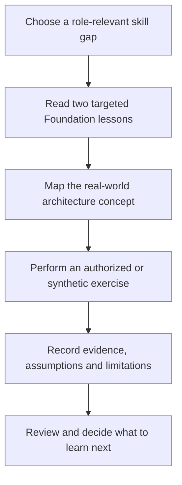

**Audience:** IT support, infrastructure, cloud, development and security professionals. **Cost:** The Foundation reading and independent exercises on this page are free.

You don't always need to restart at Module 00. Begin with the part of the technology stack you already work with, identify a specific capability gap and build a small, reviewable artifact that demonstrates what you learned.

**Need a quick fundamentals refresh?** The [7-Day Free Foundation Challenge](/7-day-challenge/) provides brief self-checks across IT, networking, systems, cloud, security and Git. Professionals can skip directly to a relevant day.

## Choose a professional goal

| Your goal | Recommended free Foundation modules | Useful output |
|---|---|---|
| **Move toward cloud engineering** | [Networking](/core-it-devops/module-02/) → [Cloud Computing](/foundation/gohackerscloud-foundation/07-cloud-computing-fundamentals/01-cloud-computing/) → [IAM](/foundation/gohackerscloud-foundation/09-identity--access-management/01-iam-fundamentals/) | Cloud application architecture and access matrix |
| **Improve security operations skills** | [Cybersecurity Fundamentals](/foundation/gohackerscloud-foundation/08-cybersecurity-fundamentals/01-security-mindset/) → [SOC Fundamentals](/foundation/gohackerscloud-foundation/12-enterprise-security-operations/01-security-operations-center-soc/) | Synthetic alert-triage report |
| **Strengthen DevOps and automation** | [Linux](/core-it-devops/module-03/) → [Programming](/core-it-devops/module-05/) → [Git & DevOps](/core-it-devops/module-06/) | Small local script and reviewable Git change |
| **Understand secure applications** | [Networking](/core-it-devops/module-02/) → [Web & API](/foundation/gohackerscloud-foundation/11-web--api-fundamentals/01-web-fundamentals/) → [Identity](/foundation/gohackerscloud-foundation/09-identity--access-management/01-iam-fundamentals/) | Trust-boundary diagram and negative authorization test plan |
| **Develop leadership and risk skills** | [Technical Documentation](/foundation/gohackerscloud-foundation/13-professional-skills/01-technical-documentation/) → [Enterprise GRC](/foundation/gohackerscloud-foundation/15-enterprise-grc/01-introduction-to-grc/) → [AI Fundamentals](/foundation/gohackerscloud-foundation/14-ai-fundamentals/01-ai-concepts/) | Risk/control register and decision summary |

These are learning examples, not guaranteed promotions or formal professional certifications. Follow only the modules relevant to your actual responsibilities and interests.

## A focused four-session learning sprint

**Session 1 — Frame the problem.** Write a single outcome, such as “I can explain why an authenticated API request might still be unauthorized.” Note what you already know.

**Session 2 — Connect the architecture.** Read the relevant Foundation material and redraw the system without looking at the source. Label trust boundaries, dependencies and owners.

**Session 3 — Test the reasoning safely.** Use a synthetic dataset, local example, approved development system or conceptual tabletop exercise. Avoid production changes and never test third-party systems without permission.

**Session 4 — Present a decision.** Create a one-page summary: objective, environment/scope, observations, uncertainties, risk, recommended next safe step and evidence needed.

## Portfolio example — Cloud identity review

A fictional service uses one shared cloud role for a reporting workload. Its business requirement is to read a specific training dataset.

1. Draw the path from workload identity to cloud resource.
2. Define a **minimum** allowed action and resource scope.
3. Write an expected-deny case for unrelated resources.
4. Identify which audit event could verify the decision.
5. Draft a short recommendation with assumptions and owner.

**Expected deliverable:** a cloud identity matrix, a Mermaid or hand-drawn diagram and a concise management-ready note. Label it **synthetic exercise**, not a real customer security assessment.

## Where to go after this free pathway

For deeper reading, explore the [14-chapter Cloud Security Engineer roadmap](/learning-hub/cloud-security-roadmap/), the [IT Interview Handbook](/learning-hub/it-interview/), or the [full 16-module Foundation directory](/curriculum/).

For separate, authorized advanced practice, compare the [13 Academy tracks](/ghc-labs/track-selection/) and [GHC Labs overview](/ghc-labs/). Availability and subscription terms depend on the selected lesson and product.

**[Browse career roadmap](/learning-hub/cloud-security-roadmap/)** · [Start a free Foundation module](/curriculum/) · [Return to Foundation home](/)
