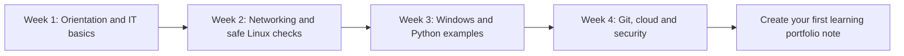

import FoundationGuidedNextSteps from '../../../components/FoundationGuidedNextSteps.astro';

**Audience:** College students, new graduates and complete beginners. **Cost:** Free published Foundation lessons; no paid Academy membership is needed.

Starting with cybersecurity tools can feel exciting, but the strongest first step is understanding how computers, operating systems and networks work. This pathway connects those subjects to real workplace tasks so you can learn the *why* before choosing a specialization.

## Your first goal

By the end of your first few study sessions, aim to explain how a browser reaches a website, identify the role of an operating system, and record an observation without copying someone else's result.

**[Open your first free lesson](/foundation/gohackerscloud-foundation/00-welcome-to-gohackerscloud/01-welcome-to-the-academy/)** · [View the 16-module Foundation syllabus](/curriculum/) · [Return to Foundation home](/)

**Try a guided first week:** the [7-Day Free Foundation Challenge](/7-day-challenge/) links seven free lessons with practical exercises and short knowledge checks. Your progress can stay private in your browser; it is not a graded vendor exam.

<FoundationGuidedNextSteps variant="student" />

## A beginner's recommended route

| Stage | Free learning material | Try this independent activity |
|---|---|---|
| **1. Understand the platform** | [Module 00 — Orientation](/core-it-devops/module-00/) | Write a personal learning goal and draw an application diagram |
| **2. Computers and operating systems** | [IT Fundamentals](/core-it-devops/module-01/), [Linux](/core-it-devops/module-03/) and [Windows](/core-it-devops/module-04/) | Identify CPU, memory and storage; practise safe, read-only commands on a device you own |
| **3. Follow a network request** | [Networking Fundamentals](/core-it-devops/module-02/) | Sketch DNS → TCP/TLS → web server → application |
| **4. Automate and track a change** | [Programming](/core-it-devops/module-05/) and [Git/DevOps](/core-it-devops/module-06/) | Run the synthetic Python example; commit a small local README |
| **5. Choose your next topic** | [Cloud Computing](/foundation/gohackerscloud-foundation/07-cloud-computing-fundamentals/01-cloud-computing/) or [Cybersecurity Fundamentals](/foundation/gohackerscloud-foundation/08-cybersecurity-fundamentals/01-security-mindset/) | Explain one cloud service model or create an asset–risk–control table |

This is a suggested sequence, not a fixed-term promise. Take longer on any concept that is new to you.

## Example four-week starter plan

| Week | Learning target | Evidence to save |
|---|---|---|
| 1 | Explain core computer components and how the operating system fits | Labeled computer/system diagram |
| 2 | Follow a basic HTTP request; recognize a Linux process | Network flow and read-only observation |
| 3 | Distinguish authentication and authorization; interpret a simple Python script | Access-control example and synthetic-script output |
| 4 | Explain what a Git commit does; choose cloud or security as your next topic | Local Git history and one-page learning review |

You can [follow the optional 12-week Foundation plan](/study-plan/) when you want a broader schedule.

## Practise as a student, think like an engineer

A fictional training portal stops loading. Rather than guessing at a fix, practise the engineering method:

1. State the symptom and which hypothetical users are affected.
2. Draw a small path: browser → DNS → web application → database.
3. Choose one safe observation for each layer.
4. Distinguish what you **observed** from what you **suspect**.
5. Write a short handover with unanswered questions.

**Expected deliverable:** one diagram and a five-line troubleshooting note. No real target, administrator access, hosted lab, account creation or subscription is necessary.

## A simple self-study checklist

- [ ] I can name the major hardware components and their purposes.
- [ ] I can explain the difference between DNS resolution and an HTTPS response.
- [ ] I can describe what a process and a filesystem permission represent.
- [ ] I can distinguish authentication from authorization.
- [ ] I can explain a small script without relying only on copied output.
- [ ] I can describe what Git stages and commits.
- [ ] I have one original diagram and one evidence-based learning note.

This checklist is for your own reflection; checking the boxes does not issue a credential or automatically update an Academy dashboard.

## Build your first technical portfolio

Use the [free Career & Portfolio Hub](/portfolio/) to turn your beginner lessons into an original system diagram, troubleshooting note or practice report. The [System Architecture & IT Inventory project](/portfolio/projects/system-architecture/) is a good first step and includes a downloadable Markdown worksheet. Label it as a synthetic learning project, not real consulting work.

## When you are ready to specialise

Choose a specialization from [nine cybersecurity career roadmaps](/learning-hub/career-paths/), including penetration testing, ethical hacking, bug bounty, SOC, cloud and DevSecOps. Each connects to [independent certification options](/learning-hub/certification-paths/) and [original interview questions](/learning-hub/interview-paths/). If cloud appeals to you, the existing [Cloud Security Engineer roadmap](/learning-hub/cloud-security-roadmap/) and [AWS Cloud Practitioner guide](/learning-hub/aws-clf-c02/) provide detailed free starting material.

If you want an authorized, hosted environment after understanding the concepts, learn [how GHC Labs works](/ghc-labs/how-it-works/) and review the [current access terms](https://gohackerscloud.com/hands-on-cybersecurity-labs). GHC Labs is **separate** from free Foundation study; some Academy tracks provide learning material without a dedicated hosted lab for every lesson.

**[Start free lesson 01](/foundation/gohackerscloud-foundation/00-welcome-to-gohackerscloud/01-welcome-to-the-academy/)** · [Choose another starting point](/#choose-your-path)
