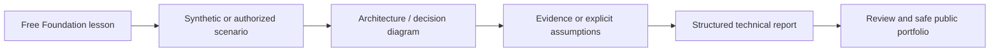

import FoundationPortfolioHubNav from '../../../components/FoundationPortfolioHubNav.astro';

[← Foundation Home](/) · [Browse 16 Modules](/curriculum/) · [Choose a Career Roadmap](/learning-hub/career-paths/)

**Learn a concept. Create evidence. Explain your decisions.**

GoHackersCloud Foundation is a free place to learn IT, cloud, cybersecurity, DevOps and professional engineering fundamentals. The **Career & Portfolio Hub** helps you turn that knowledge into clear, reviewable work samples using synthetic scenarios or your own authorized environments.

You do **not** need a course purchase, lab subscription, GitHub account, certification voucher or paid tool to complete any of these projects. They are independent learning activities—not employer work experience, formal examinations or instructor-verified qualifications.

<FoundationPortfolioHubNav />

## Choose the learning route that suits you

| Learner | Suggested free starting route | Portfolio outcome |
|---|---|---|
| **College student or beginner** | [7-Day Foundation Challenge](/7-day-challenge/) → [IT and Networking lessons](/core-it-devops/) | First architecture diagram and troubleshooting note |
| **IT support or infrastructure professional** | [Professional Upskilling Path](/paths/professionals/) → system and networking cases | Evidence-based support report and escalation summary |
| **Cloud or security engineer** | [Cloud Security Engineer Roadmap](/learning-hub/cloud-security-roadmap/) → IAM and SOC cases | Access matrix, policy review and security triage narrative |
| **Developer or DevOps engineer** | [Git & DevOps](/core-it-devops/module-06/) → API and change-review cases | Authorization test plan and secure change review |

Each route uses the same learning philosophy: understand the technology, explain the scenario, collect appropriately labeled evidence and communicate an actionable recommendation.

## From a free lesson to a portfolio artifact

A portfolio sample is most credible when it explains not only *what* you propose, but also the scope, reasoning, evidence, limitations and what you would check next.

## Project selection and worksheets

Use the six cards above to choose a project. Each link opens a self-contained guide with objectives, safe practice steps, worksheet downloads and clear links back to this hub. Begin with one well-documented project instead of attempting all six at once.

## Download the free Markdown worksheet collection

All worksheets are provided as plain Markdown files. They are easy to edit in Obsidian, VS Code or another Markdown editor. The browser can save them locally; the Foundation site does not need your file uploads or personal information.

| Worksheet | Intended use | Download |
|---|---|---|
| System Architecture Worksheet | Component map, dependencies and verification plan | <a href="/downloads/portfolio/system-architecture-worksheet.md" download="system-architecture-worksheet.md">Download .md</a> |
| Network Troubleshooting Report | Fault domains, hypotheses, evidence and handover | <a href="/downloads/portfolio/network-troubleshooting-report.md" download="network-troubleshooting-report.md">Download .md</a> |
| Cloud IAM Review | Least-privilege matrix, access decisions and audit evidence | <a href="/downloads/portfolio/cloud-iam-review.md" download="cloud-iam-review.md">Download .md</a> |
| API Authorization Test Plan | Synthetic access-control tests and remediation checks | <a href="/downloads/portfolio/api-authorization-test-plan.md" download="api-authorization-test-plan.md">Download .md</a> |
| SOC Alert Triage Report | Offline alert timeline, triage decisions and confidence | <a href="/downloads/portfolio/soc-alert-triage-report.md" download="soc-alert-triage-report.md">Download .md</a> |
| Git & DevSecOps Review | Code change, validation, security checklist and rollback | <a href="/downloads/portfolio/git-devsecops-change-review.md" download="git-devsecops-change-review.md">Download .md</a> |
| **Technical Portfolio README** | Describe your projects and learning goals in one place | <a href="/downloads/portfolio/portfolio-readme.md" download="portfolio-readme.md">Download .md</a> |

These worksheets are self-guided. You may complete them without submitting any work to GoHackersCloud or sharing it publicly.

## What a strong portfolio case study should include

An engineering reviewer should be able to identify six elements:

1. **Problem and scope** — what was the business or technical goal, what environment was used, and what was explicitly excluded?
2. **Architecture** — where are the systems, services, actors and trust boundaries? Include a readable, original diagram.
3. **Method** — what steps were appropriate, and why? Which tests were *planned* versus actually *executed*?
4. **Evidence** — what observations support the conclusion? If the scenario is synthetic, label the data as such.
5. **Risk and recommendation** — what is the proportionate next step, who would approve it, and what would a retest look like?
6. **Reflection** — what remains uncertain, and what did you learn?

### A model of careful technical writing

> **Scenario:** A fictitious reporting workload should read only a defined training dataset.
>
> **Observation:** The supplied synthetic access-policy example permits a broader resource scope than the stated requirement.
>
> **Recommendation:** Propose a narrower, resource-scoped policy for an authorized test environment. Validate an expected-allow read and an expected-deny request, then document the observed audit events.
>
> **Limitation:** No real cloud account was assessed. These are design-review observations from a training fixture.

That difference between a scenario, an observation and a verified result is the standard we want students to adopt.

## Publish safely and present yourself accurately

Before putting an exercise on a public GitHub profile, LinkedIn post or resume:

- Remove access keys, credentials, private hostnames, account identifiers, personal data and client-sensitive screenshots.
- Label fictional cases **synthetic practice project**. Only describe real assessments or real company work if they happened and you are permitted to discuss them.
- Include the learning source, date, assumptions and limits. Avoid fabricated test outcomes or inflated severity ratings.
- Do not imply GoHackersCloud or a certification vendor has verified your skill merely because you completed a self-review worksheet.
- Prefer a clear README and a few redacted diagrams to an unrestricted data dump.

## Extend your learning

Match your portfolio project to one of the [nine cybersecurity career roadmaps](/learning-hub/career-paths/) and strengthen the skills behind it. Compare [independent certification pathways](/learning-hub/certification-paths/) and practise explaining your evidence through [54 original role-specific interview questions](/learning-hub/interview-paths/). The detailed [Cloud Security Engineer Guide](/learning-hub/cloud-security-roadmap/), [IT Interview Handbook](/learning-hub/it-interview/) and [free Foundation curriculum](/curriculum/) remain available. For separately available practice environments, review [GHC Academy Labs](/ghc-labs/) and the [five-video demonstration library](/ghc-labs/instructor-demo/) as recordings are published. Hosted labs are **optional**, not prerequisites for these six projects.

**[Start with the first project](/portfolio/projects/system-architecture/)** · [Student Learning Path](/paths/students/) · [Working Professional Path](/paths/professionals/) · [Back to Foundation Home](/)

[↑ Return to the six guided projects](#guided-projects) · [All Foundation Lessons](/curriculum/#lesson-directory) · [Foundation Home](/)
