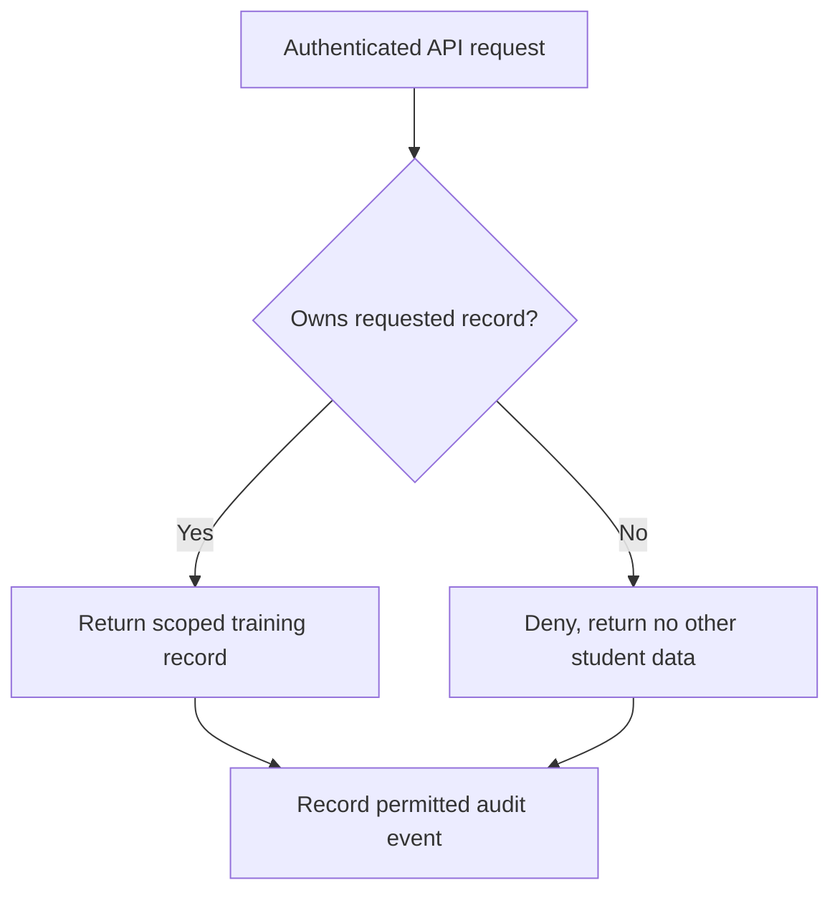

**Audience:** Developers and application security learners · **Suggested effort:** 60–90 minutes · **Level:** Intermediate · **Access:** Free independent study

This guided project is a **synthetic learning exercise**, not proof of a real client engagement or an instructor-verified assessment. Work with fictitious data or systems you are explicitly authorized to use.

[Back to Career & Portfolio Hub](/portfolio/) · [Start the 7-Day Free Challenge](/7-day-challenge/)

## The workplace-style scenario

A fictional student API returns training records. Student A should read only their own record, Student B should read only theirs, and an administrator is governed by a separate scoped policy. The design must reject cross-student record requests.

**Why this matters at work:** Secure software teams need negative tests, not just a successful-login check. The work product should tell developers what must be denied and which response evidence would demonstrate enforcement.

## Learn the concepts first

Read the relevant free Foundation lessons before writing conclusions:

- [Primary learning material](/foundation/gohackerscloud-foundation/11-web--api-fundamentals/01-web-fundamentals/)
- [Related foundational topic](/foundation/gohackerscloud-foundation/09-identity--access-management/01-iam-fundamentals/)

You should be able to explain the following in your own words:

- Separate authentication from object-level authorization
- Write positive and negative cases without probing a real target
- Describe expected outcomes and remediation evidence

## The architecture or decision flow

The diagram is an **illustrative architecture**, not an actual production topology or evidence from an engagement.

## Guided project steps

1. **Define actors.** List synthetic users A, B and Admin, their permissions and the sample resource.
2. **Write an access matrix.** Specify allowed and denied operations across own-record and other-record access.
3. **Create test cases.** Use placeholders and expected HTTP responses. Do not claim an observed result unless a permitted local fixture is actually tested.
4. **Review the server-side control.** Explain where object ownership should be checked and how a regression test would prove a fix.

## Download your project worksheet

<a href="/downloads/portfolio/api-authorization-test-plan.md" download="api-authorization-test-plan.md">Download editable Markdown worksheet</a>

The file opens in Obsidian, VS Code or any Markdown editor. Fill it in with your own reasoning, an original diagram and clearly labeled **synthetic or authorized observations**. No login, upload or hosted lab is required.

**Expected deliverable:** An access-control matrix, at least three negative/positive test cases and a remediation/retest note.

## Example professional wording

> Expected: Student A can read record A but cannot retrieve record B. This is a test-plan expectation, not a claim that a real service was tested.

Use this as a model of how to distinguish evidence from assumptions. Write your own response for your project rather than presenting the example as a test you actually conducted.

## Self-review rubric

- [ ] Cross-user read requests have explicit expected denial
- [ ] The difference between logged-in and authorized is explained
- [ ] No production or third-party API is touched
- [ ] Results are correctly marked 'not executed' until tested

These checkboxes are for personal reflection. A completed worksheet does **not** award a credential, prove employment experience or certify technical competence.

## Present your work professionally

Use the [Portfolio README template](/downloads/portfolio/portfolio-readme.md) to create a one-page project summary. Include the business context, a diagram, your methodology, evidence or stated assumptions, limitations, recommendations and citations. If sharing publicly, remove customer information, access tokens, real internal addresses and sensitive screenshots.

**[Explore other free portfolio projects](/portfolio/)** · [All Foundation modules](/curriculum/) · [Optional GHC Academy Labs](/ghc-labs/)
