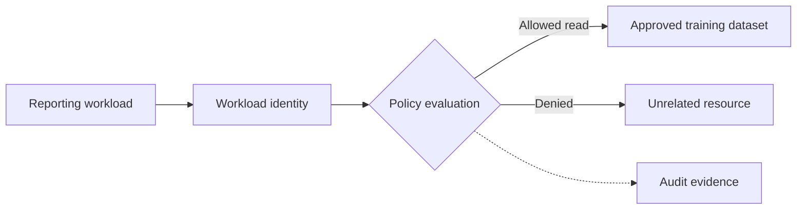

import FoundationPortfolioProjectNav from '../../../../components/FoundationPortfolioProjectNav.astro';

**Audience:** Cloud and security engineering learners · **Suggested effort:** 60–90 minutes · **Level:** Intermediate · **Access:** Free independent study

This guided project is a **synthetic learning exercise**, not proof of a real client engagement or an instructor-verified assessment. Work with fictitious data or systems you are explicitly authorized to use.

[Back to Career & Portfolio Hub](/portfolio/) · [Start the 7-Day Free Challenge](/7-day-challenge/)

## The workplace-style scenario

A fictional reporting service is allowed to read one training dataset, but a sample role policy also appears to permit operations on unrelated resources. No actual cloud tenant or IAM credentials are required for this exercise.

**Why this matters at work:** Cloud security engineers review identity trust, resource scope, permission boundaries and auditability. The objective is to propose a smaller, testable permission set without affecting production.

## Learn the concepts first

Read the relevant free Foundation lessons before writing conclusions:

- [Primary learning material](/foundation/gohackerscloud-foundation/09-identity--access-management/01-iam-fundamentals/)
- [Related foundational topic](/foundation/gohackerscloud-foundation/07-cloud-computing-fundamentals/01-cloud-computing/)

You should be able to explain the following in your own words:

- Distinguish an identity from a permission and a resource
- Express an expected-allow and expected-deny decision
- Write a realistic, approval-based hardening recommendation

## The architecture or decision flow

The diagram is an **illustrative architecture**, not an actual production topology or evidence from an engagement.

## Guided project steps

1. **Define the workload.** State the fictional reporting task, owner, resource path and business reason for access.
2. **Construct a permission matrix.** Document the minimum action and resource combination. Flag broader sample permissions as potential scope questions, not confirmed live findings.
3. **Model trust and decisions.** Diagram how a workload obtains identity and how policy evaluation governs access; add a negative test.
4. **Review verification.** Propose log evidence, expected failures, impact analysis and an owner-approved rollback/retest plan.

## Download your project worksheet

<a href="/downloads/portfolio/cloud-iam-review.md" download="cloud-iam-review.md">Download editable Markdown worksheet</a>

The file opens in Obsidian, VS Code or any Markdown editor. Fill it in with your own reasoning, an original diagram and clearly labeled **synthetic or authorized observations**. No login, upload or hosted lab is required.

**Expected deliverable:** Synthetic role inventory, least-privilege access matrix and recommended verification plan.

## Example professional wording

> The sample access pattern is broader than the stated reporting requirement. We recommend evaluating a resource-scoped read permission in an authorized test environment and confirming denial for unrelated resources.

Use this as a model of how to distinguish evidence from assumptions. Write your own response for your project rather than presenting the example as a test you actually conducted.

## Self-review rubric

- [ ] Resource and action scopes are explicit
- [ ] At least one deny case is documented
- [ ] No active cloud scanning or permission changes required
- [ ] Observations and proposed improvements are labelled clearly

These checkboxes are for personal reflection. A completed worksheet does **not** award a credential, prove employment experience or certify technical competence.

## Present your work professionally

Use the [Portfolio README template](/downloads/portfolio/portfolio-readme.md) to create a one-page project summary. Include the business context, a diagram, your methodology, evidence or stated assumptions, limitations, recommendations and citations. If sharing publicly, remove customer information, access tokens, real internal addresses and sensitive screenshots.

**[Explore other free portfolio projects](/portfolio/)** · [All Foundation modules](/curriculum/) · [Optional GHC Academy Labs](/ghc-labs/)

<FoundationPortfolioProjectNav projectId="cloud-iam-review" />
