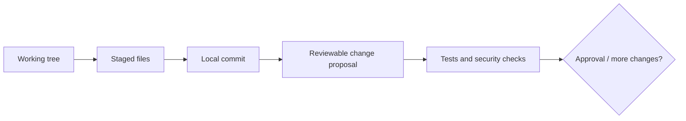

import FoundationExploreSectionNavigation from '../../../../components/FoundationExploreSectionNavigation.astro';
import FoundationPortfolioProjectNav from '../../../../components/FoundationPortfolioProjectNav.astro';

<FoundationExploreSectionNavigation section="careers" current="/portfolio/" />

<FoundationPortfolioProjectNav projectId="git-devsecops-review" variant="top" />

**Audience:** Developers, DevOps and engineering professionals · **Suggested effort:** 45–75 minutes · **Level:** Beginner–Intermediate · **Access:** Free independent study

This guided project is a **synthetic learning exercise**, not proof of a real client engagement or an instructor-verified assessment. Work with fictitious data or systems you are explicitly authorized to use.

[Start the 7-Day Free Challenge](/7-day-challenge/) · [Explore All Foundation Modules](/curriculum/)

## The workplace-style scenario

A local demonstration repository is updated to add a README, adjust a synthetic example configuration and describe a new application setting. A reviewer needs to assess what changed and whether the release plan is appropriately documented.

**Why this matters at work:** Change management and DevSecOps reviews are not only code scanning: they require scope, authorization, dependency transparency, test evidence, rollback thinking and clear ownership.

## Learn the concepts first

Read the relevant free Foundation lessons before writing conclusions:

- [Primary learning material](/core-it-devops/module-06/)
- [Related foundational topic](/core-it-devops/module-05/)

You should be able to explain the following in your own words:

- Explain working tree, staging and a Git commit
- Review a harmless change for secrets and unexpected scope
- Write a clear pull-request description and validation evidence

## The architecture or decision flow

The diagram is an **illustrative architecture**, not an actual production topology or evidence from an engagement.

## Guided project steps

1. **Plan a reversible change.** Choose a harmless local README update or fake configuration in a repository you own. Do not use actual credentials.
2. **Review the diff.** List altered files, purpose and possible security implications. Check for secrets and private information.
3. **Explain tests.** Record what was run and what was not; provide a reason for each relevant validation.
4. **Draft a review decision.** Summarize risks, rollback, outstanding questions and the next owner.

## Download your project worksheet

<a href="/downloads/portfolio/git-devsecops-change-review.md" download="git-devsecops-change-review.md">Download editable Markdown worksheet</a>

The file opens in Obsidian, VS Code or any Markdown editor. Fill it in with your own reasoning, an original diagram and clearly labeled **synthetic or authorized observations**. No login, upload or hosted lab is required.

**Expected deliverable:** A mock change request, review checklist, test evidence summary and rollback note.

## Example professional wording

> The draft adds training documentation and contains no live credentials. Integration tests were not run, and this limitation is documented. The proposed change requires a reviewer before publication.

Use this as a model of how to distinguish evidence from assumptions. Write your own response for your project rather than presenting the example as a test you actually conducted.

## Self-review rubric

- [ ] No actual secrets or private data appear in the sample
- [ ] The change purpose and affected files are clear
- [ ] Unrun tests are not represented as passed
- [ ] Review decision is conditional on recorded evidence

These checkboxes are for personal reflection. A completed worksheet does **not** award a credential, prove employment experience or certify technical competence.

## Present your work professionally

Use the [Portfolio README template](/downloads/portfolio/portfolio-readme.md) to create a one-page project summary. Include the business context, a diagram, your methodology, evidence or stated assumptions, limitations, recommendations and citations. If sharing publicly, remove customer information, access tokens, real internal addresses and sensitive screenshots.

**[Explore other free portfolio projects](/portfolio/)** · [All Foundation modules](/curriculum/) · [Optional GHC Academy Labs](/ghc-labs/)

<FoundationPortfolioProjectNav projectId="git-devsecops-review" />
