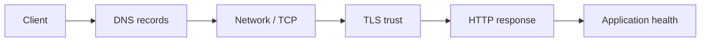

import FoundationExploreSectionNavigation from '../../../../components/FoundationExploreSectionNavigation.astro';
import FoundationPortfolioProjectNav from '../../../../components/FoundationPortfolioProjectNav.astro';

<FoundationExploreSectionNavigation section="careers" current="/portfolio/" />

<FoundationPortfolioProjectNav projectId="network-troubleshooting" variant="top" />

**Audience:** IT support, network and helpdesk learners · **Suggested effort:** 45–75 minutes · **Level:** Beginner–Intermediate · **Access:** Free independent study

This guided project is a **synthetic learning exercise**, not proof of a real client engagement or an instructor-verified assessment. Work with fictitious data or systems you are explicitly authorized to use.

[Start the 7-Day Free Challenge](/7-day-challenge/) · [Explore All Foundation Modules](/curriculum/)

## The workplace-style scenario

A fictional learning portal intermittently shows browser errors. Some screenshots show a name-resolution failure, while others show a valid HTTPS session returning an HTTP 503. The team needs to avoid treating these as the same failure.

**Why this matters at work:** A support engineer localizes the failure domain before making changes. Clear diagnostic notes avoid destructive guesses and help an application owner distinguish network, TLS and service incidents.

## Learn the concepts first

Read the relevant free Foundation lessons before writing conclusions:

- [Primary learning material](/core-it-devops/module-02/)
- [Related foundational topic](/foundation/gohackerscloud-foundation/02-networking-fundamentals/01-networking-basics/)

You should be able to explain the following in your own words:

- Distinguish DNS, transport, TLS and HTTP layers
- Build a fault-domain table using synthetic facts
- Explain the difference between a reported symptom and a confirmed cause

## The architecture or decision flow

The diagram is an **illustrative architecture**, not an actual production topology or evidence from an engagement.

## Guided project steps

1. **Map dependencies.** Draw browser → DNS → network/TCP → TLS → HTTP endpoint → application and note which layers can fail independently.
2. **Classify the observations.** Put 'DNS lookup failed' in the name-resolution row, 'certificate error' in TLS, and 'HTTP 503' under service/application.
3. **Propose reversible checks.** For each observation, describe a read-only check or a safe evidence source. Use approved fixtures only.
4. **Produce a concise ticket.** Record symptom, time window, known/unknown details, initial hypotheses and the next owner.

## Download your project worksheet

<a href="/downloads/portfolio/network-troubleshooting-report.md" download="network-troubleshooting-report.md">Download editable Markdown worksheet</a>

The file opens in Obsidian, VS Code or any Markdown editor. Fill it in with your own reasoning, an original diagram and clearly labeled **synthetic or authorized observations**. No login, upload or hosted lab is required.

**Expected deliverable:** A one-page support case with a network path, four-row evidence table and an escalation summary.

## Example professional wording

> A 503 response establishes that an HTTP-layer response was received. It does not on its own establish whether the database, application worker or upstream dependency caused the failure.

Use this as a model of how to distinguish evidence from assumptions. Write your own response for your project rather than presenting the example as a test you actually conducted.

## Self-review rubric

- [ ] HTTP 503 is not misidentified as a DNS error
- [ ] At least one alternate hypothesis is recorded
- [ ] No unapproved network scanning or configuration changes
- [ ] The handover distinguishes fact from speculation

These checkboxes are for personal reflection. A completed worksheet does **not** award a credential, prove employment experience or certify technical competence.

## Present your work professionally

Use the [Portfolio README template](/downloads/portfolio/portfolio-readme.md) to create a one-page project summary. Include the business context, a diagram, your methodology, evidence or stated assumptions, limitations, recommendations and citations. If sharing publicly, remove customer information, access tokens, real internal addresses and sensitive screenshots.

**[Explore other free portfolio projects](/portfolio/)** · [All Foundation modules](/curriculum/) · [Optional GHC Academy Labs](/ghc-labs/)

<FoundationPortfolioProjectNav projectId="network-troubleshooting" />
