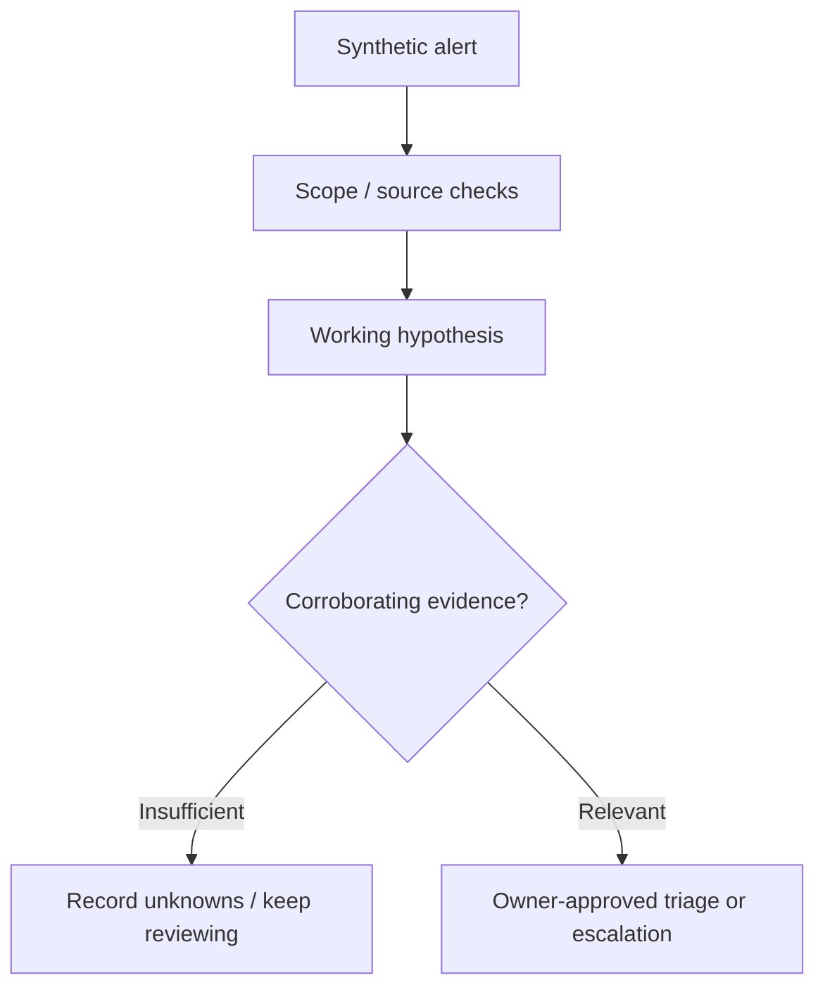

**Audience:** Security operations and incident response learners · **Suggested effort:** 45–75 minutes · **Level:** Intermediate · **Access:** Free independent study

This guided project is a **synthetic learning exercise**, not proof of a real client engagement or an instructor-verified assessment. Work with fictitious data or systems you are explicitly authorized to use.

[Back to Career & Portfolio Hub](/portfolio/) · [Start the 7-Day Free Challenge](/7-day-challenge/)

## The workplace-style scenario

An offline, fictional alert shows several denied sign-in attempts for a training account followed by one successful sign-in. The example has no real IP addresses, customer data or system access.

**Why this matters at work:** Analysts are expected to validate alert quality, identify competing explanations, document confidence and recommend an owner-approved next action without assuming an intrusion is confirmed.

## Learn the concepts first

Read the relevant free Foundation lessons before writing conclusions:

- [Primary learning material](/foundation/gohackerscloud-foundation/08-cybersecurity-fundamentals/01-security-mindset/)
- [Related foundational topic](/foundation/gohackerscloud-foundation/12-enterprise-security-operations/01-security-operations-center-soc/)

You should be able to explain the following in your own words:

- Develop a hypothesis and benign alternative
- Use a synthetic event timeline to guide triage
- Separate suspicious activity from confirmed incidents

## The architecture or decision flow

The diagram is an **illustrative architecture**, not an actual production topology or evidence from an engagement.

## Guided project steps

1. **Define scope.** State the synthetic asset, owner, timestamp format and what a detection is designed to identify.
2. **Create the timeline.** Write a three- to five-event table with fictional times, statuses and affected identities.
3. **Challenge your hypothesis.** Describe benign explanations such as an incorrect stored password or authorized user retries.
4. **Document the decision.** Write status, confidence, unknown facts, escalation conditions and safe next evidence sources.

## Download your project worksheet

<a href="/downloads/portfolio/soc-alert-triage-report.md" download="soc-alert-triage-report.md">Download editable Markdown worksheet</a>

The file opens in Obsidian, VS Code or any Markdown editor. Fill it in with your own reasoning, an original diagram and clearly labeled **synthetic or authorized observations**. No login, upload or hosted lab is required.

**Expected deliverable:** Synthetic event timeline, alert evaluation and a management-readable triage note.

## Example professional wording

> The sequence merits review, but a successful sign-in after failures is not enough by itself to conclude account takeover. Additional authorized context is needed.

Use this as a model of how to distinguish evidence from assumptions. Write your own response for your project rather than presenting the example as a test you actually conducted.

## Self-review rubric

- [ ] No unsupported incident claim
- [ ] At least one benign alternative is considered
- [ ] Evidence gaps and confidence are explicit
- [ ] Suggested actions require appropriate owner approval

These checkboxes are for personal reflection. A completed worksheet does **not** award a credential, prove employment experience or certify technical competence.

## Present your work professionally

Use the [Portfolio README template](/downloads/portfolio/portfolio-readme.md) to create a one-page project summary. Include the business context, a diagram, your methodology, evidence or stated assumptions, limitations, recommendations and citations. If sharing publicly, remove customer information, access tokens, real internal addresses and sensitive screenshots.

**[Explore other free portfolio projects](/portfolio/)** · [All Foundation modules](/curriculum/) · [Optional GHC Academy Labs](/ghc-labs/)
