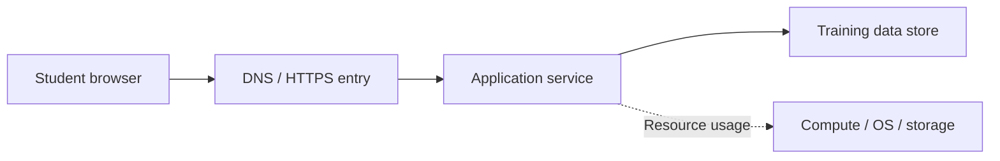

import FoundationExploreSectionNavigation from '../../../../components/FoundationExploreSectionNavigation.astro';
import FoundationPortfolioProjectNav from '../../../../components/FoundationPortfolioProjectNav.astro';

<FoundationExploreSectionNavigation section="careers" current="/portfolio/" />

<FoundationPortfolioProjectNav projectId="system-architecture" variant="top" />

**Audience:** Beginners and IT support learners · **Suggested effort:** 45–60 minutes · **Level:** Beginner · **Access:** Free independent study

This guided project is a **synthetic learning exercise**, not proof of a real client engagement or an instructor-verified assessment. Work with fictitious data or systems you are explicitly authorized to use.

[Start the 7-Day Free Challenge](/7-day-challenge/) · [Explore All Foundation Modules](/curriculum/)

## The workplace-style scenario

A fictional college learning portal has a browser frontend, an application, a database and a managed network. Users report that the portal is slow, but the team has not established whether the cause is CPU pressure, DNS delay, insufficient RAM or a database wait.

**Why this matters at work:** Engineers document a system before troubleshooting it. A labeled diagram and component inventory help support teams identify owners, dependencies, data paths and the next safe observation.

## Learn the concepts first

Read the relevant free Foundation lessons before writing conclusions:

- [Primary learning material](/core-it-devops/module-01/)
- [Related foundational topic](/core-it-devops/module-02/)

You should be able to explain the following in your own words:

- Distinguish CPU, memory, storage, operating system and application responsibilities
- Map the request path and explain system dependencies
- Record observations separately from hypotheses

## The architecture or decision flow

The diagram is an **illustrative architecture**, not an actual production topology or evidence from an engagement.

## Guided project steps

1. **Model the system.** Draw the browser, DNS resolver, TLS endpoint, application service and database. Label the host/VM or abstract service boundary.
2. **List responsibilities.** Create a table of each component, its purpose, the type of data it handles and who owns its configuration.
3. **Choose evidence.** For a slow response, suggest safe observation points for compute, networking and storage. Do not invent actual readings.
4. **Write a handover.** Explain your top hypothesis, one alternative, what evidence would distinguish them and an appropriate next owner.

## Download your project worksheet

<a href="/downloads/portfolio/system-architecture-worksheet.md" download="system-architecture-worksheet.md">Download editable Markdown worksheet</a>

The file opens in Obsidian, VS Code or any Markdown editor. Fill it in with your own reasoning, an original diagram and clearly labeled **synthetic or authorized observations**. No login, upload or hosted lab is required.

**Expected deliverable:** One original architecture diagram, component inventory and a five-sentence engineering handover.

## Example professional wording

> The portal is reported slow. The diagram identifies application and data-store dependencies, but no performance metrics have been collected. We would first compare safe request timing and resource utilization from an authorized training fixture.

Use this as a model of how to distinguish evidence from assumptions. Write your own response for your project rather than presenting the example as a test you actually conducted.

## Self-review rubric

- [ ] Each component has a defensible purpose
- [ ] Request path and trust/data boundaries are labeled
- [ ] Observations are clearly separated from assumptions
- [ ] The next proposed check is safe and proportionate

These checkboxes are for personal reflection. A completed worksheet does **not** award a credential, prove employment experience or certify technical competence.

## Present your work professionally

Use the [Portfolio README template](/downloads/portfolio/portfolio-readme.md) to create a one-page project summary. Include the business context, a diagram, your methodology, evidence or stated assumptions, limitations, recommendations and citations. If sharing publicly, remove customer information, access tokens, real internal addresses and sensitive screenshots.

**[Explore other free portfolio projects](/portfolio/)** · [All Foundation modules](/curriculum/) · [Optional GHC Academy Labs](/ghc-labs/)

<FoundationPortfolioProjectNav projectId="system-architecture" />
